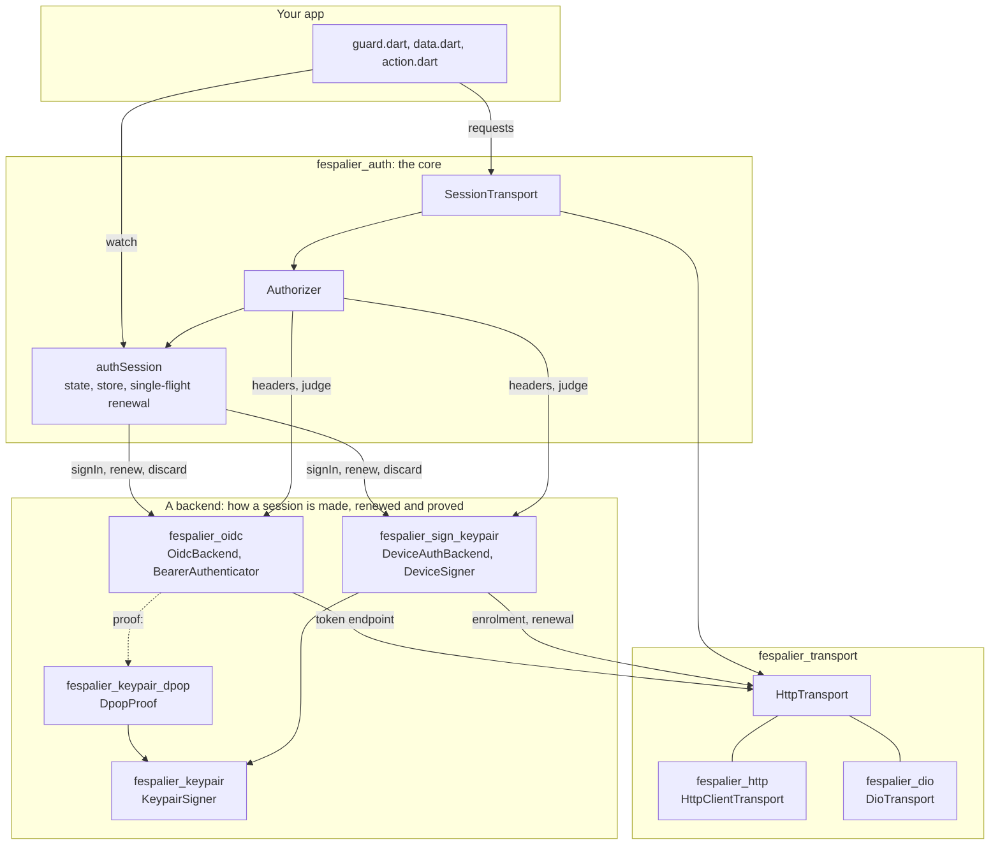
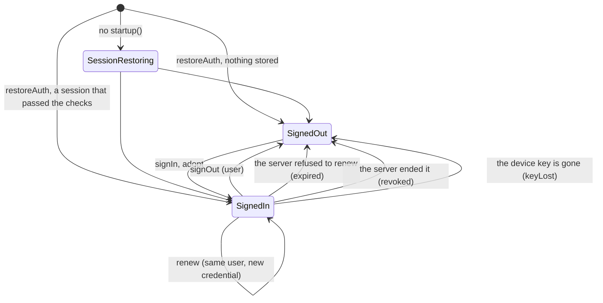
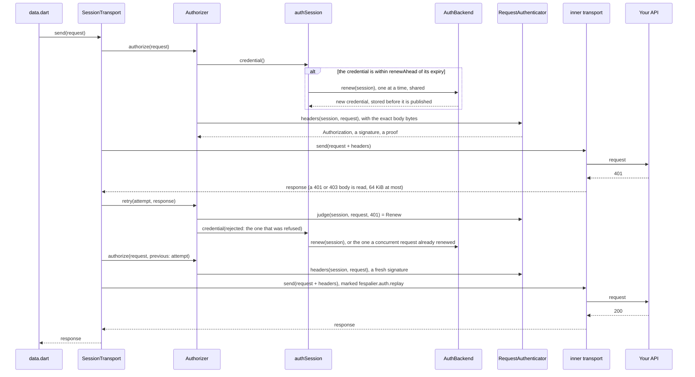
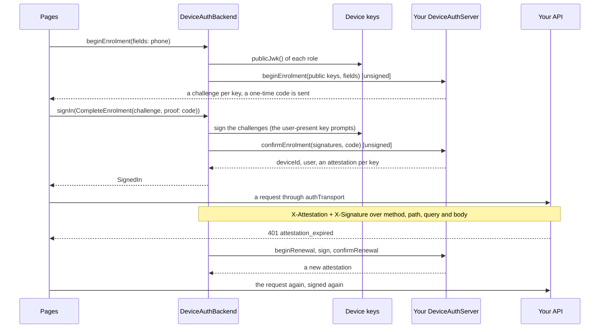
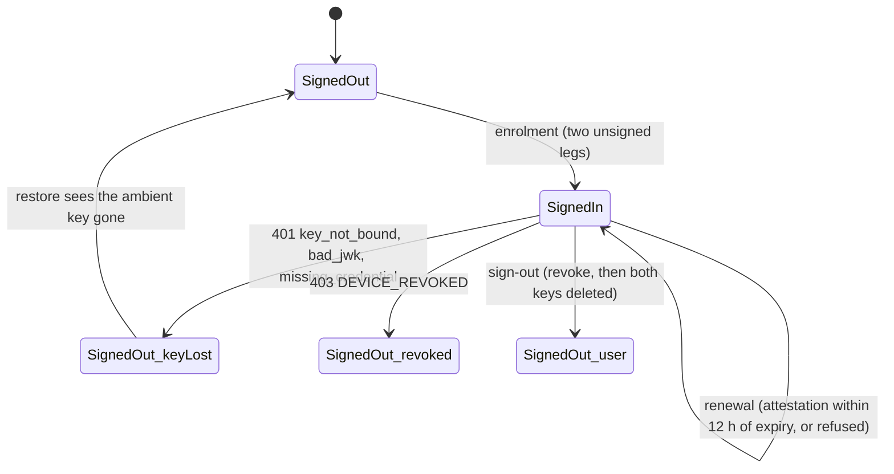

# Authentication

Since 0.9.0. `package:fespalier_auth` is the pattern of [Guards](guards.md) packaged: a session provider, guards for `guard.dart`, session storage, lazy renewal with a single flight and a transport that carries the session, behind one `AuthBackend` interface. It adds no timer and no listener.

Since 0.21.0 the package is the **protocol-agnostic core**. It knows a `SessionCredential`, a `RequestAuthenticator` and an `AuthBackend`, and no token, no OpenID Connect flow and no key. What proves a session to your API is a **backend** you add next to it:

| You sign in with                           | Add                                                                     | The session is proved by                                |
| ------------------------------------------ | ----------------------------------------------------------------------- | ------------------------------------------------------- |
| OpenID Connect or Keycloak, bearer tokens  | `fespalier_oidc`                                                        | `Authorization: Bearer <token>`                         |
| OpenID Connect, tokens bound to the device | `fespalier_oidc` and `fespalier_keypair_dpop` (and `fespalier_keypair`) | `Authorization: DPoP <token>` and a signed `DPoP` proof |
| Enrolling the device, no token at all      | `fespalier_sign_keypair` (and `fespalier_keypair`)                      | an attestation and a signature over each request        |
| Firebase, Supabase, or your own API        | a backend of your own (a recipe)                                        | whatever its `RequestAuthenticator` adds                |

- **The session** is a provider, `authSession`, whose state is sealed: `SessionRestoring`, `SignedOut(reason)` and `SignedIn(session)`.
- **`restoreAuth(config)`** in `startup()` reads the stored session before the first frame, and never touches the network.
- **The guard helpers** (`requireSignedIn`, `requireRole`, `requireUser`, `redirectIfSignedIn`) are plain Dart over a `Ref`, so a guard stays synchronous, and signing in navigates back by itself.
- **`authTransport`** is an [`HttpTransport`](transport.md) that attaches the session to your API's requests, renews once when the credential has expired and sends a request again after a verdict that says so. `fespalier_auth` sends only through it, so it links neither `package:http` nor Dio.
- **`package:fespalier_auth/testing.dart`** has `fakeAuth(...)`: a signed-in or signed-out test in one line.

## How it fits together



The core owns **when**: lazy single-flight renewal, the store, the guards, the transport. A backend owns **how**: how a session is made (`signIn`), renewed (`renew`), proved on each request (its `RequestAuthenticator`) and forgotten (`discard`). `AuthConfig` is the one place that joins them, in `startup()`: a backend, a transport and the origins that get the session.

## Installing fespalier_auth

Add it next to fespalier, with the same `url` and the same `ref` ([Companion packages](getting-started.md#companion-packages) says why), and a backend:

<!-- x-release-please-start-version -->

```yaml
dependencies:
  fespalier:
    git:
      url: https://github.com/fespalier/fespalier
      path: packages/fespalier
      ref: v0.22.0
  fespalier_auth:
    git:
      url: https://github.com/fespalier/fespalier
      path: packages/fespalier_auth
      ref: v0.22.0
  fespalier_oidc: # the backend: OpenID Connect and Keycloak
    git:
      url: https://github.com/fespalier/fespalier
      path: packages/fespalier_oidc
      ref: v0.22.0
  fespalier_http: # a transport implementation: package:http (or fespalier_dio for Dio)
    git:
      url: https://github.com/fespalier/fespalier
      path: packages/fespalier_http
      ref: v0.22.0
```

<!-- x-release-please-end -->

`fespalier_transport` comes with them at the same tag. The core's one plugin is `flutter_secure_storage` (the session store; Android minSdk 24, `>=10.0.0 <12.0.0` accepted), which is in every app that imports the package, whichever backend it uses. A backend that is an SDK of its own (Firebase, Supabase) keeps its own session and does not use the store. No package of the auth family depends on `package:http` or Dio except the two transport implementations you pick (`test/no_http_test.dart` in each).

## The session

```dart
final state = ref.watch(authSession); // SessionRestoring | SignedOut | SignedIn
```

| Provider                         | What it is                                                                                                                                    |
| -------------------------------- | --------------------------------------------------------------------------------------------------------------------------------------------- |
| `authSession`                    | The `SessionState`, and `ref.read(authSession.notifier)` for `signIn`, `adopt`, `signOut`, `endSession` and `credential()`. Not auto-disposed |
| `isSignedIn` (a `bool`)          | What a guard watches: a renewal does not change it                                                                                            |
| `authUser` (`AuthUser?`)         | The user: `id`, `roles`, `claims`, `email`, `name`. Changes when the user or their roles do, never on a renewal that changes nothing          |
| `authUserId` (`String?`)         | Watch it in a `data.dart` whose data belongs to the user: another user loads it again, a renewal does not                                     |
| `authTransport`                  | The `HttpTransport` that carries the session (see [Calling your API](#calling-your-api))                                                      |
| `authConfig`, `authInitialState` | The app's `AuthConfig`, and what `restoreAuth` read. Reading `authConfig` with no override throws a `StateError` that says what to do         |

There is **no `renewing` state**: a renewal keeps `SignedIn` and swaps the credential, so a guard that watches the session never runs again, and a request is never bounced to the sign-in page in the middle of one.



`SignedOut` carries a `SignOutReason`: `expired` (the server refused to renew the session: the sign-in page can say "your session expired"), `user` (a sign-out), `keyLost` (a session bound to a device key that is gone, see below) or `revoked` (since 0.21.0: the server says this device or session is dead). The first start has no reason.

`AuthUser`, `AuthSession` and `PasswordSignIn` print without a token, an id, an e-mail or a password (`AuthUser(roles: {admin})`), and a `SessionCredential`'s `toString` never shows a secret, so a log line is safe. `unverifiedJwtClaims(token)` (in `fespalier_oidc`) reads a JWT's payload for display and routing; it does not verify it, and the server still decides.

## Restoring at startup

```dart
// lib/app/startup.dart
FutureOr<List<Override>> startup() => restoreAuth(authSetup());

// lib/auth_setup.dart
final transport = HttpClientTransport(http.Client()); // fespalier_http; or DioTransport(dio) from fespalier_dio

AuthConfig authSetup() => AuthConfig(
  backend: ApiBackend(Uri.parse('https://api.example.com'), transport), // an AuthBackend
  transport: transport,                                                 // what requests (and the backend's own calls) go through
  apiOrigins: [Uri.parse('https://api.example.com')],                   // where the session is sent: nothing else
);
```

`restoreAuth` returns the overrides for the app's `ProviderScope` (the generated `main()` calls [`startup()`](app-startup.md) and passes them), so every guard is synchronous from the first navigation: a cold deep link to a signed-in page has no blank frame and no redirect.

- It is **synchronous** when the store answers synchronously (`MemoryTokenStore`, a backend that keeps its own session), and one keychain read otherwise (`SecureTokenStore`, the default), shown behind `splash.dart`, or the native splash when there is none.
- It does **no network**: an expired credential is renewed by the first request that needs it, so an offline start works.

It drops what it cannot trust, without a request:

| Stored session                                                                                                | Result                                                                                                                                   |
| ------------------------------------------------------------------------------------------------------------- | ---------------------------------------------------------------------------------------------------------------------------------------- |
| none                                                                                                          | `SignedOut()`                                                                                                                            |
| another backend's (`AuthBackend.name` differs)                                                                | deleted, `SignedOut()`                                                                                                                   |
| the credential cannot be renewed any more (`renewableUntil` has passed, or it expired and is not `renewable`) | deleted, `SignedOut(reason: SignOutReason.expired)`                                                                                      |
| the backend's `check` refuses it: the device key a credential is bound to is gone, or is another              | deleted, `SignedOut(reason: SignOutReason.keyLost)`                                                                                      |
| written by 0.20.0 or earlier (`"v": 1`), or corrupt                                                           | reported (`FlutterError.reportError`, context `while restoring the stored session`), deleted, `SignedOut()`: the user signs in once more |

A store that cannot be read at all (a locked keychain) makes `startup()` fail, which the generated `main()` shows with a retry. `AuthConfig` has `backend`, `transport`, `store` and `apiOrigins`; **when a credential counts as expired is the backend's** (`AuthBackend.renewAhead`: 30 seconds before expiry for `OidcBackend`, which is what `AuthConfig.leeway` was until 0.20.0). Install the telemetry sink first in `startup()` to see the restore as a span.

**Where the session is stored.** A stored session is `AuthSession.toJson` (`{"v": 2, "backend", "credential", "user"}`) under one key (`fespalier_auth.session`): on Apple in the Keychain with `first_unlock_this_device` (not in backups, not on another device); on Android in encrypted storage; on the web in encrypted `localStorage`, which a script on the page can read, so use `MemoryTokenStore` there (a reload signs out) for anything that matters.

An app with no `startup.dart` still works: add `authConfig.overrideWithValue(config)` to the `ProviderScope`, and the session restores itself at the first read. The state is `SessionRestoring` meanwhile, and the guard helpers return a `Future` for that long, which costs a frame.

## Guarding signed-in routes

```dart
// lib/app/(signed-in)/guard.dart: every route under the group needs a session
GuardResult guard(Ref ref, {required Uri uri}) =>
    requireSignedIn(ref, uri, signIn: (from) => SignInRoute(from: from));

// lib/app/(signed-in)/admin/guard.dart: and this one an admin
GuardResult guard(Ref ref, {required Uri uri}) => requireRole(
  ref, uri, 'admin',
  signIn: (from) => SignInRoute(from: from),
  forbidden: const ForbiddenRoute(),
);

// lib/app/sign-in/guard.dart: the sign-in page's own guard, beside the group
GuardResult guard(Ref ref, {String? from}) => redirectIfSignedIn(ref, from: from);
```

- **`requireSignedIn(ref, uri, signIn:)`** returns `null` when signed in, else `signIn(uri.toString()).location`: a typed call the compiler checks, with the requested location (query included) as `from`. It watches only the session's phase, so it runs again on sign-out (the user is moved in that frame, from a pushed page too since 0.21.0: [Guards](guards.md#a-guard-on-a-pushed-page)) and never on a renewal. It answers **synchronously**, unless the session is still being restored.
- **`requireRole(ref, uri, role, signIn:, forbidden:)`** is `requireSignedIn`, then `forbidden` when the user lacks the role. **`requireUser(ref, uri, test, ...)`** takes a function of the `AuthUser` instead. They watch only their own answer, so a role gained or lost runs the guard again, and a renewal does not.
- **`redirectIfSignedIn(ref, from:)`** is for the **sign-in route's own** `guard.dart`: when there is a session it returns `returnTo(from)`. It watches the session, so **signing in on that page sends the user back to `from` by itself**, and the page has no navigation code. `returnTo` refuses `//host`, `https://…` and `/\`, so a crafted `?from=` cannot send the user elsewhere.
- **The sign-in page sits beside the guarded group**, never inside it: a guard on the sign-in page would send the user to the sign-in page.
- A guard under a **pushed** page reacts only when you pop back to it, but the pushed page's own guard watches the session while the page is on top and moves it (since 0.21.0, [Guards](guards.md#a-guard-on-a-pushed-page)). A sign-out button over a pushed page that has no guard of its own should navigate too: `const HomeRoute().go(context)`.
- A guard is not access control: the server decides what a session may do.

## Signing in and out

The sign-in page is a [form on an action](forms.md) (`fespalier_forms`, which the app's `pubspec.yaml` needs for it), and the backend throws `FieldErrors` for wrong credentials, which the form shows under its field:

```dart
// lib/app/sign-in/action.dart
typedef SignInFields = ({String username, String password});

SignInFields form() => (username: '', password: '');

FieldErrors? validate(SignInFields input) => FieldErrors({
  if (input.username.trim().isEmpty) 'username': 'Enter your user name',
  if (input.password.isEmpty) 'password': 'Enter your password',
});

Future<void> action(Ref ref, {required SignInFields input}) async {
  await ref
      .read(authSession.notifier)
      .signIn(PasswordSignIn(username: input.username.trim(), password: input.password));
}
```

`signIn(request)` asks the backend, **stores the session, then** sets `SignedIn`, and rethrows what the backend threw with the state unchanged: `AuthCancelled` (the user closed a browser sign-in), `FieldErrors` (wrong credentials), `AuthRejected` (the server refused), or any other error (it could not ask). A sign-in overtaken by another one, or by a sign-out, throws `NotSignedIn` and changes nothing. The request is typed: `PasswordSignIn` and `BrowserSignIn` (from `fespalier_oidc`), a `CompleteEnrolment` (`fespalier_sign_keypair`), or a subclass of `SignInRequest` of your own, so a page is the same whichever backend is configured, and a test swaps in `FakeAuthBackend`. `adopt(session)` signs in with a session the app obtained itself (a deep-link callback, a multi-step SDK flow), and throws an `ArgumentError` when it comes from another backend than the configured one.

`signOut()` sets `SignedOut(reason: SignOutReason.user)` **synchronously**, so the guards move the user in that frame (from a pushed page too since 0.21.0), then clears the store, runs the backend's `signOut` (best effort: its errors are swallowed) and `discard`, which forgets what was bound to the session (a DPoP key and its nonces, a device's keys). It does nothing when nobody is signed in. `endSession(reason)` (since 0.21.0) is the same without the server call: an app whose own API says the device is revoked ends the session with `SignOutReason.revoked`; the transport does it itself when an authenticator says so.

## Calling your API

```dart
// lib/app/(signed-in)/orders/data.dart
Future<List<Order>> data(Ref ref) async {
  ref.watch(authUserId); // another user: load again; a renewal: nothing
  final client = TransportClient(ref.watch(authTransport)); // fespalier_http: an http.Client over the session
  final response = await client.get(Uri.parse('https://api.example.com/orders'));
  if (response.statusCode != 200) throw ApiError(response.statusCode);
  return Order.listFromJson(response.body);
}
```

`authTransport` is a `SessionTransport` over `AuthConfig.transport` (override `authConfig` in a test with a `FakeTransport`). A request to an origin in `AuthConfig.apiOrigins` carries what the backend's `RequestAuthenticator` adds (`Authorization: Bearer <token>` for `fespalier_oidc`); any other origin gets nothing, so a credential cannot leak to a third party, and `apiOrigins` empty is an error the first time `authorizer` is read. A client that is not a transport sits on top of it: `TransportClient(authTransport)` is an `http.Client`, `TransportAdapter(authTransport)` a Dio adapter ([HTTP transport](transport.md#the-two-implementations)).



- **Renewal is lazy and single-flight, with no timer.** `ref.read(authSession.notifier).credential()` returns the credential **synchronously** while it is good, and starts one shared renewal when it has expired (`expiresAt` less `renewAhead`, against `clock.now()`), after a verdict that says `Renew` (a 401, for a bearer token) to the credential in use, or when forced. Any number of requests that find it expired wait for the same `Future`: with refresh-token rotation (Keycloak's "Revoke Refresh Token"), a second renewal with the same token would sign the user out. The new credential is stored before the state publishes it, so a kill between the two leaves the store on the one the server accepts.
- **A renewal the server refuses** (`AuthRejected`, an OAuth `invalid_grant`) signs the user out with `expired` and clears the store; a backend that throws `AuthEnded(reason)` gives another reason (`revoked`). **One that could not run** (offline, a 5xx: `AuthUnavailable`, a `TransportFailure`) keeps the session, and the next request asks again.
- **What a response means is the authenticator's to say.** `RequestAuthenticator.judge` answers an `AuthVerdict`: `Accept` (the response stands: anything ambiguous is this, so a session is never wiped and a request never loops on a response about something else), `Resend` (same session, new headers: a DPoP nonce, a clock correction), `Renew` (renew, then send once more) or `SessionEnded(reason)` (sign out and fail the request with `AuthRejected`).
- **At most three sends per request**: the first, one after a `Resend`, and one after a `Renew`. **Every send is authorized again with the exact bytes of the body**, so a signature is fresh each time. Only a request that can be sent again (`TransportRequest.replayable`: its body is bytes) is: a streamed body is sent once, and its caller gets the 401, after the renewal, so its next attempt works. A second 401 is returned as it is.
- **For a client of your own**, `ref.watch(authorizer)` is an `HttpCredentials` (`fespalier_transport`): `authorize(request, previous:)` returns the headers, and `retry(attempt, response)` says whether to send again. A download or a plugin that is not a transport takes it as it is.
- **One logical request, however many sends.** A retrier above the session (`dio_smart_retry`) calls it again for the same request, and the request's [`TransportMemo`](transport.md#the-memo) carries what the session settled the first time: a request the session refused is refused again with the same `AuthRejected`, with no renewal and no send, so a retrier that retries every error cannot send it out unauthenticated; a request authorized for one user is never sent again as another (or with nobody signed in); a request renews at most once, however many sends it takes. A client that keeps no memo makes every send a first one: `TransportAdapter` and `TransportClient` keep one ([The memo](transport.md#the-memo) says where it breaks, `RetryClient` for one).
- **A replay is marked, and keeps its abort trigger.** A request sent again carries `fespalier.auth.replay: true` in `TransportRequest.attributes` (`transportReplayKey`), so a guard against re-sent writes (Dio's `WriteGuard`) lets that one through; the first send is not a replay. The `abortTrigger` is the request's, so aborting still cancels the replay when the page that wanted it goes away.
- **Where the session sits in the chain.** `SessionTransport(WriteGuardTransport(HttpClientTransport(client)), authorizer)`: the write guard next to the network. A retrier goes **above** the session, never under it: under a session that signs requests it would re-send the same signature (with DPoP, the same proof, and the server refuses a reused `jti`). [Decorators and their order](transport.md#decorators-and-their-order) has the whole order.
- **One container.** The single flight is per `ProviderContainer`: a second isolate or a second web tab that renews the same rotating token gets `invalid_grant`. Renew in one place, or do not turn rotation on.
- **User data across users.** A `dataCache` keeps the previous user's data until it loads again: watch `authUserId` in user-owned data and clear the cache storage on sign-out.

## OpenID Connect and Keycloak

`package:fespalier_oidc` (a separate package since 0.21.0; it was `package:fespalier_auth/oidc.dart` from 0.9.0 to 0.20.0: an app that signs in some other way links none of it) has `OidcBackend`: the authorization code flow with PKCE (S256) for a **public** client, in pure Dart over an `HttpTransport`, with Keycloak's defaults. It owns the token exchange and the renewal, which is what makes the single flight, refresh-token rotation and [DPoP](#device-bound-tokens-dpop-with-fespalier_keypair_dpop) on the token endpoint possible. Its `BearerAuthenticator` sends `Authorization: Bearer <token>` and answers a 401 with `Renew`. The browser step is a function you give it, so the package links no plugin: `flutter_web_auth_2` (MIT; Android, iOS, macOS, web, Windows and Linux) is the usual one.

```dart
// lib/auth_setup.dart
final issuer = Uri.parse('https://sso.example.com/realms/shop');
final transport = HttpClientTransport(http.Client());

AuthConfig authSetup() => AuthConfig(
  transport: transport,
  backend: OidcBackend(
    issuer: issuer,
    clientId: 'shop-app',
    redirectUri: Uri.parse('com.example.shop:/callback'),
    endpoints: OidcEndpoints.keycloak(issuer), // no discovery request
    openBrowser: openBrowser,
    transport: transport, // the token, discovery and revocation calls; no session on them
  ),
  apiOrigins: [Uri.parse('https://api.example.com')],
);

Future<Uri> openBrowser(Uri url, Uri redirect) async {
  try {
    return Uri.parse(
      await FlutterWebAuth2.authenticate(
        url: url.toString(),
        callbackUrlScheme: redirect.scheme,
        options: const FlutterWebAuth2Options(preferEphemeral: true),
      ),
    );
  } on PlatformException catch (e) {
    if (e.code == 'CANCELED') throw const AuthCancelled();
    rethrow;
  }
}
```

The backend's `transport:` is the app's transport **without** the session: the token endpoint is not your API, and a session on the call that renews the session would wait for itself. Pass the same transport as `AuthConfig.transport`.

The sign-in button calls `ref.read(authSession.notifier).signIn(const BrowserSignIn())` straight from its `onPressed` (a web popup is blocked when `signIn` runs later), and catches `AuthCancelled`. The sign-in guard moves the user. `BrowserSignIn` has `loginHint`, `prompt` (`login` shows the form over a single-sign-on cookie, `none` fails with `login_required`) and `parameters` (`{'kc_idp_hint': 'google'}`). The session holds a `TokenCredential` (access, refresh and ID token, `expiresAt`, `renewableUntil`, `jkt`); `OidcBackend(renewAhead:)` is how early before `expiresAt` a token is renewed (30 seconds by default).

- **What it checks.** The redirect: its `state`, its `error` (`access_denied` is `AuthCancelled`, anything else an `OidcException`), its `iss` when present (RFC 9207, which Keycloak sends) and its `code`. Then the ID token's `iss`, `aud` and `nonce`. The ID token's signature is **not** verified (OpenID Connect Core 3.1.3.7: it came straight from the token endpoint over TLS). Every message is in the troubleshooting skill.
- **Roles** come from the access token: `realm_access.roles` and `resource_access.<clientId>.roles` (`keycloakRoles(clientId)`, the default; pass `roles:` to read another claim). Keycloak does not put them in the ID token unless a mapper does. `userFromClaims` builds the `AuthUser`.
- **Discovery.** `OidcEndpoints.keycloak(issuer)` spells Keycloak's four endpoints, and `OidcEndpoints.discover(issuer)` reads `<issuer>/.well-known/openid-configuration` and refuses a document whose `issuer` is another one. Leave `endpoints:` out and discovery runs at the first sign-in or renewal, once.
- **Sign-out** revokes the refresh token (RFC 7009), which makes Keycloak end the whole session, best effort. `endBrowserSession(session)` also ends the browser's single-sign-on session through the end-session endpoint; with `preferEphemeral: true` there is none to end.
- **No timeout of its own** (that would be a timer): give it a transport over a client that times out if you want one. A confidential client (a `client_secret`) is out of scope: a mobile or web app is a public client.

**Keycloak settings and traps**, read from a live Keycloak 26.8.0 (`examples/auth/keycloak/realm-fespalier.json` is a realm exported from it):

- A **public client** with Standard flow on, Direct access grants off, and the client attribute `pkce.code.challenge.method` set to `S256` (without a challenge the authorization endpoint answers `error=invalid_request&error_description=Missing+parameter%3A+code_challenge_method`). Its **valid redirect URIs** must list `redirectUri` exactly.
- **"Revoke Refresh Token"** makes a refresh token good once: a second renewal with the same one answers `invalid_grant` with `Maximum allowed refresh token reuse exceeded`, **and the whole session is then gone**. That is why the renewal is a single flight, and why two isolates or two web tabs that share a session sign each other out.
- **The refresh token lives as long as the SSO session's idle timeout** (30 minutes by default; the token response's `refresh_expires_in` says): a user who is away longer gets `invalid_grant` with `Token is not active`. For longer sessions ask for the `offline_access` scope (`OidcBackend(scopes: ['openid', 'profile', 'email', 'offline_access'])`).
- **The issuer is Keycloak's configured hostname.** With `--hostname=http://10.0.2.2:8080` every token says `http://10.0.2.2:8080/realms/...`, so an app that reaches the same Keycloak as `localhost` gets `the ID token was
issued by ..., not ...`. On an Android emulator, use `adb reverse tcp:8080 tcp:8080` and `localhost`, or give Keycloak the `10.0.2.2` hostname.
- **A single-sign-on cookie signs the user in again silently** after a sign-out, unless the browser session is ephemeral (`preferEphemeral: true`) or the sign-in asks `BrowserSignIn(prompt: 'login')`.

## Device-bound tokens: DPoP with fespalier_keypair_dpop

`package:fespalier_keypair_dpop` (a separate package; it was `package:fespalier_sign_keypair` from 0.9.0 to 0.20.0) is **DPoP** ([RFC 9449](https://www.rfc-editor.org/rfc/rfc9449)) for `OidcBackend`: every token request, renewal and API call carries a proof, a JWT signed by a key that lives in the Secure Enclave (iOS, macOS), the AndroidKeyStore (StrongBox or the TEE) or, on the web, a non-extractable `CryptoKey`. The keys come from `fespalier_keypair` (through [flutter-sign-keypair](https://github.com/vaam-apps/flutter-sign-keypair)). The server binds the access and refresh tokens to that key (`cnf.jkt`), so a token copied off the device is useless without the device. `DpopProof` implements `fespalier_oidc`'s `ProofOfPossession`, so nothing else in the app changes:

```dart
// lib/auth_setup.dart
AuthConfig authSetup() => AuthConfig(
  transport: transport,
  backend: OidcBackend(
    issuer: issuer,
    clientId: 'shop-app',
    redirectUri: Uri.parse('com.example.shop:/callback'),
    endpoints: OidcEndpoints.keycloak(issuer),
    openBrowser: openBrowser,
    transport: transport,
    proof: DpopProof.device(), // throws DpopUnavailable on Windows and Linux unless a fallback is given
  ),
  apiOrigins: [Uri.parse('https://api.example.com')],
);
```

Install `fespalier_keypair` and `fespalier_keypair_dpop` next to `fespalier`, `fespalier_auth` and `fespalier_oidc`, with the same `url` and `ref` for all (the READMEs have the block). They need Dart 3.12 and Flutter 3.44, Android minSdk 24, iOS 15 and macOS 10.15, and depend on flutter-sign-keypair **by git, pinned to a commit** (the repository is not on pub.dev), so `flutter pub get` clones `github.com/vaam-apps/flutter-sign-keypair`.

- **What is sent.** A proof is `{typ: dpop+jwt, alg: ES256, jwk}` and `{jti, htm, htu, iat, ath?, nonce?}`, ES256 signed: `jti` is new for every send (retries included), `htu` has no query or fragment, `ath` is only on requests that carry an access token, and the authorization request carries `dpop_jkt`, so the code is bound to the key too. One signature per request, made by the secure element; nothing is cached (a proof is single-use), and no timer or listener is started. The API call carries `Authorization: DPoP <token>` and the proof.
- **Nonces and the clock.** A `DPoP-Nonce` from any response is kept per origin, and a `use_dpop_nonce` challenge (an authorization server's `400`, a resource server's `401`) is answered once: the authenticator's verdict is `Resend`. When a server refuses a proof as not active and its `Date` header says the device clock is more than 5 seconds off, the difference is applied to every later `iat` and the request is sent once more. **Keycloak sends neither a nonce nor a `Date`**, so a wrong clock there is `invalid_request` / `DPoP proof is not active`: set the clock.
- **The key.** An _ambient_ key (it never prompts), made on first use under the key id `fespalier_dpop`. Sign-out deletes it (`rotateKeyOnSignOut`, through `discard`), so the next sign-in makes a new one and an old refresh token, even a stolen one, is useless. `restoreAuth` signs the user out (`SignedOut(reason: SignOutReason.keyLost)`) when the key a stored session is bound to is gone: a restored backup, a wiped keychain.
- **The web** (since 0.21.0) uses the browser's non-extractable key, kept in IndexedDB, so the session survives a reload; until 0.20.0 `DpopProof.device()` refused on the web by default. It is not a secure element, and it is **UNCHECKED in CI**: it was run by hand in Chrome only (`fespalier_keypair`'s README says what was and was not tried).
- **Where there is no key at all** (Windows, Linux, Fuchsia, a web page that is not a secure context) `DpopFallback.refuse`, the default, throws `DpopUnavailable`: a library that promises tokens bound to a device must not quietly give you tokens bound to nothing. `DpopFallback.software` is a key in memory (its scalar is in the process; pass a `softwareStore` to keep it across restarts), and `DpopFallback.bearer` is no DPoP (`device()` returns null; the client must not require DPoP-bound tokens). `requireHardware: true` makes a device without a secure element fail instead (the iOS simulator has only the keychain, and the web key is not one).
- **Keycloak** supports DPoP since 26.4. Switch on **Require DPoP bound tokens** on the client (the attribute `dpop.bound.access.tokens`; `examples/auth/keycloak/` has a realm with such a client, `fespalier-auth-example-dpop`). Read from Keycloak 26.8.0: errors are `invalid_request` with descriptions (`DPoP proof is missing`, `DPoP proof is not active`, `DPoP proof has already been used`), a refresh token bound to another key is `invalid_grant` / `DPoP confirmation doesn't match DPoP proof`, and a resource server's 401 is `WWW-Authenticate: DPoP ... error="invalid_token"` for every problem with the proof.
- **A retrier goes over the session transport**, never under it (see Calling your API).
- **Tests.** `package:fespalier_keypair/testing.dart` has `FakeKeypairSigner` (a software key from a fixed scalar: the same key and signature on every run) and `package:fespalier_keypair_dpop/verify.dart` has `verifyDpopProof`, which a fake server checks every proof with and which names the first check that failed. `examples/auth` runs a DPoP-checking demo server.

## Device-signed sessions: fespalier_sign_keypair

`package:fespalier_sign_keypair` (since 0.21.0; it held DPoP until 0.20.0) is a session with **no token at all**: no OIDC provider, no access or refresh token, no DPoP, no `Authorization` header. "Signed in" means this device's key is enrolled and holds a valid attestation, and every request then carries its own signature over its method, path, query and exact body bytes. It plugs into the same core as an OIDC app: the same `authSession` states, guards, restore, `keyLost` and sign-out. It depends on `fespalier_auth` and `fespalier_keypair`, and on no HTTP client; it talks to your server through the `DeviceAuthServer` you write. Its README has the full guide; this section is the map, and `examples/device` is the device-sessions example (an enrolment you can run).

```dart
// lib/auth_setup.dart
final backend = DeviceAuthBackend(
  server: ShopDeviceServer(transport), // your endpoints: a DeviceAuthServer
  keys: DeviceKeys.device(), // ambient + user-present where the device has it
  profile: const DeviceSignatureProfile(audience: 'https://api.example.com'),
);

AuthConfig authSetup() => AuthConfig(
  backend: backend,
  transport: transport, // the enrolment and renewal legs go through it: no session on it
  apiOrigins: [Uri.parse('https://api.example.com')],
);
```

- **Enrolling the device is signing in.** The device holds two P-256 keys: an _ambient_ key that never prompts and signs ordinary requests, and, where the platform has a secure element, a _user-present_ key (a biometric or the device credential) for calls worth a prompt. A phone screen calls `backend.beginEnrolment(fields: {'phone': phone})`, a code screen finishes with `ref.read(authSession.notifier).signIn(CompleteEnrolment(challenge, proof: code))`; both legs are unsigned. The server answers with an **attestation** per key: a JWS from your issuer (`iss`, `sub`, `did`, `iat`, `exp`, `cnf.jkt`, a status) that binds the key and means nothing without a fresh signature from it.
- **Every request carries** `X-Attestation` (the stored attestation) and `X-Signature` (a compact JWS over `iat`, `exp`, a fresh `jti`, `mth`, `pth`, `qsh` and `bdh`, the hash of the exact body bytes). `SessionTransport` hands the signer the final bytes, so JSON, CBOR and multipart are covered alike; **a streamed body cannot be signed** and is refused with an `ArgumentError`.
- **Renewal is a re-attestation**, not a refresh token: a silent proof of possession (`beginRenewal`, sign the challenge, `confirmRenewal`), lazy and single-flight, when the ambient attestation is within `renewAhead` (12 hours) of its expiry or a server refuses it.
- **A refusal is classified, not guessed.** `webankRefusals` (replace it with `classify:`) reads the status and the `error` of the body: `attestation_expired` and `device_not_active` renew and send once more; `key_not_bound`, `bad_jwk` and `missing_credential` end the session as `keyLost` (both keys are deleted); a 403 `DEVICE_REVOKED` ends it as `revoked`. Anything else is ambiguous and never wipes the session or loops.
- **Key roles per request.** A request asks for the user-present key through its attributes (`DeviceSigner.roleAttribute: KeyRole.userPresent`, `DeviceSigner.reasonAttribute: 'Confirm the transfer'`, or a `policy:` of your own, a `KeyRolePolicy`). A refused prompt is a `UserPresenceRefused` that fails that one request and nothing else. Background and queued work never asks.
- **Sign-out revokes the device**, best effort, signed with the user-present key when there is one (it prompts), and then deletes **both** keys and the stored session whatever the revoke did. A restore signs the user out as `keyLost` when the ambient key is gone or is not the one the stored attestation is bound to.
- **The enrolment and renewal calls are unsigned by name**, not by origin: send them through the transport you gave `AuthConfig.transport`, or list their paths in `unsignedPaths:` when they go through `authTransport`.
- **A server and tests.** `package:fespalier_sign_keypair/verify.dart` has `verifyDeviceSignature` for a demo server (it checks the attestation, `cnf.jkt`, the signature, freshness, the claims and a `jti` that was not used before; the failure's `code` is the one the client classifier reads), and `package:fespalier_sign_keypair/testing.dart` has `FakeDeviceAuthServer` next to `FakeKeypairSigner`.





**Unchecked on a device.** No CI job runs the secure-element parts; the tests use `FakeKeypairSigner`. The user-present prompt (the Secure Enclave and StrongBox/TEE biometric or device-credential prompt, a cancelled prompt, a device with no screen lock), biometric invalidation (it destroys the user-present key and leaves the ambient one), the web key across a reload and in Safari and Firefox, hardware-backed keys on real devices, and a real backend that issues attestations and enforces the profile are all untried: the package README lists them.

## Firebase, Supabase and your own API

Firebase's and Supabase's SDKs keep the session and renew it themselves, so their backends say `keepsOwnSession`: the token store is not used, `currentSession()` is read once at start-up (a one-shot read of the SDK, so the framework holds no listener), and `renew` asks the SDK for a new credential. They are **recipes, not packages**: a first-party package for each would add a heavy SDK to every app and a release surface. The code is in `skills/fespalier-guards/references/auth-backends.md`:

- **Firebase** (`firebase_auth`, no Linux): `signIn(PasswordSignIn)` is `signInWithEmailAndPassword`, whose `wrong-password`, `invalid-credential` and `user-not-found` become `FieldErrors`; `renew` is `getIdTokenResult(true)`, and `user-disabled` or `user-token-expired` become `AuthRejected`. Initialise Firebase in `startup()` before `restoreAuth`.
- **Supabase** (`supabase_flutter`): its client **auto-refreshes with a timer by default**, so initialise it with `authOptions: FlutterAuthClientOptions(autoRefreshToken: false)` and renew lazily with `refreshSession()`. Import it with a prefix: `gotrue` exports `AuthState`, `Session` and `User`.
- **Your own API** (a username and a password): `examples/auth/lib/demo/demo_backend.dart`. A wrong password is a `FieldErrors`, a refused renewal is `AuthRejected`, and a socket error or a 5xx keeps the session.

## Writing a backend

**A backend** is `AuthBackend`. A short constant `name` (`oidc`, `device`, `firebase`, `api`: what a stored session is tied to, and telemetry's `fespalier.auth.backend`) and `scheme` (`bearer`, `dpop`, `device`: telemetry's `fespalier.auth.scheme`, the backend's `name` by default); `signIn(request)`; `renew(session, {hint})`, which throws `AuthRejected` when the server refused (the session is over; `AuthEnded(reason)` gives another reason) and anything else when it could not ask (the session stays); `renewAhead`, how long before `SessionCredential.expiresAt` the credential is renewed; `readCredential(json)`, which reads back what `SessionCredential.toJson` wrote and throws a `FormatException` on anything else; `check(session)`, run at restore after the expiry rule (null keeps the session, a `SignOutReason` drops it); `signOut(session)`, best effort on the server; and `discard(session)`, which forgets local secrets (keys, nonces).

Its credential is a `SessionCredential` (`expiresAt`, `renewableUntil`, `renewable`, `toJson`) and what it adds to each request is its `RequestAuthenticator`: `headers(session, request)` returns the headers for one send (it is called again for every send, with the exact body bytes in `request.body`, and may throw to refuse the send), and `judge(session, request, statusCode:, headers:, body:, retried:)` returns an `AuthVerdict`. The starter in `skills/fespalier-guards/references/auth-package.md` is a complete one over a JSON API: a `POST /auth/login` and `/auth/renew`. The core knows nothing else about the scheme: no token, no header name, no key.

## Testing signed-in routes

`package:fespalier_auth/testing.dart` has `fakeAuth(...)`, the overrides for `pumpRouter`: signed in as the `AuthUser` you give, or signed out, on a `FakeAuthBackend` (a `FakeCredential`, no token) and a `MemoryTokenStore`, with no `startup()` and no network:

```dart
testWidgets('a member sees the orders', (tester) async {
  await pumpRouter(
    tester,
    AppRoutes.router(initialLocation: '/orders'),
    overrides: fakeAuth(signedInAs: const AuthUser(id: 'ada', roles: {'admin'})),
  );
  expect(currentLocation(tester), '/orders');
});
```

Call it inside the test body, where the fake clock starts. Pass `backend:` to read its counters (`signIns`, `renewals`, `signOuts`, `discards`), to make it fail (`signInError`, `renewError`) or to hold a call open (`gate`, a `Completer<void>`: a pending state to look at), `credentialLifetime:` to age the session with `tester.pump(const Duration(minutes: 6))`, `apiOrigins:` and `transport:` (a `FakeTransport` from `package:fespalier_transport/testing.dart`) to test an API call. Signed out, a guarded route lands on `/sign-in?from=%2Forders`. In [`fsp test`](route-tests.md#route-smoke-tests-fsp-test), the setup file returns `fakeAuth(signedInAs: …)` from `overrides`, so guarded routes render:

```dart
// test/routes/setup.dart
List<Override> overrides(String pattern) => fakeAuth(signedInAs: const AuthUser(id: 'ada'));
```

`FakeAuthenticator` stands in for a scheme that signs (it adds `x-fake-credential: <id>#<n>`, so every send is visibly signed afresh), `FakeProof` (`package:fespalier_oidc/testing.dart`) for a proof of possession, `FakeKeypairSigner` for a key, and `RecordingTelemetry` sees the `auth` spans (`#2 start auth renew backend=fake trigger=expired`); [Telemetry conventions](telemetry-conventions.md#telemetry-conventions) lists their attributes (the step is `renew` and the scheme `fespalier.auth.scheme` since 0.21.0; they were `refresh` and a boolean `fespalier.auth.dpop`).
