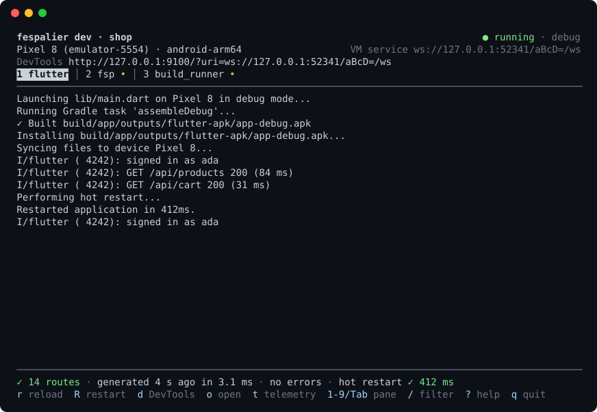

# CLI reference

Every `fsp` command, the generated file, the editor plugins and `fsp dev`. For `fsp maestro` and `fsp test`, see [Route tests](route-tests.md).

## The generator

```sh
fsp create my_app       # a new Flutter app with fespalier in it, ready to run (since 0.15.0)
fsp init                # first-time setup of an existing app: starter files, then gen
fsp add storage         # an optional feature of fsp create, added to this app (since 0.23.0)
fsp gen                 # check lib/app/, write lib/app.g.dart
fsp gen --format        # ...and run `dart format` on it
fsp routes              # print the route table (--json: one object per route)
fsp routes --graph      # the route tree as a Mermaid graph (--graph dot: Graphviz)
fsp routes --graph json # the same tree as JSON (what the DevTools extension reads)
fsp links               # App Links, Universal Links, assetlinks.json and a sitemap from the routes
fsp links --check       # CI: non-zero exit when those files are stale
fsp maestro             # Maestro smoke flows, one per route (since 0.7.0)
fsp maestro --check     # CI: non-zero exit when those flows are stale
fsp size                # the web build's JavaScript per deferred route (since 0.8.1)
fsp size --check        # CI: non-zero exit when a budget in `size:` is exceeded
fsp test                # a widget smoke test per route, in test/routes/ (since 0.8.1)
fsp test --check        # CI: non-zero exit when that file is stale
fsp telemetry           # a local OpenTelemetry stack with fespalier's dashboards (since 0.8.1; needs Docker)
fsp telemetry --grafana # ...and Grafana, with the same dashboards
fsp upgrade             # upgrade fsp the way it was installed (since 0.15.0)
fsp upgrade --check     # exit 0 up to date, 3 an update is available, 1 error
fsp upgrade --app       # move the ref: of fespalier and every companion to this fsp's release (since 0.23.0)
fsp doctor              # what main() wires and why, and what is out of line: refs, lock, go_router, Flutter (since 0.23.0)
fsp schema              # the JSON Schema of the fespalier: section, for editors (since 0.23.0; --pubspec: the whole file)
fsp watch               # same, whenever the routing changes (keep it next to `flutter run`)
fsp dev                 # fsp watch and flutter run in one terminal, hot reloading the app as you save (since 0.9.0)
fsp build web           # fsp gen, then flutter build web, with the hooks of `tasks: build:` (since 0.9.0)
fsp run codegen         # a task of your own from `tasks:` in pubspec.yaml; `fsp run` lists them (since 0.9.0)
fsp run --json          # the same list as JSON lines, for the editor plugins (since 0.22.0)
fsp check               # CI: non-zero exit on errors, writes nothing
fsp new 'products/[id]' --name Product --data --action --loading --error --layout --guard --transition
                        # [id] or :id both mean $id, so no shell quoting of $
fsp new '(account)' --layout    # a (group) folder: layout only, no page.dart
fsp new 'kyc/shop/name' --function --name KycShopName
                        # views as functions (`Widget page()`), with a routeName
fsp new 'shop' --not-found      # not_found.dart (not-found.dart with `file_style: kebab`)
fsp new 'orders' --nav          # nav.dart: how the folder shows in the generated menus (since 0.8.1)
fsp new 'orders/[id]' --observe # observe.dart: onEnter, onFocus and onLeave (since 0.8.1)
fsp new 'orders/[id]/edit' --leave # leave.dart: asked before this page goes; true lets it go (since 0.11.0)
```

All commands take `--project <dir>` (default: the nearest folder with a `pubspec.yaml`). `fsp` is one native binary, fast enough to run on every save (a full scan, check and emit of an example takes a few milliseconds). Install it as described in [Installation and setup](getting-started.md#install-fsp); to build it from source, see [Development](development.md).

### fsp new

`fsp new` writes `page.dart` plus the kinds you ask for with flags. It skips files that already exist, then regenerates `lib/app.g.dart` and prints the result line (if that fails, it lists the files it created).

- **Class names** come from `--name` (default: from the path, e.g. `ProductsId`). A segment that already has a type elsewhere in the tree keeps it.
- **`--function`** writes [function views](file-kinds.md#function-views) instead of classes; `--name` becomes the `routeName` (UpperCamelCase). **`--no-page`** leaves `page.dart` out.
- **`--not-found`** adds a `not_found.dart` that takes the segments of its path as `String`s (see [Not-found views](routing.md#not-found-views)).
- **A `(group)` target** (`'(account)'`) gets no `page.dart`, since a group has no URL of its own. After `fsp new '(account)' --layout` the generator warns "folder has no page.dart and no routes below it; skipped" until you add a route inside the group. That is expected.

`fsp gen`, `check` and `watch` also look at the string paths in `lib/` (see [Checking string paths](#checking-string-paths)).

### fsp create

Since 0.15.0. `fsp create my_app` makes a new Flutter app with fespalier in it, and leaves it with a green `flutter test`:

```sh
fsp create my_app                      # the base app: two pages and a layout
fsp create my_app --org com.example --platforms android,ios,web
fsp create my_app --features storage,connectivity   # the base app plus optional features
fsp create my_app --template tabs      # two tabs, as a bar, a rail or a drawer by window width
fsp create my_app --features otel,sentry   # traces and error reports
fsp create my_app --features auth,i18n,image   # signed-in routes, translations, responsive images
fsp create my_app --features http,download     # an http.Client page, downloads that outlive a screen
fsp create my_app --features all       # every optional feature your Flutter runs
fsp create my_app --dry-run            # print every file and command; write and run nothing
fsp create --list-features             # the optional features (--json: one object per line)
```

It needs Flutter 3.35 or newer on `PATH` and a folder that does not exist or is empty (to add fespalier to an app you already have, use [`fsp init`](getting-started.md#fsp-init)). It does not read a project, so `--project` is refused: the folder is the argument.

What it does, in order:

1. `flutter create --empty --no-pub` into a folder next to the app, `.my_app.fsp-create-<pid>`, so a failure leaves nothing behind.
2. Writes `pubspec.yaml` whole (fespalier by git at the tag of the `fsp` you run, `flutter_lints`, a commented [`tasks:`](#tasks-commands-around-flutter-run) example), `lib/main.dart` (`AppMain.run()`) and `lib/app/`: the files [`fsp init`](getting-started.md#fsp-init) writes, plus a home page that links to an about page with a typed route.
3. Moves the folder to `my_app`. This is before `pub get` because the platform files and the package config hold absolute paths.
4. `flutter pub get`, then `fsp gen` and [`fsp test`](route-tests.md) in the same process: `fsp test` needs no `test:` key, so the app starts with a smoke test per route.

If a step before the move fails, the app is not made. If a later one fails, the app stays, and the message says which step failed and the commands that finish the job (`cd my_app`, then `flutter pub get && fsp gen && fsp test`).

| Flag                    | What it does                                                                                                                                                                                                                                                                                                                                                      |
| ----------------------- | ----------------------------------------------------------------------------------------------------------------------------------------------------------------------------------------------------------------------------------------------------------------------------------------------------------------------------------------------------------------- |
| `--project-name <name>` | The Dart package name. The default is the folder's name, lower case with `-` and spaces as `_`; a name that is a Dart keyword, starts with a digit or is the name of a dependency is refused.                                                                                                                                                                     |
| `--org <org>`           | The organization for the Android and iOS identifiers, `flutter create`'s `--org`.                                                                                                                                                                                                                                                                                 |
| `--platforms <a,b>`     | `android`, `ios`, `linux`, `macos`, `web` and `windows`; the default is all of them.                                                                                                                                                                                                                                                                              |
| `--description <text>`  | The pubspec's `description:`.                                                                                                                                                                                                                                                                                                                                     |
| `--template <name>`     | `minimal` (the default) or `tabs`. `tabs` is the `adaptive` feature: asking for either gives the same app, and `--template minimal` with `adaptive` is refused (with `all` it leaves `adaptive` out).                                                                                                                                                             |
| `--features <a,b>`      | Optional features to add, or `all` for every one that the installed Flutter runs (one that needs a newer Flutter is left out of `all`, with a note). A feature another one needs is added with it, with a note; two that conflict are refused; one asked for by name that needs a newer Flutter than the one installed is refused. The features are listed below. |
| `--list-features`       | Print the features and exit, as `id  description` lines (the last is `all`), or with `--json` one object per line (`id`, `description`, `flutter`, `requires`, `conflicts`, `companions`; `all` is not one of them).                                                                                                                                              |
| `--no-pub-get`          | Write the app and generate, but leave `flutter pub get` to you.                                                                                                                                                                                                                                                                                                   |
| `--offline`             | Pass `--offline` to `flutter pub get`.                                                                                                                                                                                                                                                                                                                            |
| `--dry-run`             | Print the plan (the commands, then every file in full) on stderr and write nothing. It does not run Flutter, so it checks no Flutter version.                                                                                                                                                                                                                     |
| `--json`                | Print events to stdout, one JSON object per line, and keep the text for people on stderr (Flutter's own output goes there too).                                                                                                                                                                                                                                   |

**Features** (since 0.15.0). Each one adds its companion package to the pubspec (at the same tag as `fespalier`), what the app needs to start in `lib/app/startup.dart`, and a passing test in `test/`. CI makes an app with each feature alone and with all of them, and runs `dart format`, `flutter analyze` and `flutter test` on it:

- `storage`: [`fespalier_storage`](data.md#a-cache-on-disk-fespalier_storage). `startup()` opens a `PrefsDataStorage` and gives it to `dataCacheStorage`, so a `data.dart` with a `dataCache` is on the first frame at the next start. The test starts the app over an in-memory preferences store and checks that the cache has its place on disk.
- `connectivity`: [`fespalier_connectivity`](data.md#reconnects-fespalier_connectivity). `startup()` sets `reconnectSignal` to `ConnectivitySignal`, so `Freshness(refetchOnReconnect: true)` works. The test uses `FakeConnectivity` to check the signal and `hasNetwork`.
- `devtools`: a committed `devtools_options.yaml` that turns the `fespalier` extension on, as [How to see it](devtools.md#how-to-see-it) shows, so DevTools does not ask once per project. It adds no dependency. The test checks the file and that a debug build has the extension.
- `adaptive`: [`fespalier_adaptive`](layouts.md#a-bar-a-rail-or-a-drawer-fespalier_adaptive), and `--template tabs` is the same thing. The base app's layout and two pages are replaced by a tab layout, `lib/app/(tabs)/layout.dart`, with a `nav.dart` and a page in each tab's folder (Home and About), shown by `AdaptiveNavScaffold` as a `NavigationBar` on a phone, a `NavigationRail` on a tablet and a `NavigationDrawer` on a wide window. The test resizes the window and checks each, and that a tab keeps its place.
- `forms`: [`fespalier_forms`](forms.md). `lib/app/contact/action.dart` has an `action()` with a `form()` and a `validate()`, and its page builds the generated `ContactRoute.useForm`. The test uses `isFieldErrors` and drives the page: errors under the fields, then a valid submit.
- `otel`: [`fespalier_otel`](observability.md#opentelemetry-from-the-generated-main) on `otel_zone` (pinned by commit, as the docs say, because it is not on pub.dev). Since 0.19.0 the app's pubspec has `otel: true` under `fespalier:`, and the generated `main()` starts the SDK and adds the sink, so the app writes no `startup.dart` for it; the Riverpod and route observers are there too, and a test that builds the app never starts the SDK. The app is generated with `telemetry: true`. A release build exports nothing unless you pass `--dart-define=OTEL_EXPORTER_OTLP_ENDPOINT=...`. The test runs the real SDK with an in-memory exporter and checks the span of a navigation. `otel_zone` needs Dart 3.9, so `otel` **needs Flutter 3.35 or newer**. It pins no `go_router` of its own: `otel_zone`'s `otel_go_router` accepts go_router 17 and 18, so pub resolves 18 where Flutter has it.
- `sentry`: [`fespalier_sentry`](observability.md#wiring-sentry) and `sentry_flutter`. `zone()` is Sentry's `SentryFlutter.init`, so a crash anywhere in the start is Sentry's, `startup()` installs `FespalierSentry()`, and the web gets the navigator observer. It sends nothing while `SENTRY_DSN` is empty; `--dart-define=SENTRY_DSN=https://...` turns it on. The app is generated with `telemetry: true`. The test uses `RecordingSentry` (no network): a page change is a breadcrumb and an error knows its screen.
- `flags`: [`fespalier_flags`](guards.md#feature-flags-fespalier_flags). `lib/flags.dart` declares a `BoolFlag('labs')`, `lib/app/labs/guard.dart` is `flagGuard` on it, and `startup()` gives `flagSource` a `ConstFlags` read from `--dart-define=LABS=true`. The test uses `FakeFlags`: `/labs` is there with the flag on and goes with it.
- `auth`: [`fespalier_auth`](auth.md) (and `fespalier_forms`, for the sign-in form). `/account` sits in a `(signed-in)` folder whose `guard.dart` is `requireSignedIn`, `/sign-in` is a form on an action with its own `redirectIfSignedIn` guard, and `startup()` restores the stored session (`restoreAuth(authSetup())`, after the telemetry sink and before everything else). **There is no identity provider yet**: `IdentityBackend` in `lib/auth_setup.dart` throws `UnimplementedError('connect your identity provider: docs/auth.md')` from `signIn`, `refresh` and `signOut`, and the sign-in form shows it. Write the backend (`OidcBackend`, a JSON API, Firebase and Supabase are in [auth](auth.md)) and set `apiOrigins`. The test signs in and out through `fakeAuth`. `flutter_secure_storage`, the token store, needs Android 7.0 (`minSdk` 24), which Flutter's default is only from Flutter 3.35 on: when the app has an Android folder, `fsp create` makes the `minSdk` line of `android/app/build.gradle.kts` `maxOf(flutter.minSdkVersion, 24)` (a comment on the line says why), and if the line is not there it says so and leaves the file.
- `i18n`: [`fespalier_tolgee`](i18n-tolgee.md). English and French catalogs in `assets/i18n/`, read by `startup()` (a local read: no Tolgee key, no network, no `remote:`), and an `App` whose `routerConfig` is `TranslationScope.routerConfig`, with `flutter_localizations` for the Material strings. `/translations` shows `TrText`, an ICU plural and a button per language; the language is the `lang` query of the location (`/translations?lang=fr`), and a location without one keeps the language before it. For a language in the path (`/fr/products`) see [Locales and the URL](i18n-tolgee.md#locales-and-the-url). The app's own `App` replaces `lib/app/app.dart`, and `/translations` is left out of the `fsp test` smoke tests (a `test: skip:` in the pubspec), because it needs the scope: its test opens it through the app's `App` and switches the language.
- `image`: [`fespalier_image`](responsive-images.md). `lib/images.dart` has the app's `ImageCdn`: a `TemplateUrlBuilder` over `--dart-define=IMAGES_URL=...` (default `https://images.example.com`) with the width in the URL, and **no signing key** (the package has no parameter for one). `startup()` gives it to `imageCdnProvider`, and `/photo` shows a `ResponsiveImage` with a retry. The test uses `FakeImages` and checks the URL asked for.
- `http`: [`fespalier_http`](http.md) and `package:http`. `lib/api.dart` has `httpClient`, a provider of an `http.Client` that closes it with `ref.onDispose`, and `apiUrl` from `--dart-define=API_URL=...` (a placeholder, `https://api.example.com`, by default). `lib/app/headlines/data.dart` loads a JSON list through `ref.abortable(ref.watch(httpClient))`, as [Cancelling a load whose page is gone](http.md#cancelling-a-load-whose-page-is-gone) shows, so leaving the page (or loading again) aborts the request. The test serves the page from `FakeHttpClient` (no network) and checks both the request and that leaving `/headlines` counts one abort. `/headlines` is left out of the `fsp test` smoke tests (a `test: skip:`), because it needs a server. There is **no Dio** and no retry: `httpClient` is the one place to add a retrier, a `WriteGuardTransport` and a session, in the order of [The wrapping order](http.md#the-wrapping-order): build the chain as a transport (`HttpClientTransport(client)`, `WriteGuardTransport`, `SessionTransport`) and wrap it in a `TransportClient` since 0.21.0 (with `auth`, use `TransportClient(ref.watch(authTransport))`; `authHttpClient` and `WriteGuardClient` until 0.20.0). For Dio, add `fespalier_dio` yourself and point your Dio's `httpClientAdapter` at a `TransportAdapter` (`DioHttpClient` made your Dio an `http.Client` until 0.20.0).
- `download`: [`fespalier_download`](downloads.md) and `path_provider` (with `platform` and `file`, which nothing imports: they keep the app's lowest dependency versions compiling), over the **foreground** backend. `startup()` gives `downloadsEngine` a `Downloads` over `HttpDownloadBackend`, `FileDownloadStore` and `TransferDownloadFiles`, with the base folders from `path_provider` (the package depends on no plugin, so the app names them). `lib/downloads.dart` has the sample `DownloadRequest` (the file from `--dart-define=DOWNLOAD_URL=...`, a placeholder by default) and `/downloads` shows `downloadStatus` with a start button, progress with a pause, resume, and a retry after a failure. A foreground transfer stops when the app is closed: for downloads that go on, add `fespalier_download_background` yourself ([The background backend](downloads.md#the-background-backend); it needs Flutter 3.47 and platform setup). The test plays the platform with `downloadTestOverrides` and `FakeDownloadBackend`. `/downloads` is left out of the smoke tests, because it needs the engine.

The pages of `forms`, `flags`, `i18n`, `image`, `auth`, `http` and `download` have a `Scaffold` of their own, so they look the same under the base layout and the tabs; open them by their URL (`/contact`, `/labs`, `/translations`, `/photo`, `/account`, `/headlines`, `/downloads`).

`otel` and `sentry` together are the wiring of [Wiring Sentry](observability.md#wiring-sentry): **one** `zone()`, Sentry's, and `startup()` adds Sentry's sink with `FespalierTelemetry.add`, once (a top-level `final _sentry` and `if (!FespalierTelemetry.contains(_sentry)) ...`, because Retry runs `startup()` again and `add` appends a sink each time), next to the OpenTelemetry sink that the generated `main()` installs (since 0.19.0; `install` would replace it). `otel_zone`'s `runGuarded` is not used then: it would send an uncaught async error to Talker only, and Sentry would never see it.

`lib/app/startup.dart` is written once for all of them: its imports are sorted, its steps run in a fixed order (telemetry sinks first, then the session, then the rest) and it is `async` only when a step awaits.

The events of `--json` are `run` (`command`, before each command and, with `--dry-run`, for each one planned), `file` (`path` and `action`, which is `new` or `overwrite`, and with `--dry-run` the file's `content`), `done` (`dir`, `name`, `features` and `dry_run`) and, when the command fails, `error` (`message`).

### fsp add

Since 0.23.0. `fsp add <feature>...` puts an optional feature of [`fsp create`](#fsp-create) into the app you have: the same features, from the same table, with the same files.

```sh
fsp add storage             # one feature
fsp add http image          # several at once; a feature another one needs comes with it
fsp add auth --dry-run      # what would change, every file in full; nothing is written or run
fsp add i18n --no-pub-get   # write the files, and leave `flutter pub get` to you
```

What it does, in order:

1. Reads `pubspec.yaml` and the files the features write, and works out which features the app has: one whose packages are under `dependencies:`, whose `fespalier:` keys are set and whose files are all there. A feature you ask for that the app has is a `note` and nothing more.
2. Edits `pubspec.yaml` line by line, and keeps its comments, blank lines, quotes and order. Each companion package is pinned the way `fespalier` is: the same git `url` and `ref`, or, for an app that takes fespalier from a checkout's folder (`path:`), the folder next to it, with the `dependency_overrides:` a checkout needs, as `fsp create --local-packages` writes them. Each other dependency is written as `fsp create` writes it; one the app already lists keeps its version. Then the feature's `fespalier:` keys, its `test: skip:` routes (the routes of the features being added: one you took out of `skip:` for a feature the app has stays out, except that a setup file made now also lists the guarded routes of those) and its `flutter: assets:`. A companion the app lists under `dev_dependencies:` only is a `note` to move it, not a second line. A dependency goes in name order when the section is in name order, and last when it is not. After each change the file is read back as YAML and compared with what the change means: a layout it does not edit (a section on one line, such as `dev_dependencies: {...}`) stops `fsp add` before anything is written, and the message gives the lines to write by hand. A file that starts with `---`, a `%YAML` line or a byte order mark is edited like any other. A real run lists each change under `edit   pubspec.yaml`.
3. Writes the feature's own files. It never writes over a file: when some of them are there already, it writes nothing and names them.
4. Updates the files that every feature adds to: `lib/app/startup.dart`, `lib/app/app.dart`, `lib/main.dart`, `test/routes/setup.dart`, and the test of another feature that starts the whole app (once `auth` is in, `test/storage_test.dart` gives the keychain a mock). Each is composed as `fsp create` composes it, for the features the app has plus the new ones. A file that is what `fsp create` writes for the features the app has, byte for byte or but for what `dart format` changes, is replaced. A file you changed, or wrote yourself, is left as it is, and the change to make is printed as `+` and `-` lines, under `By hand: <file> (...). Make this change:`, as soon as the files are written and before any command runs. Until you make it, the feature is not wired in, and its test fails.
5. Raises the Android `minSdk` as `fsp create` does, for a feature that needs it (`auth`), when `android/app/build.gradle.kts` has Flutter's own line.
6. Runs `flutter pub get`, `dart format` on the Dart files it wrote (so they follow your language version and page width; without `dart` on `PATH` it says so, and they are as `fsp create` writes them), `fsp gen`, and [`fsp test`](route-tests.md) when the app has `test/routes/routes_test.dart`.

If `flutter pub get`, `fsp gen` or `fsp test` fails, the files stay written, and the message lists the commands that finish the job (and, when there are changes to make by hand, says they are printed above). The app has the feature by then, so a second `fsp add` of it says `nothing to add`: run the commands, do not repeat `fsp add`. An interrupt (Ctrl-C) during one of them keeps the exit code 130.

It refuses, before it writes anything:

- no feature, `all` (which is `fsp create`'s), or a feature that does not exist; the message lists the features.
- `adaptive`, which takes the place of the base app's layout and pages: only `fsp create --template tabs` makes it.
- an app with `main: manual`, or with an `app_dir:` or `output:` of its own: the files are `fsp create`'s, which wire the generated `main()` from `lib/app/` and import `lib/app.g.dart`. [The features](#fsp-create) say what each one adds, for a person to add it by hand.
- a `pubspec.yaml` without `fespalier` under `dependencies:`, or one whose companions are not pinned as `fespalier` is (another `url` or `ref`). [`fsp upgrade --app`](#moving-the-apps-pins) moves them together.
- an app that pins `fespalier` by git at a release other than this `fsp`'s, when there is something to add: the files and the pins are this release's, and the packages at another release may not have what they use (a companion that is newer, an API that changed). Move the refs with `fsp upgrade --app` first, or run the `fsp` of the pin with `dart run fespalier add <feature>` (from 0.23.0 on; an older `fsp` has no `add`); for a pin newer than this `fsp`, upgrade `fsp`. A branch or a commit `ref:` cannot be compared and is let through, and so is a checkout.
- an `environment: sdk:` below `^3.9.0`, the Dart that `fsp create`'s files are written in, or an `environment: flutter:` below a feature's floor.

| Flag           | What it does                                                                                                                                                                                                                                           |
| -------------- | ------------------------------------------------------------------------------------------------------------------------------------------------------------------------------------------------------------------------------------------------------ |
| `--dry-run`    | Prints the plan on stderr and writes and runs nothing: the features the app has, each change to `pubspec.yaml`, each file (`new` or `update`), each change to make by hand and the commands, then the change to `pubspec.yaml` and every file in full. |
| `--no-pub-get` | Writes the files and generates, but leaves `flutter pub get` to you.                                                                                                                                                                                   |
| `--offline`    | Passes `--offline` to `flutter pub get`.                                                                                                                                                                                                               |

An app made by `fsp create` that gets every feature with `fsp add`, one at a time and in any order, is the app that `fsp create --features` makes with all of them: a test pins it, and CI's `create` job checks it (its `add` case) with `dart format`, `flutter analyze` and `flutter test`.

### fsp routes

`fsp routes` prints what the header of `lib/app.g.dart` lists: each route's URL pattern, its typed route class, its `page.dart` and its tags (a [localized](routing.md#localized-paths) route lists each spelling under its row, `fr  /produits/:id`).

```text
/products/:id  ProductRoute   products/$id/page.dart  (data, transition)
```

The tags are `redirect`, `data`, `action`, `guard`, `layout`, `transition`, `present`, and:

- `observe` (since 0.8.1): an [`observe.dart`](observability.md#route-lifecycle-observedart) at or above the page;
- `leave` (since 0.11.0): a [`leave.dart`](navigation.md#leaving-a-page-leavedart) in the page's own folder;
- `root`;
- `sibling`: a route with [`nest = false`](routing.md#a-sibling-with-a-compound-path);
- `remount`: the page [starts again when its URL changes](navigation.md#remounting-a-page-remount);
- `deferred` (since 0.7.0), always last: its [code loads on demand](navigation.md#deferred-routes-a-pages-code-on-demand);
- `fresh` (since 0.8.1), after `data`: its data has a [`freshness`](data.md#freshness-staletime-resume-and-reconnect);
- `cached` (since 0.8.1): it has a [`dataCache`](data.md#a-cache-that-survives-a-restart-datacache).

**`--graph`** (since 0.5.0) prints the route _tree_ instead, to paste into a README, a pull request or an issue: a Mermaid `flowchart TD` (the default, or `--graph mermaid`; GitHub renders it) or a Graphviz `digraph` (`--graph dot | dot -Tsvg`).

```text
flowchart TD
  subgraph rootnav["root navigator"]
    subgraph b0["layout layout.dart"]
      n0["/<br/>HomeRoute"]
      n1["/cart<br/>CartRoute"]
      n2["/checkout<br/>CheckoutRoute<br/>(guard)"]
      ...
```

The graph shows what `app.g.dart` gives go_router, not the folders. **Nodes** are routes: the URL pattern, the route class, each spelling of a [localized path](routing.md#localized-paths) and the markers (the tags above); a `redirect.dart` route is dashed. **Edges** are nesting: a page is the parent of the routes in the folders below it, a route with [`nest = false`](routing.md#a-sibling-with-a-compound-path) hangs from the page above its parent, and a shell's routes hang from the route above the shell. **Boxes** are navigators: the root navigator, a [layout](file-kinds.md)'s shell (with `data` for a [section](data.md#section-data) and `guard` for its folder's guard) and each branch of a [tab layout](layouts.md#tab-layouts). The output has no timestamp and a fixed order, so a committed graph changes only when the routes do. `--graph` and `--json` cannot be combined.

**`--graph json`** (since 0.7.0) prints the same tree as JSON, with each guard, `redirect.dart`, `data.dart` and `action.dart` as a _site_ the generated code names. The [DevTools extension](devtools.md) reads it, and `app.g.dart` embeds it. Every route has its URL pattern, route class, file and folder (relative to the app folder), markers, typed parameters and each other spelling of a localized path; layouts and tab layouts are items of their own. Since 0.20.0 a `data.dart`'s site is `d` and its folder's stem (`dProductsId`) and an action's `a`, the stem, `_` and the function (`aNotesId_edit`), so they stay when a route is added; guards and `redirect.dart`s keep `g5@6` and `r32`. Read a site as an opaque key.

**`--json`** prints one JSON object per line, for scripts and editors, with each route's parameters and the [manifest](routing.md#route-manifest-and-metadart)'s fields; `file` is relative to the project root:

```json
{
  "pattern": "/products/:id",
  "route": "ProductRoute",
  "file": "lib/app/products/$id/page.dart",
  "tags": ["data", "transition"],
  "params": [{ "name": "id", "type": "int", "in": "path" }],
  "folder": "products/$id",
  "presentation": "page",
  "groups": [],
  "layouts": [],
  "tabs": [],
  "data_keys": ["id"],
  "meta": null,
  "catch_all": null
}
```

### JSON diagnostics

`fsp gen --json` and `fsp check --json` print each diagnostic to stdout as one JSON object per line, instead of the rendering under [What the commands print](#what-the-commands-print), so an editor can draw squiggles. The success and failure lines still go to stderr, and stdout is empty when there is nothing to report.

```json
{
  "file": "lib/app/shops/$shop/items/$id/page.dart",
  "line": 6,
  "column": 18,
  "severity": "error",
  "message": "can't fill `label`: ..."
}
```

`line` and `column` count from 1 (the column counts characters, not bytes) and are `null` for a diagnostic that isn't about a place in a file. `severity` is `error` or `warning`.

### Formatting

The generated file is not formatted by default, so a committed `app.g.dart` doesn't depend on which Dart SDK ran `fsp`. To format it, use `fsp gen --format` or `format: true` in the pubspec section. It pipes the file through `dart format` (which needs `dart` on your `PATH`; without it `fsp` warns and writes the unformatted code), using your package's language version and `analysis_options.yaml` (`formatter: page_width`). `fsp gen` compares the formatted text with the file on disk, so a formatted file that is up to date stays "unchanged". `fsp watch`, `fsp new` and `fsp init` follow `format:` too; `fsp check` writes and compares nothing, so it never runs `dart`.

**build_runner.** `build_runner` can delete the generated file (since 0.17.0: `fsp` warns about it). The builders that write `.g.dart` files (json_serializable, riverpod_generator, ...) claim an `X.g.dart` for every `X.dart` in the package, so with a `lib/app.dart` beside `lib/app.g.dart` a `dart run build_runner build` deletes the file `fsp` wrote, and logs nothing; `lib/app.dart` is a common name in a Flutter app. `fsp gen`, `check`, `watch` and `dev` warn when the output is `X.g.dart`, an `X.dart` exists beside it and `build_runner` is under `dependencies` or `dev_dependencies`. It is a warning on that `.dart` file, and the commands still succeed:

```text
warning: lib/app.dart: `build_runner` can delete `lib/app.g.dart`: `lib/app.dart` exists, so the builders that write `.g.dart` files (json_serializable, riverpod_generator, ...) claim that path as an output of theirs, and `dart run build_runner build` removes the file `fsp` wrote; set `fespalier: output:` in pubspec.yaml to another file (for example `lib/routes.g.dart`), or rename `lib/app.dart`
```

Either way out works: `output: lib/routes.g.dart` (any `.g.dart` with no `.dart` beside it, or a name that doesn't end in `.g.dart`) or renaming `lib/app.dart`. A third keeps `lib/app.dart` out of the builder that claims every `.g.dart`, in `build.yaml` (checked with build_runner 2.16.1); `fsp` doesn't warn when it reads exactly that:

```yaml
targets:
  $default:
    builders:
      source_gen:combining_builder:
        generate_for:
          exclude:
            - lib/app.dart
```

`lib/app.dart` then can't have generated parts of its own. The same check covers `output_manifest` and the generated `lib/app.main.g.dart`. Without `build_runner`, or without an `X.dart` beside the output, nothing is said.

### What the commands print

- `fsp gen`: `✓ 12 routes → lib/app.g.dart`, or `✓ 12 routes, lib/app.g.dart unchanged` when the output didn't change. With `output_manifest`, or a [generated `main()`](app-startup.md) (since 0.8.1), every file is named: `✓ 12 routes → lib/app.g.dart, lib/app.main.g.dart`.
- `fsp check`: `✓ 12 routes, no errors`.
- `fsp dev` (since 0.9.0): the same `gen` line, then the [full-screen view](#running-your-app-fsp-dev), or with `--no-tui` the lines of each process with its name in front, `[fsp] ✓ 12 routes → lib/app.g.dart (3.1ms)`.
- `fsp watch`: the `gen` line once at startup, then a line each time a save changes `lib/app.g.dart`; an edit that doesn't (a widget's `build` method) prints nothing, and it ignores its own output, so it doesn't loop while idle. It keeps the parse results of files that didn't change, so a save parses only the file you saved, and it also watches the rest of `lib/` (Dart files and folders only), because the enum a segment names, or a typedef a route file spells (since 0.21.0), is declared there: editing `lib/models/category.dart` regenerates. Since 0.22.0 it also watches, each on its own, the folders of a `path:` dependency that hold a file it read (never the dependency's whole tree), so editing `packages/shared/lib/src/ids.dart` regenerates too. Restart it after changing `dependencies:`, yours or a path dependency's, as for any pubspec change. See [Performance](#performance).
- A reader that stops early, such as `fsp routes --json | head -1`, ends the output and not the command (since 0.23.1): `fsp` writes nothing more to stdout and exits with the code it would have had, so `fsp check --json | head -1` still fails on an error. An older `fsp` panics there (`failed printing to stdout: Broken pipe`, exit 101).

Errors point at the parameter or declaration at fault, and `app.g.dart` is left untouched while there are any. A file that can't be fully parsed gets a warning instead (the Dart compiler reports the exact error), and the generator works with what it could read:

```text
error: can't fill `label`: it isn't a segment of this path ($shop, $id) or data.dart's String
  ┌─ lib/app/shops/$shop/items/$id/page.dart:6:18
  │
6 │   const ItemPage(this.label, {super.key});
  │                  ^^^^^^^^^^

error: `$id` is int in products/$id/data.dart:6 but String here
```

## The generated file

`lib/app.g.dart` is plain go_router and Riverpod code, meant to be read and committed. It opens with a route table (see `examples/shop/lib/app.g.dart`).

- **Types are never re-spelled.** The generator doesn't copy your imports: values flow through inference, and each route's provider is a `static final` whose type is inferred. The exceptions are a [typed `extra`](navigation.md#typed-extra) and an [enum segment or query parameter](routing.md#enum-segments), whose types the typed route has to name; it imports those from the file's imports.
- **Segments and query parameters are parsed into a record** (`({int id, int? page})`), which compares by value, so providers are keyed by it directly.
- **Page-less folders** fold into their children's paths (`greet/$name` → `'greet/:name'`). `(group)` folders fold away completely, apart from the ShellRoute their layout adds.
- **Static routes come first** among siblings, then dynamic ones, then a [catch-all](routing.md#catch-all-segments), so go_router's first match is the most specific one.
- **`AppRoutes.mount(at:)`** only changes the root path (and, with `navigatorKey:`, the root navigator's key). Typed routes read `AppRoutes.base`, so `.location` stays correct when mounted under `/shop`.

## Editor plugins

Two editor plugins show the JSON diagnostics. Neither is on a marketplace yet, so you build them from source. Both use `fsp` from your `PATH`, or `dart run fespalier` when there is none, and check again when you save a file under the app folder (`app_dir`, `lib/app` by default). Since 0.22.0 both also run your tasks: see [Tasks in your editor](#tasks-in-your-editor). Since 0.23.0 both also complete and check the `fespalier:` section of `pubspec.yaml`: see [Completion and checks in your editor](configuration.md#completion-and-checks-in-your-editor).

- **VS Code:** `editors/vscode/` puts the diagnostics in the Problems panel, with a `fespalier: generate` command and a status bar item; `fespalier.runner` chooses the runner. Build it with `npm install && npm test && npx @vscode/vsce package` in that folder and install the `.vsix` (see `editors/vscode/README.md`).
- **IntelliJ IDEA and Android Studio:** `editors/intellij/` (Kotlin) underlines the problems, with their severity, in the files under the app folder, and adds _Tools | fespalier: Generate_ and _fespalier: Check_, and since 0.22.0 _Tools | fespalier: Run Task..._ for your tasks; a notification says when `fsp` could not run. Settings | Tools | fespalier chooses the runner (auto, `fsp`, or `dart run fespalier`) and the path to `fsp`. It needs platform 252 (2025.2) or later, and the Dart plugin for highlighting route files (Android Studio includes it). Build it with JDK 21:

  ```sh
  cd editors/intellij
  ./gradlew build buildPlugin      # tests, then build/distributions/fespalier-intellij-<version>.zip
  ```

  Then _Settings | Plugins | gear icon | Install Plugin from Disk..._ and pick the zip. `./gradlew runIde` starts a sandbox IDE with the plugin instead (see `editors/intellij/README.md`).

## Running your app: `fsp dev`

Since 0.9.0. `fsp dev` is `fsp watch` and `flutter run` in one terminal, with no configuration. It writes `lib/app.g.dart`, starts the app, and **hot reloads** it on every save. When the routes change, the reload swaps them in when the app can (see [A hot reload after a regeneration](#a-hot-reload-after-a-regeneration)), and `fsp dev` **hot restarts** the app otherwise.

```sh
fsp dev                  # pick a device, run the app, keep app.g.dart current
fsp dev -- -d chrome     # anything after -- goes to flutter run
```



| Key            |                                                    |
| -------------- | -------------------------------------------------- |
| `r` / `R`      | hot reload / hot restart                           |
| `d` / `o`      | open DevTools / open the app in the browser (web)  |
| `t`            | start [`fsp telemetry`](telemetry-dashboards.md)   |
| `Tab`, `1`–`9` | switch between flutter, fsp and your own processes |
| `/`            | filter the log; `Esc` clears                       |
| `?` / `q`      | help / quit                                        |

- The header shows the device, the web address or VM service, and the DevTools link. The status line shows the route count, the first routing error (clickable in terminals that support links), and how long the last hot reload took.
- When flutter stops by itself (a build error, say), the view stays: fix it and press `R`.
- `fsp dev` runs `flutter run --machine` and talks to it over flutter's own protocol, so it works the same on macOS, Linux and Windows. Flutter's other keys (`p`, `w`, ...) live in DevTools (`d`).
- You can still run `fsp watch` next to your own `flutter run`, or your editor's.
- With several devices, `fsp dev` asks which one and remembers the answer in `.dart_tool/fespalier/dev.json`; with one phone or emulator it picks that. To name one yourself: `fsp dev -- -d chrome`.

### A hot reload after a regeneration

Since 0.19.0. In a debug build of an app that uses the generated `main()` (an `app.dart` `router()` that returns `AppRoutes.router()` is fine), a hot reload after `lib/app.g.dart` was regenerated swaps in the new route table, and the app keeps its state, for the edits that swap (below). `fsp dev` does it by itself (below); next to `flutter run` or in your IDE, press `r`. A page you were on keeps its state (a count, a form's text), a removed route shows the not-found page, and a new page opens at its URL with `AboutRoute().go(context)`.

- **What swaps, and when.** The router takes the regenerated routes when the generated file changed, and nothing the table keeps changed (below). An edit to a page's own file does not change `app.g.dart`, so a hot reload of it swaps nothing and costs nothing. A profile or release build never swaps: it keeps the routes it started with.
- **Which edits swap.** Since 0.20.0 the names the file gives what a hot reload keeps come from the folders, not from where a route sorts: `products/$id/data.dart`'s provider is `_dataProductsId`, the deferred `checkout/page.dart`'s library `_libCheckout` (imported `deferred as _pageCheckout`, so the code it loaded stays loaded through a swap that adds a file before it, a route or not), `edit()` of `notes/$id/action.dart` `_actionNotesId_edit`. So adding, removing or renaming a page swaps wherever it goes, and so does adding or removing a route with its own `data.dart` or `action.dart`, a deferred route (since 0.20.0 also beside another: `AppRoutes.deferred` is a getter the swap lists again, so with `deferred: true` in pubspec.yaml a page added or removed swaps, and so does one added below a `route.dart` with `const deferred = true`; the first deferred route and the removal of the last also rewrite `lib/app.main.g.dart`, so `fsp dev` restarts for those), `deferred` turned on or off in a `route.dart`, or a new name for a page's class. Refused (next bullet): a changed `data()` function (its keys, `Future` or `Stream`, a `freshness` or `dataCache` beside it) or action (its input, keys, `validate()`, `optimistic()`, `form()`, `invalidates`, a multi-page form's steps); a `data.dart` added or removed that an action invalidates (by default its own folder's and its sections'); a moved or renamed folder that has a `data.dart` or an `action.dart`; a prefixed type (`m.Item` as an action's input, `m.Category` as the enum segment of a data route) whose `import ... as m` is pointed at another library, even one with the same type name (the swap accepted that before 0.20.0); a router setting. In the shop example a new `about/page.dart` swaps, as a new `zz/page.dart` does; a restart (`R`) brings in what a swap refuses. Two folders that both have names and whose paths give the same stem (`order-history/` and `order_history/`, `(shop)/cart/` and `shop/cart/`) each get `_` and 8 hex digits of a hash of their folder (`_dataOrderHistory_a6adc020`), so adding the second renames the first one's names once, and removing one of the two renames the other back. When the names that change are only deferred libraries (two deferred pages: `_libOrderHistory` becomes `_libOrderHistory_a6adc020`, and no name is in both files), the edit swaps, and a page of the renamed library on screen loads its code again through its loading view, so its state starts over. When one is a `data.dart`'s provider or an action (a folder with a `data.dart` or an `action.dart`, whose route class keeps the name), both edits are refused. A third folder with the same stem renames nothing. If the 8 digits agree as well (about one pair in four billion), `fsp` stops with an error that names both folders. Before 0.20.0 the names were numbered by position (`_data6`, `_lib2`, `_action3_0`), and a route put before one with a `data()` function, an action or a deferred page was refused, and so was a second deferred route (`AppRoutes.deferred` was a `static final` list).
- **What is kept.** The state of the pages on screen, of the layouts and their navigators, and of a page a `push` put on top of the root navigator. The tab on screen keeps its stack, and from go_router 18.1.1 so does every tab that was loaded.
- **What `fsp dev` does.** After a regeneration that writes `lib/app.g.dart`, `fsp dev` reloads the app when it can swap the routes, and restarts it when it cannot. Its `fsp` lines say which:

  ```text
  hot reload: lib/app.g.dart changed
  hot restart: lib/app.g.dart changed
  hot restart: lib/app.g.dart changed and the hot reload failed
  hot restart: the app kept its old routes
  ```

  Plain output puts `[fsp]` and a space in front of each. The second is the line of 0.9.0, unchanged. The third follows a reload of a regeneration that flutter refused (its `✗ hot reload failed` line comes first): one restart runs the file on disk. The fourth is the refusal above, answered with a restart, once for each version: `fsp dev` hears it as an event of flutter's protocol (`app.log`) or, where flutter prints the app's output as plain lines (the web), as one of those, and acts on it only when a reload went out since the last restart, so the same line said again does not restart twice.

  `fsp dev` reloads when `lib/app.main.g.dart` was not rewritten (a reload never runs `main()` again), the app's `router()` is the generated one, and the new routes swap in from the ones the app holds: `fsp dev` reads `_version` and `_kept` back from the file on disk, and applies the rule the app applies, so that no name both keep has another hash. It restarts otherwise: when the main was rewritten, when `router()` builds its own router, when the file has no stamp, when the app has not started yet (the restart waits for `app.start`), when the app holds no routes to compare with (a save that finds a `router()` of your own drops them, so after you change it to the generated one the first regeneration restarts once and sets them), when the routes do not swap in, when the last hot result failed, when a reload still in flight does not swap to the new routes either, and when a restart is under way. A save that does not regenerate the routes reloads, as before. `hot_reload: false` in `tasks: dev:` turns the automatic ones off: a regeneration sends nothing, and `r` and `R` still work.

  The swap relies on `lib/main.dart` calling `AppMain.run()` (which every scaffold and example does) or `runApp(AppMain.root())`: both put `StartupGate` around the router. `fsp` reads the app folder, not `lib/main.dart`, so an app whose `main()` builds the router's widget tree another way keeps its routes until a restart, and `fsp dev` cannot tell.

- **A refused swap.** The table keeps some fields a hot reload does not re-run: each top-level and static `final` (a provider, a deferred library, a `data.dart`'s providers) and the router's settings (the `fespalier:` keys that shape `router()`, and the adapters). A name present both before and after with another value refuses the swap: the app keeps its old routes, and the debug console prints this once for that version:

  ```text
  fespalier: the regenerated routes change a provider, a deferred library or a router setting that a hot reload keeps, so the app keeps its old routes: hot restart (R) to use the new ones
  ```

  Added or removed names do not refuse it. A hot restart (`R`) brings in the new routes. If building the regenerated routes throws, the error is reported (`while building the routes again after a hot reload`), the old routes stay, and the next hot reload tries the same file again.

- **The limits.**
  - The tab on screen keeps its stack. From go_router 18.1.1 every tab that was loaded keeps its stack too, and the pages of a tab that is not on screen run no `onLeave` when a swap keeps them: go_router keeps a branch's state by its navigator key, which the generated routes reuse. A loaded tab the edit removed keeps its pages until its layout goes; their `onLeave` runs then, and a tab on screen whose location the edit removes leaves the layout with it. Before go_router 18.1.1 a tab that is not on screen starts over at its first page, and the `observe.dart` pages it held run `onLeave`: go_router kept the state of a branch by its `StatefulShellBranch` object, which the regenerated table makes again. fespalier allows both (`>=17.2.3 <19.0.0`), so the tab you left behind is either kept or reset, by the go_router the app resolved.
  - On go_router 17 (Flutter below 3.44), a page pushed inside a layout is lost by a swap. Pushed pages on the root navigator are kept on both.
  - The swap is a navigation to where the user is: the guards, the `redirect`s and the adapters' `onEnter` run again, as they do for `refresh()`.
  - With `telemetry: true`, a swap that keeps the location starts no navigation. A guard that moves the user is a navigation like any other. The DevTools history gets one entry for each commit, the swap's included.
  - An app with `main: manual` does not swap, even when it builds `AppRoutes.router()` in its own `main()`: the swap starts in the `reassemble` of `StartupGate`, which only the generated `main()` puts around the router. Nor does one that builds its own `GoRouter` around `AppRoutes.mount(at:)`. Both keep the routes they started with until a restart.
  - In DevTools, a guard's decision recorded before a swap that added or removed a folder ahead of it can name another guard's file after a refresh: guard and `redirect.dart` sites are still numbered by folder (a `data.dart`'s and an action's follow their folder since 0.20.0).
  - A deferred route a swap adds loads its code on its first visit, off the web too (the generated `main()` loads the others before the first frame, once); a page on screen whose route turns `deferred` on moves into a `DeferredView`, and one whose route turns it off leaves it, so its state starts over either way.
  - A deferred route a swap removes stays registered (`DeferredLibrary.anyPending`, `DeferredLibrary.loadAll()` without arguments) until a restart; `AppRoutes.loadDeferred()` loads the current ones.
- **UNCHECKED.** The tests run the swap in Flutter's test binding, on go_router 17 and 18. `just dev-e2e` runs, in headless Chrome, the reload of a new route and of one put before a `data()` route (each opened after the reload), a deferred page opened after a route was put before it, and a second deferred route reloaded in while the first is on screen (its code stays loaded), the restart after that `data()` became a stream, and the restart after an app refused a swap. A device `flutter run` (Android, iOS, the tab, a route put before a data route, a deferred route added or removed, `deferred` turned on or off, the refused swap, profile) is a `human-test` issue. Its steps add a page anywhere to see a swap, and change a `data()` or a router setting to see a refusal.

### Tasks: commands around `flutter run`

Add what your app needs around `flutter run` under `tasks:` in the `fespalier:` section of `pubspec.yaml`:

```yaml
fespalier:
  tasks:
    dev:
      before: dart run build_runner build # runs first; if it fails, fsp dev stops
      with:
        build_runner: dart run build_runner watch # runs alongside, in a pane of its own
      env:
        API_URL: http://localhost:8080
    codegen: dart run build_runner build # fsp run codegen
```

| Key          | What it is                                                                                                                                                                                                   |
| ------------ | ------------------------------------------------------------------------------------------------------------------------------------------------------------------------------------------------------------ |
| `run`        | The main command. `dev` defaults to `flutter run` (fsp adds `--machine`, the device and your args), `build` to `flutter build`. Write `fvm flutter run`, or a script that passes `"$@"` on to `flutter run`. |
| `before`     | A command or a list, run one after the other before `run`. The first that fails stops the task with its exit code.                                                                                           |
| `with`       | Long-running commands, by name, started next to `run` and stopped with it.                                                                                                                                   |
| `after`      | A command or a list, run when `run` exits 0.                                                                                                                                                                 |
| `env`        | Variables for these commands (not for the app: use `--dart-define` for that).                                                                                                                                |
| `hot_reload` | `dev` only. `false` turns the automatic reload and restart off; `r` and `R` still work.                                                                                                                      |

- `build_runner` needs no `-d` here: since build_runner 2.7.0 it ignores the flag and deletes conflicting outputs on its own. That is also why it can delete `lib/app.g.dart`, in `before`, in `with` and in `fsp run codegen` alike, when a `lib/app.dart` exists and a builder writes `.g.dart` files (json_serializable, riverpod_generator, ...): they claim an `X.g.dart` for every `X.dart`, `fsp`'s file included, and nothing is logged. Since 0.17.0 `fsp dev` warns about it (as `fsp gen` does, see [The generator](#the-generator)); set `output: lib/routes.g.dart` in the `fespalier:` section, or rename `lib/app.dart`, before you add these tasks.
- A command written as a string runs in the shell (`sh` on macOS and Linux, `cmd` on Windows). Written as a list (`[flutter, test]`) it runs with no shell, the same everywhere.
- `fsp` at the start of a command is the `fsp` running the task, even under `dart run fespalier`.
- A list under `before` or `after` is a list of commands, so `before: [dart, run, x]` is three shell commands; write `before: [[dart, run, x]]` for one command with no shell.
- A task that is only `run` can be written as the command itself, as `codegen` is above.
- A custom `run` gets `--machine` and the arguments after `--` appended, but not a device: put `-d` in it, or after `--`.
- A mistake in `tasks:` is reported by `fsp dev`, `fsp build` and `fsp run`, never by `fsp gen`.

### `fsp build` and `fsp run`

`fsp build <target>` runs `fsp gen`, then the `build` task: `before`, `flutter build <target>` (plus your args after `--`), `after`. `fsp run <task>` runs a task of your own; `fsp run` alone lists them, and `fsp run --json` lists them for the editor plugins (since 0.22.0, see [Tasks in your editor](#tasks-in-your-editor)). `--dry-run` prints what would run and runs nothing.

```yaml
check: # fsp run check
  before: [fsp check, fsp test --check]
  run: [flutter, test]
web: # fsp run web
  run: fsp build web -- --release
  after: fsp size --check
```

`fsp telemetry` starts its stack and returns, so it goes in `before` (`before: fsp telemetry`), not `with`.

### Tasks in your editor

Since 0.22.0 the VS Code and IntelliJ plugins run the `tasks:` of your `pubspec.yaml`, next to the diagnostics. Both read them from `fsp run --json` (see below).

- **VS Code.** _Terminal | Run Task... | fespalier_ lists `dev` and each task of your own, each in a terminal of its own, so `fsp dev` shows its full-screen view. With several projects in one workspace folder a task is named `name - <path>`, where `<path>` is its project's folder, relative to the workspace folder. The list is read again when a `pubspec.yaml` changes. A list that could not be read (no `fsp`, or one older than 0.22.0) is not kept: a warning says why, and the next _Run Task_ asks again, so `fsp upgrade` is enough. `build` needs a target, so it is a `.vscode/tasks.json` entry with `"type": "fespalier"`, `"task": "build"` and a `"target"` (add `"path"` when the project is not the workspace folder itself):

  ```json
  {
    "version": "2.0.0",
    "tasks": [
      {
        "type": "fespalier",
        "task": "build",
        "target": "web",
        "args": ["--release"],
        "label": "build web",
        "problemMatcher": []
      }
    ]
  }
  ```

  An entry is checked before it runs: `args` must be a list of strings, `path` and `target` strings, and the folder (the workspace folder, or `path` below it) must have a `pubspec.yaml`; otherwise a message says what is wrong and nothing runs.

  **UNCHECKED on a device.** The Run Task list, the terminals and Terminate Task have not run in VS Code. The tests run the task provider against a stand-in for the `vscode` module: they check the parsing of `fsp run --json`, the commands, what is kept and warned about when a listing fails, the labels, and how a `tasks.json` entry is checked and resolved.

- **IntelliJ IDEA and Android Studio.** A run icon sits beside each task key in `pubspec.yaml` where the YAML plugin is installed, as it is in both; the keys must be a block mapping, so `tasks: {codegen: ...}` (a flow mapping) gets no icon, although _Run Task..._ still lists its tasks. _Tools | fespalier: Run Task..._ lists every task, `dev` and `build` included. A task runs through a _fespalier task_ run configuration, found by its project folder and task, or made when there is none: it is named `codegen (shop)`, or `codegen (apps/shop)` when the project is below the IDE project's folder, so two projects that share a folder name keep two. _Run | Edit Configurations... | + | fespalier task_ makes one by hand: the project folder (it must have a `pubspec.yaml`), the task, a target for `build`, and the arguments after `--`. The run console is not a terminal, so `fsp dev` prints [plain lines](#plain-output-ci-and-windows): type `r`, `R` or `q` and Enter, and with several devices put `-d <id>` in the arguments. On Linux and macOS, Stop sends Ctrl-C first, so `fsp dev` stops flutter; on Windows it ends the process at once unless the IDE's registry key `kill.windows.processes.softly` is on, and `fsp dev` then cannot ask flutter to stop the app. **UNCHECKED on a device.** Stop, the run console and Windows have not run in an IDE; the tests run a headless IDE for the run icons, the run configurations a task finds or makes and the run configuration's command line only.

Both read the list from `fsp run --json` (no task name): one JSON object per task on stdout, `dev` and `build` first, then the order of `tasks:`. The `codegen` task of the example above is:

```json
{
  "name": "codegen",
  "args": ["run", "codegen"],
  "needs_target": false,
  "run": "dart run build_runner build",
  "declared": true
}
```

| Key            | What it is                                                                                                                          |
| -------------- | ----------------------------------------------------------------------------------------------------------------------------------- |
| `name`         | The key in `tasks:`. `dev` and `build` are always listed, even when `tasks:` does not set them.                                     |
| `args`         | What to give `fsp`: `["dev"]`, `["build"]` or `["run", "<name>"]`, so an editor need not know that `fsp run dev` is refused.        |
| `needs_target` | `true` for `build`: the target goes right after `args`.                                                                             |
| `run`          | The task's main command as `fsp run` lists it: its `run`, else `flutter run` for `dev` and `flutter build` for `build`, else empty. |
| `declared`     | Whether pubspec.yaml has the task.                                                                                                  |

Keys are only added, never renamed.

`fsp run --json` exits 0 when it lists the tasks, also when there is no `tasks:`. A mistake in `tasks:` or in pubspec.yaml exits 1, with the message on stderr and nothing on stdout. `--json` cannot be combined with a task name, with `--dry-run` or with arguments after `--` (exit 2). An `fsp` older than 0.22.0 has no `--json` and exits 2 with `unexpected argument '--json' found`; the plugins then say ``this fsp cannot list tasks: `fsp run --json` needs fespalier 0.22.0 or later``. Both run the `fsp` they find, as [Editor plugins](#editor-plugins) says, so with `dart run fespalier` the app's own fespalier version decides.

### Plain output, CI and Windows

Outside a terminal (CI, an IDE's run panel), with `TERM=dumb`, or with `fsp dev --no-tui`, `fsp dev` prints each line with the name of the process in front (`[flutter]`, `[fsp]`, `[build_runner]`). You type `r`, `R` or `q` followed by Enter. With several devices and no terminal to ask in, pass one: `fsp dev -- -d <id>`. Quitting asks flutter to stop the app, then stops the `with` commands and everything they started; a second `q` or Ctrl-C stops them at once.

## Deep links and a sitemap (`fsp links`)

Since 0.5.0. `fsp links` writes the lists the platforms want from the route tree, so you don't keep them by hand: the `<intent-filter>`s of Android App Links and `assetlinks.json`, the `apple-app-site-association` file and the entitlement of iOS Universal Links, and a `sitemap.xml`. Say where the app lives in `pubspec.yaml`:

```yaml
fespalier:
  links:
    domains: [shop.example.com] # required; the first one is the sitemap's
    scheme: myshop # optional custom scheme: myshop://shop.example.com/products/2
    scheme_host: true # since 0.11.0; `false`: myshop:///products/2, any host (see below)
    paths: [/, /products/*] # since 0.11.0; default: every linkable route (see below)
    android_package: com.example.shop # with android_sha256: the Android files
    android_sha256: ["AB:CD:...:EF"] # the signing certificates' fingerprints, 32 hex pairs each
    ios_app_id: ABCDE12345.com.example.shop # Team ID, a dot, the bundle id: the iOS files
    android_manifest: android/app/src/main/AndroidManifest.xml # since 0.11.0; opt in: `fsp links` edits it (see below)
    ios_entitlements: ios/Runner/Runner.entitlements # since 0.11.0; opt in: `fsp links` edits its applinks: entries
    # flavors: ...                    # since 0.11.0: instead of the keys for one app above (see Flavours)
    out: links # default: where the files go, relative to the project; `false` (since 0.12.0): no sitemap, no .well-known (see below)
```

It then writes below `out` (`links/` unless you say otherwise; commit it, like `app.g.dart`):

```text
links/
  android/intent-filters.xml                  one <intent-filter android:autoVerify="true"> per domain, one for `scheme`
  ios/associated-domains.entitlements         the applinks:<domain> entries
  ios/info-url-types.xml                      CFBundleURLTypes, with `scheme` and `ios_app_id`
  web/.well-known/assetlinks.json             serve it at https://<domain>/.well-known/assetlinks.json
  web/.well-known/apple-app-site-association  serve it at the same place, as application/json, without a redirect
  web/sitemap.xml                             every static route, on the first domain
```

- The Android files are written when `android_package` is set (it needs `android_sha256`, and the reverse), the iOS ones when `ios_app_id` is, and the sitemap always.
- **`out: false`** (since 0.12.0) writes nothing below `out`: no sitemap, no `.well-known` files, no copies of the snippets. `fsp links` then manages only the [platform files](#editing-androidmanifestxml-and-the-entitlements) you opted into (`android_manifest`, `ios_entitlements`), and `fsp links --check` compares only those, ignoring whatever is left in the old folder (`fsp links` doesn't remove it). `true` is an error. Use it when the app serves its own `/.well-known` files and sitemap. It needs something to manage: without `android_manifest` or `ios_entitlements` it is an error (``leaves `fsp links` nothing to write``). The rest of the config is checked as usual: the first domain still can't be a wildcard, and `ios_app_id` still takes a Team ID. A YAML 1.2 `out: no` is the folder `no/`, not `false`.
- **`android_sha256` is optional with `out: false`** (since 0.12.0): the fingerprints only go into `assetlinks.json`, which isn't written then, so `android_package` can stand alone (the manifest's filters don't need them), and `android_sha256` without `android_package` is still an error. Any you list are still checked. While `fsp links` writes `assetlinks.json`, `android_package` without `android_sha256` is the error ``needs `android_sha256` while `fsp links` writes assetlinks.json``.
- A missing key, or a fingerprint or package that isn't one, is an error that names the key. Only `fsp links` checks them: a mistake there never stops `fsp gen`. (Since 0.16.0 `fsp gen` also reads `domains`, for [`AppRoutes.urlOf`](#urls-to-share-approutesurlof), and warns when the first one is not usable; it never fails on it.)
- A file the config no longer asks for is removed by `fsp links` and reported by `--check`.

**What is listed.** Each route's path, in each spelling of its [localized paths](routing.md#localized-paths), and every route in a folder that doesn't say [`const linkable = false;`](configuration.md#per-folder-settings-routedart) (a `route.dart` constant, inherited down the tree). Redirects are opened by the app, so they are in the Android and iOS lists; a sitemap leaves them out.

| Route                         | Android                                    | iOS (`components`)      | Sitemap                  |
| ----------------------------- | ------------------------------------------ | ----------------------- | ------------------------ |
| `/about` (static)             | `android:path="/about"`                    | `/about`                | listed                   |
| `/products/:id`               | `pathPattern="/products/..*"`              | `/products/?*`          | left out                 |
| `/docs/*rest`                 | `pathPrefix="/docs/"`                      | `/docs/?*`              | left out                 |
| `/files/*path?`               | `path="/files"` and `pathPrefix="/files/"` | `/files` and `/files/*` | left out                 |
| `help/` with `{'fr': 'aide'}` | one entry per spelling                     | one entry per spelling  | one `<url>` per spelling |

- **A `$dynamic` segment is a wildcard.** Android's `pathPattern` can't say "one segment", so `/products/..*` also lets `/products/2/extra` through; the app's router has the last word and shows its not-found view. iOS's `?*` is the same. `linkable = false` removes a route's own entries; it can't carve a hole out of the wildcard a dynamic sibling makes (a `$slug` at the root lets every one-segment path in).
- **Localized spellings.** Android gets the characters as written, which it compares with the decoded path (`/führer`); iOS and the sitemap get the percent-encoded form (`/f%C3%BChrer`). The sitemap gives each spelling its own `<url>` with `xhtml:link` `hreflang` alternates for every locale (the canonical path is `x-default`).
- **iOS case.** A [case-insensitive](routing.md#case-and-trailing-slashes) route gets `"caseSensitive": false` in its component (with `paths:`, an entry such a route meets). Android always matches by case.
- **The sitemap lists static routes only.** Dynamic routes and catch-alls have no URL to write down without data fespalier doesn't have. Guards aren't looked at: a route behind a guard is listed, so mark it `linkable = false` if a crawler shouldn't see it.
- **Mounting.** The paths are the routes' own: an app that mounts its routes under a prefix (`AppRoutes.mount(at: '/shop')`) has to put the prefix in front itself.

**Using the files.** Since 0.11.0 `fsp links` can edit `AndroidManifest.xml` and the `.entitlements` files itself, when you [ask it to](#editing-androidmanifestxml-and-the-entitlements). It never edits `Info.plist`, and without those keys it edits nothing: copy the output in yourself.

1. Paste `android/intent-filters.xml` into the `<activity>` of `android/app/src/main/AndroidManifest.xml` that has the `MAIN`/`LAUNCHER` filter (replace what you pasted last time), or set `android_manifest:`.
2. Add the `applinks:` lines of `ios/associated-domains.entitlements` to `ios/Runner/Runner.entitlements`, or set `ios_entitlements:`. Add the entry of `ios/info-url-types.xml` to `Info.plist`. With [flavours](#flavours), do it in each flavour's own `.entitlements` and `Info.plist`.
3. Copy `links/web/` into your Flutter project's `web/` folder (`flutter build web` ships `.well-known/` as it ships the rest), or serve it from wherever the domain's server keeps its files.

Android only verifies a domain when `assetlinks.json` is served over HTTPS at `/.well-known/assetlinks.json` with no redirect.

**Staying current.** The output is a function of the tree and the pubspec (a fixed order, no dates). `fsp links --check` writes nothing and exits non-zero when a file is missing, out of date or no longer wanted, and names it; run it in CI next to `fsp check` ([Links in CI](#links-in-ci)).

### Flavours

Since 0.11.0. An app built in flavours (`prod` and `debug`, each with its own application id, signing certificate and bundle id) lists them instead of the flat keys:

```yaml
fespalier:
  links:
    domains: [shop.example.com]
    scheme: myshop
    android_manifest: android/app/src/main/AndroidManifest.xml # since 0.11.0, one for all flavours (see below)
    flavors:
      prod:
        android_package: com.example.shop
        android_sha256: ["AB:CD:...:EF"]
        ios_app_id: ABCDE12345.com.example.shop
        ios_entitlements: ios/Runner/RunnerProd.entitlements # since 0.11.0, see below
      debug:
        android_package: com.example.shop.debug
        android_sha256: ["12:34:...:56"]
        ios_app_id: ABCDE12345.com.example.shop.debug
        ios_entitlements: ios/Runner/RunnerDebug.entitlements
```

- **Each flavour is an app.** Name it as Gradle does (`prod`, `devStaging`): letters, digits and `_`, starting with a lower-case letter. An empty `flavors:` or a name listed twice is an error. It sets `android_package` (with `android_sha256`, unless `out: false`), `ios_app_id` (with an optional `ios_entitlements`, the file of that flavour) or both. Two flavours can't share a package or an app id.
- **`assetlinks.json`** has one statement per package, in the order the pubspec lists them. **The association file** has one `details` entry whose `appIDs` holds every app id, with the same `components`.
- **The flat keys still work**, as one app with no name (`android_package`, `android_sha256`, `ios_app_id` and `ios_entitlements`): a config with no `flavors:` writes exactly what it wrote before. Setting any of them beside `flavors:` is an error.
- **Domains and the scheme are shared.** A flavour with its own `domains:` is an `invalid pubspec.yaml` error.
- **`info-url-types.xml`** uses the bundle id of the first iOS app.

### Host-less schemes and path patterns

Since 0.11.0.

**`scheme_host: false`** writes the scheme's intent filter with the scheme alone (`<data android:scheme="myshop" />`: no host and no path, since Android ignores path attributes without a host), and makes the default `link:` of [`fsp maestro`](route-tests.md#maestro-flows-fsp-maestro) `myshop://`, so a flow opens `myshop:///orders/42`. The default, `true`, is the `myshop://shop.example.com/orders/42` of before. Prefer the host-less form: the router matches the path only, so `myshop:///orders/42` is `/orders/42` however the embedding hands the link over, while `myshop://orders/42` would be read as host `orders` and reach `/42`. It needs `scheme`.

**`paths:`** lists what the platforms open instead of every linkable route (the sitemap still comes from the routes). Each entry starts with `/`: `/about` is that path, `/orders/*` is everything below `/orders/` (not `/orders` itself), and `*` is only ever the whole last segment (`/*` is everything). An entry is literal: `/orders/:id` and `/orders/$id` are errors (write `/orders/*`), and so are an empty, `.` or `..` segment and any of `?`, `#`, `%`, `\` and whitespace. A component is case-sensitive, except that an entry a [case-insensitive](routing.md#case-and-trailing-slashes) route meets gets `"caseSensitive": false`; Android always matches by case.

| Entry       | Android                 | iOS (`components`) |
| ----------- | ----------------------- | ------------------ |
| `/`         | `android:path="/"`      | `/`                |
| `/about`    | `android:path="/about"` | `/about`           |
| `/orders/*` | `pathPrefix="/orders/"` | `/orders/*`        |

`fsp links` warns, without failing (`--check` doesn't either), where `paths:` and the routes disagree: a linkable route no entry covers (``add `/orders/*`, or `const linkable = false;` in its route.dart``: the entry it suggests is the exact path for a static route, `/orders/*` below a dynamic segment, and both `/files` and `/files/*` for an optional catch-all), and an entry no linkable route matches. An empty list is an error: leave `paths:` out to list every route.

**Maestro and `paths:`.** `fsp maestro` writes a flow for every route, whatever `paths:` lists. With the default `https://` or `scheme://<domain>` link, a flow for a route that `paths:` leaves out can't open on a device (a host-less scheme filter has no paths, so it can). Give those routes no flow with `const linkable = false;`, or ignore them.

### Editing AndroidManifest.xml and the entitlements

Since 0.11.0. Two keys of `links:` make `fsp links` edit the platform files, so the filters and the associated domains are never pasted by hand. Both are opt-in: without them `fsp links` writes only the files below `out`.

```yaml
fespalier:
  links:
    android_manifest: android/app/src/main/AndroidManifest.xml # needs android_package
    ios_entitlements: ios/Runner/Runner.entitlements # needs ios_app_id; per flavour with `flavors:`
```

`android_manifest` is a path to a file called `AndroidManifest.xml` under `android/`, and `ios_entitlements` a `.entitlements` file under `ios/`, both relative to the project. `android_manifest` is top-level only (a flavour's own is an unknown field): the filters are the same for every flavour, and a flavour's manifest in `android/app/src/<flavour>/` is a case for markers by hand. Each flavour names its own `ios_entitlements` (two may name the same file). The domains are the same in every flavour, so each file gets the same entries.

**The manifest.** The intent filters go between two comment markers, in the one `<activity>` that has the `MAIN` intent filter:

```xml
            <!-- fsp links: begin. Written from lib/app by `fsp links`; change links: in pubspec.yaml, not these lines. -->
            <intent-filter android:autoVerify="true">
                ...
            </intent-filter>
            <!-- fsp links: end -->
        </activity>
```

- **The first run** has no markers to go by. It finds the activity with the `MAIN` action (an `<activity-alias>` and anything in a comment don't count) and inserts the block before its `</activity>`, indented four spaces deeper than that line. The file must have exactly one such activity, and the file must exist: `fsp` doesn't create a manifest (`flutter create --platforms android .` does).
- **Later runs** replace only what is between the markers, so a second run changes no byte, and nothing outside them is touched: your other filters, your comments, the file's line endings.
- **Markers must be inside an `<activity>`** (or `<activity-alias>`), both in the same one: Android reads intent filters nowhere else, so markers in `<application>` or split between elements are an error.
- **By hand.** A manifest with several launcher activities, or a flavour manifest of its own, gets the markers where you want them: write `<!-- fsp links: begin -->` and `<!-- fsp links: end -->` on two lines of their own inside the activity that opens links, and run `fsp links`. Those marker lines stay as you wrote them.
- **A filter of your own** for one of the `domains` (or for the `scheme`, with `scheme_host: false`) outside the markers is a warning, with its line: remove it, `fsp links` writes that filter now.

**An entitlements file.** `fsp links` owns **every** `<string>applinks:...</string>` entry of the `com.apple.developer.associated-domains` array, one per domain, and nothing else in the file. An `applinks:` entry you added by hand (a staging domain, `applinks:x.example.com?mode=developer`) is removed on the next run, with a warning that names it: put the domain in `domains:` instead.

- With the key there, only the `applinks:` items are removed and rewritten: the other entries (`webcredentials:`, `activitycontinuation:`), comments and their indentation stay byte for byte, and the new `applinks:` items go before the end of the array, in domain order. An array that already holds exactly them is not touched. An empty `<array/>` is filled. A key whose value isn't an `<array>` is an error: fix it by hand.
- Without the key, the entry goes in before the end of the top-level `<dict>`.
- A file that doesn't exist is written whole (a property list with that one entry), but only when its folder does: with no `ios/Runner/`, it is an error that points at `flutter create --platforms ios .`, so `fsp links` never makes an iOS tree by itself. A file that isn't a property list with a `<dict>` at the top is an error.
- The rest of the file is left as it is: toggling the Associated Domains capability rewrites the file, and the next run splices into what Xcode wrote.
- A file that no `CODE_SIGN_ENTITLEMENTS` (spelled plainly, or with `$(SRCROOT)/`, `${SRCROOT}/`, `$(PROJECT_DIR)/`, `$(SOURCE_ROOT)/` or `./` in front) in `ios/Runner.xcodeproj/project.pbxproj` names is a warning: no build uses it. Add the Associated Domains capability in Xcode, or point the build setting (per flavour configuration) at the file.

A file that isn't UTF-8 is an error (`{path} is not UTF-8; fsp links edits only UTF-8 files`): the edit writes the whole file back, and a lossy rewrite would change bytes outside the markers. Files are written through a temporary file and a rename, so an interrupted run never leaves one empty. The copies below `out` say, when a platform file is managed, that `fsp links` does the pasting. A filter with `tools:node="remove"` or `"removeAll"` is not warned about.

`Info.plist` stays by hand, for the `CFBundleURLTypes` entry of `ios/info-url-types.xml`.

**Flutter's deep linking switch (since 0.12.0).** `fsp links` and `fsp links --check` read, and never edit, two settings that stop Flutter from handing links to the router: `<meta-data android:name="flutter_deeplinking_enabled" android:value="false" />` (any value but `true`, inside the `<activity>`) in `AndroidManifest.xml` (the file `android_manifest:` names, else `android/app/src/main/AndroidManifest.xml` when an Android app is configured), and `FlutterDeepLinkingEnabled` set to `<false/>` (or `<string>NO</string>`, `<integer>0</integer>`) in `ios/Runner/Info.plist` (when an iOS app is configured). Each is a warning that doesn't fail `--check`: `flutter_deeplinking_enabled is false in {manifest}: Flutter will not hand links to the router (intended with a deep-link plugin: ...)`, and the same for `FlutterDeepLinkingEnabled is false in ios/Runner/Info.plist`. A deep-link plugin asks for the switch off on purpose; see [With a deep-link plugin](navigation.md#with-a-deep-link-plugin-app_links-branch). Flutter has had deep linking on by default since 3.27, so an app that never set the key is quiet.

**`--check`.** `fsp links --check` works out each platform file's edited text, compares it with the disk, writes nothing, and exits non-zero when one is stale. It says `{path} has no fsp links markers yet` for a manifest the first run hasn't reached, `{path}: the intent filters between the fsp links markers are out of date`, `{path}: the applinks: entries of com.apple.developer.associated-domains are out of date` or `{path} is missing`. A missing manifest is an error rather than a stale file, and the warnings don't fail it. When all is current it prints `✓ links: 5 files in links are up to date, and 2 platform files`.

### Links in CI

Since 0.11.0. Run `fsp links --check` next to `fsp check`, so a new route or a changed domain can't ship with a manifest, an entitlement or an association file that still says the old thing:

```yaml
- run: dart run fespalier check && dart run fespalier links --check
```

With the platform files opted in, the same step also fails when someone changed a route and forgot to run `fsp links`, or hand-edited the lines between the markers. The fix is the one command locally: `dart run fespalier links`, and commit the result. Warnings (a filter outside the markers, an entitlements file no build uses, a `paths:` entry no route matches) print but don't fail the step.

### URLs to share: `AppRoutes.urlOf`

Since 0.16.0. The domain you gave `links:` is also where the app's routes live on the web, so `fsp gen` writes one more method into `AppRoutes` when `links:` has a usable first domain: the https URL of a typed route. It is what a share sheet, a notification payload or an `og:url` gives out, built from the route, so a renamed folder or a changed parameter cannot leave a stale string behind.

```dart
AppRoutes.urlOf(const ProductRoute(id: 2)); // https://shop.example.com/products/2
AppRoutes.urlOf(const HelpTopicRoute(topic: 'routing'), locale: 'fr'); // https://shop.example.com/aide/routing
```

```dart
static Uri urlOf(TypedLocation route, {String? locale}) =>
    Uri.parse('https://shop.example.com${route.locationFor(locale)}');
```

- **The host** is the first of `domains:`, in lower case: the one the sitemap is on. It is plain `https`; the custom `scheme` is not used, because a custom-scheme link opens the app only where it is installed, and a link to share must open anywhere.
- **`locale`** picks the spelling of the [localized segments](routing.md#localized-paths), as `route.go(context, locale:)` does: `fr-CA` falls back to `fr`, and a locale the route has no spelling for gives the canonical path.
- **The mount prefix is in it**, as in `route.location`: with `AppRoutes.mount(at: '/shop')` the URL is `https://shop.example.com/shop/products/2`. The sitemap and the platform files list the routes' own paths, so this is the one place the prefix shows up; keep the domain's server in step with it.
- **Without `links:`, there is no `urlOf`**, and the generated file is what it was.
- **A `links:` whose domains `fsp links` would refuse** (none, an entry that is not a host name, a wildcard first) gives no `urlOf` and a warning on `pubspec.yaml`, ``! pubspec.yaml  `AppRoutes.urlOf` is not generated: `fespalier.links.domains` is required: ...``, and `fsp gen` goes on. Fix the key (the same message is the error `fsp links` stops with). Only `domains` is read by `fsp gen`: the rest of the section, a bad `android_sha256` included, is still checked by `fsp links` alone.
- **It builds a URL, it does not check one.** Whether the domain's server answers there, and whether the platforms open it in the app, is what the [files above](#deep-links-and-a-sitemap-fsp-links) are for.

## Checking string paths

Since 0.7.0. A typed route can't be misspelled, but a string path is sometimes the right thing (a CMS link, a notification payload), and `context.go('/prodcts/2')` compiles, runs and shows `not_found.dart`. So `fsp gen`, `check` and `watch` read the string paths your code gives the router and warn about one that **matches no route**. A path that matches is fine: typed routes are preferred, not forced. ([Why `fsp` and not an analyzer plugin](faq.md#why-string-paths-are-checked-by-fsp-not-an-analyzer-plugin).)

```text
warning: no route matches `/prodcts/2`, so it shows not-found; did you mean `/products/2`? [unknown_path]
  ┌─ lib/screens/home.dart:2:14
  │
2 │   context.go('/prodcts/2');
  │              ^^^^^^^^^^^^
```

**What is checked.** A string literal in one of these places: the first argument of `.go(...)`, `.push(...)`, `.pushReplacement(...)` or `.replace(...)` on anything (`context.go('/x')`, `GoRouter.of(context).push<int>('/x')`, `router..go('/x')`); `RouteLink(uri: Uri.parse('/x'))`; and `initialLocation:` of `AppRoutes.router(...)` or `GoRouter(...)`. Not these: a bare `go('/x')` with no receiver, `goNamed` and `pushNamed`, `Navigator.pushNamed`, the typed routes, `TabOptions(initialLocation:)` (the generator already checks it against the tab), and `AppRoutes.match`, `matchUrl`, `dataAt` and `preload`, which exist to ask about any location. A path that is built (`'/a' + b`) or held in a variable is not a literal and is not read.

**What matches.** The same rules as `AppRoutes.match`: segments and [catch-alls](routing.md#catch-all-segments) (`$$rest` needs one part, `$$$rest` none); [case](routing.md#case-and-trailing-slashes) by the route's own setting; every [localized spelling](routing.md#localized-paths), mixed ones too; non-ASCII paths and `%` escapes decoded, a trailing slash or `//` ignored; a `redirect.dart` is a route, a `not_found.dart` is not; the query and the fragment are not looked at; and the first route that fits the path decides.

Since 0.8.1 segment **types are checked** too, the way the route parses them. `/products/abc` reaches `products/$id`, and with `{required int id}` that route shows not-found, so it is reported (`` `/products/abc` reaches /products/:id, but `abc` is not an int, so it shows not-found [unknown_path] ``). An app with `unknown_path: error` that passed on 0.7.0 can fail on 0.8.1 for a path that always showed not-found.

- `int`, `double`, `num`, `bool`, `DateTime` (its start only) and [enum](routing.md#enum-segments) segments are checked, and each part of a typed [catch-all](routing.md#typed-catch-alls). An enum's message lists its values and suggests the nearest.
- A part with a space or other non-ASCII whitespace is not judged (Dart trims it before parsing).
- The message names the route by its canonical pattern, also for a localized spelling.

**Interpolation.** A path that interpolates is checked up to its first `$`: `'/products/$id'` is fine and `'/prodcts/$id'` is flagged (`no route starts with ...`). The complete segments before the `$` are checked by type too (`'/products/abc/$tab'` is reported), but nothing after a `$` is, since the value can be empty or hold a `/`.

**Skipped.** A path that is not an app path: a relative one (`'details'`), a URL (`'https://...'`), one that starts with an interpolation (`'$base/x'`), one with a `..` or a malformed `%` escape.

**Which files.** Every Dart file under `lib/` (the app folder included), except the generated ones (`*.g.dart`, the `output` and `output_manifest`) and folders that start with a `.`. Not `test/`, `integration_test/` or `bin/`: tests navigate to paths that match nothing on purpose, to try `not_found.dart`, and mount the tree under prefixes the app doesn't use.

**The mount point.** `AppRoutes.mount(at: '/shop')` is read, and a path is checked below it: `/shop/products/2` is looked up as `/products/2`. A path outside the mount point belongs to the host router (`legacyRoutes` beside `...AppRoutes.mount(at: '/shop')`) and is skipped. When `at:` is not a string literal, or two calls give two different values, the check reports nothing for the run. A host router with routes of its own and the tree mounted at `/` gets a warning for those routes' string paths: silence them as below, or turn the lint off.

**Severity.** `lints:` in the `fespalier:` section of `pubspec.yaml`:

```yaml
fespalier:
  lints:
    unknown_path: warning # default; `error` fails `fsp gen` and `fsp check`; `off` skips the check
```

A warning never fails a command, so a false positive can't break a build. With `error`:

- `fsp check` exits 1 (``1 error(s) in string paths (`lints: unknown_path: error`)``).
- So do `fsp gen` and `fsp watch`, after they write the output (`...; lib/app.g.dart is up to date`): a typo in some other file does not stop `watch` from regenerating.
- `fsp new` and `fsp init` report it as a warning at most.
- If the route tree itself has errors, the check doesn't run: a half-resolved tree would make every path look unknown.

**Silencing one.** A comment on the line above, or after the path on its own line:

```dart
TextButton(
  // fsp:ignore unknown_path -- gift cards aren't built yet: not_found.dart shows
  onPressed: () => context.go('/gift-cards'),
  child: const Text('Gift cards'),
),
```

A comment on a line of its own covers the call that starts on the next line, however long it is; one after code covers that line. `// fsp:ignore-file unknown_path` anywhere in a file silences the file. The lint's id, `unknown_path`, is what both and `lints:` name; it is also the last word of the message. Both editor plugins show it in the file it is about, and check again when any Dart file under `lib/` is saved.

## Web chunk sizes (`fsp size`)

Since 0.8.1. A [deferred route](navigation.md#deferred-routes-a-pages-code-on-demand) is a `main.dart.js_N.part.js` on the web, and the chunk files say nothing about which route they belong to. `fsp size` reads that out of the build, reports what each deferred route costs, and can hold the build to byte budgets in CI. Build for the web first (`flutter build web`), then:

```sh
fsp size                # report main.dart.js and each deferred route's chunks
fsp size --json         # the same, one JSON object per line
fsp size --check        # CI: non-zero exit when a budget in `size:` is exceeded
fsp size --build out    # a build in another folder (default: `build/web`, or `size.build`)
```

For `examples/shop`, which defers `/checkout` and `/products/:id` (a release build, Flutter 3.47.5):

```text
main.dart.js                                          2384299 B (2.3 MB)  budget 3.0 MB
/checkout      CheckoutRoute  checkout/page.dart      5259 B (5.1 KB)     own 1090 B, shared 4169 B  budget 8.0 KB
/products/:id  ProductRoute   products/$id/page.dart  5982 B (5.8 KB)     own 1813 B, shared 4169 B  budget 8.0 KB
shared  main.dart.js_2.part.js  4169 B (4.1 KB): /checkout, /products/:id
```

```text
✓ size: 6 routes, 2 deferred, 3 parts, within budget
```

(The summary goes to stderr, the report to stdout, so `fsp size > report.txt` keeps the report.)

- **Own** is the bytes of the chunks only this route loads, **shared** the bytes of the chunks it loads that other deferred routes load too, and the **total** is both: what a first visit downloads when nothing else is loaded. dart2js moves code that several deferred pages use into a shared chunk, so one chunk can count for several routes.
- Routes that are not deferred have no line: their code is in `main.dart.js`, which the first line reports. The summary counts them (`6 routes, 2 deferred`).
- A chunk that no route loads is listed as `other`, with the deferred imports that do load it (code of your own that uses `deferred as`).
- **`--json`** prints one object per line on stdout: `{"kind":"main","file":"main.dart.js","bytes":…,"budget":…}`; then `{"kind":"route","pattern","route","file","parts":[…],"own","shared","bytes","budget"}` for each deferred route (`file` is the page, relative to the project; `parts` are in dart2js's order); then `{"kind":"part","file","bytes","routes":[…]}` for every chunk (`routes` is empty for an `other` one). `budget` is `null` without one.

**How it knows.** dart2js writes a table of deferred parts into `main.dart.js`, in every build mode:

```text
deferredLibraryParts:{_pageCheckout:[0,1],_pageProductsId:[0,2]},deferredPartUris:["main.dart.js_2.part.js","main.dart.js_1.part.js","main.dart.js_3.part.js"],
```

The keys are the import prefixes of the generated `app.g.dart` (`import 'app/checkout/page.dart' deferred as _pageCheckout;`: since 0.20.0 a deferred page's prefix is `_page` and its folder's stem, `_i7` before), and each value lists indexes into `deferredPartUris` (not the file numbering: index 0 is `_2`). `fsp size` knows each deferred route's prefix from the same tree that wrote the file, and adds up the sizes of the part files on disk. It needs no flag and no special build: it reads the build you deploy.

**A budget** goes in the `fespalier:` section of `pubspec.yaml`:

```yaml
fespalier:
  size:
    build: build/web # default; the `flutter build web` output, inside the project
    main: 3 MB # main.dart.js
    route: 64 KB # each deferred route's total (own + shared)
    routes: # per route, by pattern as `fsp routes` prints it; wins over `route`
      /checkout: 8 KB
```

- A size is a number of bytes (an integer of at least 1), or a number with a unit: `B`, `KB` (1,024 bytes) or `MB` (1,048,576 bytes), in capitals, with or without a space, with a fraction if you like: `3 MB`, `1.5 MB`, `64KB`, `900 B`.
- A budget on a route that is not deferred is an error (budget that code with `main`).
- `fsp size --check` reports as above and exits non-zero when anything is over (`2 over budget: /checkout, /products/:id`), and also when there is no budget to check.

In CI:

```yaml
- run: flutter build web --release
- run: fsp size --check
```

dart2js's output is deterministic for one Flutter version and one version of your code, so a budget is a ceiling that holds. A Flutter upgrade moves `main.dart.js` by kilobytes: keep about 30 % headroom on `main` and raise the budgets deliberately, in the commit that bumps Flutter.

**A stale build is caught.** The table is keyed by the routes as they were when you built, so a build older than your routes would be reported against the wrong ones. `fsp size` fails when the keys of the table are not exactly the prefixes the routes defer now (a deferred route added, removed or moved), and it warns when `lib/app.g.dart` is newer than `main.dart.js`:

```text
warning: build/web/main.dart.js is older than lib/app.g.dart; if the routes changed since, run `flutter build web` again
```

A build from an `app.g.dart` older than 0.20.0 (keys `_i7`, `_i14`) is one: build again.

Every message `fsp size` can print is quoted in the `fespalier-troubleshooting` skill.

**Limits.**

- Sizes are bytes on disk, **not compressed**: a server's gzip or brotli makes each chunk several times smaller, in about the same proportion for all of them. Use the numbers to compare chunks and to notice growth, not as a download size.
- It reads the JavaScript build. A `--wasm` build also writes a `main.dart.js` (the fallback), which is what is read; the `.wasm` file is not looked at.
- The routes' own import prefixes are the only ones it matches, which is exact for an app whose deferred imports are the generated ones. A deferred import of your own named like the generated ones (`_page` and a capital, or `_i` and digits) counts as one of them.
- For what is _in_ a chunk, `flutter build web --dump-info` writes `main.dart.js.info.json` (tens of megabytes) that a tool like `dart pub global run dart2js_info` reads; `fsp size` does not use it.

## fsp upgrade

`fsp upgrade` (since 0.15.0) upgrades the `fsp` binary that runs it, by the installer that put it there. It needs no project, and it is the one command that looks at the network: it follows GitHub's `releases/latest` redirect with the system `curl` (`-fsSL --proto =https`, so `HTTPS_PROXY` and the OS trust store apply; without `curl` it stops and names the install script). With `--app` (since 0.23.0) it upgrades the app instead: see [Moving the app's pins](#moving-the-apps-pins).

| Flag              | What it does                                                                                                                                                                                                                                                                                                                               |
| ----------------- | ------------------------------------------------------------------------------------------------------------------------------------------------------------------------------------------------------------------------------------------------------------------------------------------------------------------------------------------ |
| `--check`         | Writes nothing. Prints the installed and the latest version and the command that would upgrade. Exit **0** when up to date (or ahead of the latest release), **3** when an update is available, **1** on an error (no network, no release).                                                                                                |
| `--dry-run`       | Prints what it would run or replace and does nothing.                                                                                                                                                                                                                                                                                      |
| `--json`          | With `--check` or `--dry-run`, one object on stdout: `current`, `latest`, `target`, `method` (`homebrew`, `scoop`, `cargo`, `script`, `dart-run`, `source`), `command` (null when the install cannot be upgraded from here) and `upToDate`. With `--app` (since 0.23.0) it is one object in every run: see [below](#moving-the-apps-pins). |
| `--version <tag>` | Upgrade (or downgrade) to `vX.Y.Z` or `X.Y.Z` instead of the latest, for an install-script install (a downgrade prints a notice); a Homebrew or Scoop install is pointed at the script's `FSP_VERSION` instead.                                                                                                                            |
| `--app`           | Moves the app's pins instead of upgrading `fsp` (since 0.23.0), to this `fsp`'s release or to `--version`: see [below](#moving-the-apps-pins).                                                                                                                                                                                             |
| `--no-pub-get`    | With `--app`: writes `pubspec.yaml`, and leaves `flutter pub get` to you.                                                                                                                                                                                                                                                                  |

How the install is told apart, in this order: the `dart run fespalier` cache (`<cache>/fespalier/<version>-<target>/`), a build of the source tree (`target/debug` or `target/release`), Homebrew (`Cellar/fsp/`), Scoop (`scoop/apps/fsp/`, or under `$SCOOP`), cargo (`$CARGO_HOME/bin`, default `~/.cargo/bin`), and otherwise the install script. Homebrew's upgrade runs with your terminal; Scoop's and cargo's commands are printed, not run; an install-script binary is replaced in place once the archive matches both the release's `.sha256` and the checksum pinned at the tag (a mismatch, or a release without pins, is refused and nothing changes; see [Upgrading fsp](getting-started.md#upgrading-fsp)). The cache copy and a source build are refused, with the reason: the first follows the `ref:` in `pubspec.yaml`. `FSP_RELEASES_URL` and `FSP_BASE_URL` redirect the lookup and the downloads (see [Upgrading fsp](getting-started.md#upgrading-fsp)).

After an upgrade that installed a new `fsp` (Homebrew's or an install-script replace; not `--check`, `--dry-run` or the printed Scoop and cargo commands), `fsp upgrade` reads the `pubspec.yaml` it finds above the current folder, if any. When that pins `fespalier` from a repository at a `ref:` that is a release other than the `fsp` now installed, it adds a note: move the refs of fespalier and every companion to the `fsp`'s release with `fsp upgrade --app`, or run `dart run fespalier` to use the `fsp` that matches the pin; for a pin newer than the `fsp`, the note says to upgrade `fsp` instead (moving the refs back would be a downgrade). A path or hosted dependency, a branch or commit `ref:`, or no project at all gives no note, and the exit code does not change.

### Moving the app's pins

Since 0.23.0. `fsp upgrade --app` moves fespalier and its companion packages together: every `ref:` of a package of this repository in `pubspec.yaml`, under `dependencies:` and `dev_dependencies:` and as a git override of the same repository under `dependency_overrides:`, goes to one release.

```sh
fsp upgrade --app                     # every ref to the release of this fsp
fsp upgrade --app --version vX.Y.Z    # to another release
fsp upgrade --app --check             # exit 3 when a ref would move (for CI)
fsp upgrade --app --dry-run           # what would move, and the notes
```

- **The release** is the one of the `fsp` that runs, unless `--version` names another: `fsp` writes the code of its own release, so the packages move to it. With `dart run fespalier`, whose `fsp` is the one of the release the app pins, give `--version` (`fsp upgrade --check` prints the latest); that needs an app that pins 0.23.0 or later, since an older `fsp` has no `--app`, so the first move from an older pin is a global `fsp` of 0.23.0 or later, or a hand edit.
- **It does not move the app back.** When a ref is at a release newer than this `fsp` and there is no `--version`, it refuses (exit 1, writing nothing, also with `--check` and `--dry-run`) and says to upgrade `fsp` (`fsp upgrade`) or to use the `fsp` of the pin (`dart run fespalier`). `--version vX.Y.Z` goes back on purpose: the moves are marked `(a downgrade)`, and the notes are a link only.
- **Only the `ref:` values change**: the `url`, the comments, the quotes and the rest of the file stay as they are. Refs at different releases are fine, since moving them together is the point.
- **It refuses**, and writes nothing, when a package of this repository comes from another repository, comes from a folder while `fespalier` comes from git, or is pinned to a `ref:` that is not a release tag (a branch or a commit). The message lists each one.
- **A checkout has nothing to move.** An app that takes `fespalier` from a folder (`path:`) gets a line that says so, and exit 0. An override to a folder, under `dependency_overrides:` or in `pubspec_overrides.yaml`, is left as it is, with a `note`.
- **The migration notes** come as soon as `pubspec.yaml` is written, before any command that can fail. For each release after the oldest one the app pinned, up to the new one, it prints the first paragraph of its section in [Upgrading](migration.md#upgrading) (what breaks, and which apps regenerate `app.g.dart`), the lead of each bullet, and a link to the section at the new release's tag. The notes are the ones the running `fsp` was built with; for releases after it, it prints a link to the page at the new tag instead. A downgrade prints that link only.
- **Then** it runs `flutter pub get` (with `--no-pub-get` it leaves it to you and says that `pubspec.lock` still names the old commits) and, when the release is the `fsp`'s own, `fsp gen`; for another release it says to regenerate with that release's `fsp`. If `pub get` or `gen` fails, the refs stay moved, the notes are above the message, and the message says what to run (`flutter pub get`, then `fsp gen`) or to put the old refs back; a second `fsp upgrade --app` finds every ref at the release and prints no notes. An interrupt (Ctrl-C) keeps the exit code 130.

`--check` prints the moves and writes nothing: exit **0** when every ref is at the release, **3** when one would move, **1** on an error (an `fsp` older than the app's pins is one). `--dry-run` prints the moves and the notes. `--json` prints one object on stdout, and the lines for people on stderr: `from` (the oldest release pinned, or the newest when every ref goes back), `target`, `upToDate`, `packages` (each with `name`, `section`, `from`, `to` and `downgrade`) and `notes` (the releases whose sections apply); for a checkout, `checkout` is the folder and `packages` is empty.

## fsp doctor

`fsp doctor` (since 0.23.0) reports what the generated `main()` wires and why, and what is out of line around it: the fespalier refs of the app against the `fsp` you run, `pubspec.lock`, `go_router` and Flutter. Run it after you move the refs of an upgrade ([what 0.23.0 asks](migration.md#0230)), when an adapter does nothing, or in CI. It writes nothing, and it exits 1 only when a row is an error.

The report has three sections, each a list of rows under its title. Each row is one check, with a status and a message that stands alone. This is a fragment of the text output (the header, the other sections and the other rows are left out):

```text
Versions
  ✓ fespalier    fespalier: git, ref v0.23.0, the version of this fsp
  ! lock         pubspec.lock resolves fespalier 0.22.1, and this fsp writes code for 0.23.0: move the refs to v0.23.0 with `fsp upgrade --app`, or run `dart run fespalier` to use the fsp of the pin
  ! lock         pubspec.lock resolves fespalier_push 0.22.0, and fespalier 0.22.1: give every companion fespalier's ref, then run `flutter pub get`
  ✓ go_router    go_router 18.1.0 (pubspec.lock), in what fespalier supports, >=17.2.3 <19.0.0

2 warnings.
```

The marks and statuses are these:

| Mark | Status    | Meaning                                                        |
| ---- | --------- | -------------------------------------------------------------- |
| ✓    | `ok`      | as it should be                                                |
| ·    | `info`    | what is, neither right nor wrong (`telemetry: false`)          |
| !    | `warning` | works, and may not be what you meant                           |
| ✗    | `error`   | will not work as it is                                         |
| -    | `skipped` | not checked, and why (no `pubspec.lock`, no `flutter` on PATH) |

The sections and their check ids, one line each. The ids are part of the `--json` output, and new ones are only added.

- **What the generated main() wires, and why** (`wiring`): `main` (whether `lib/app.main.g.dart` is written, and why, or why it is not; skipped when the app folder cannot be read as a tree), `root_file` (per root file, what it gives the generated `main()`), `hot_reload` (whether a hot reload in `fsp dev` swaps the route table), `adapter` (per adapter that is on: whether a Dart file under `lib/` calls its `configure(`; and per first-party adapter package under `dependencies:` that is off: `info` when nothing calls its `configure(`, since a package of the family is often a dependency for something else, and a warning when a Dart file does and `adapters:` leaves the package out, because the adapter then never runs), `telemetry`, `otel`, `forms` (an error when an action has a `form()` and `fespalier_forms` is not a dependency), `deferred` (how many pages load on demand) and `tasks` (whether `tasks:` reads).
- **Versions** (`versions`): `fespalier` (its `ref:` against this `fsp`; a branch, a commit or a path is `info`; no ref and a hosted constraint are a warning, and so is, since 0.23.1, fespalier under `dev_dependencies:` only, since the generated files under `lib/` import it), `companion` (per `fespalier_*` dependency: the same `url` and `ref` as fespalier), `override` (per `fespalier*` entry of `dependency_overrides:`, `info`), `lock` (what `pubspec.lock` resolved: fespalier against this `fsp`, and each companion against the fespalier it locked; skipped without the lock, which for a pub workspace member (`resolution: workspace`) is the one at the workspace root, where pub writes it), `go_router` (the locked version against `>=17.2.3 <19.0.0`), `flutter` and `dart` (against Flutter 3.35.0 and Dart 3.9.0, a pre-release of the floor counting as below it, and a Flutter that reports `0.0.0` because its checkout has no tags is an error that says so; and `flutter` for each dependency that needs a newer Flutter: `fespalier_download_background` 3.47.0, `fespalier_keypair`, `fespalier_keypair_dpop` and `fespalier_sign_keypair` 3.44.0).
- **Checks** (`checks`): `config` (a `pubspec.yaml` that `fsp` refuses: one error row, and the wiring rows and the other checks are left out, but the versions still show), `section` (per `links:`, `maestro:`, `size:` and `test:`, checked as their own command checks them), `build_runner` (the warning `fsp check` prints for a generated file that `build_runner` would delete, or an ok row), `main_dart` (whether `lib/main.dart`, or another Dart file under `lib/` that it hands over to (a `bootstrap.dart`), calls `AppMain.run()`, and with `main: manual` and adapters, whether a Dart file calls `AppAdapters`), and `fsp_check` (one line: how many routes, and how many errors and warnings `fsp check` finds that no row above is already).

**Exit codes.** `0` when no row is an error (warnings and skipped rows included). `1` when one is, and the report is the whole of the output. `2` for a usage error, from the argument parser.

**`--json`** prints one object per row, one per line, on stdout, with every key always there and in this order: `section` (`wiring`, `versions` or `checks`), `check`, `subject` (the package or file the row is about, or `null`), `status` (`ok`, `info`, `warning`, `error` or `skipped`) and `message`:

```text
{"section":"wiring","check":"main","subject":null,"status":"ok","message":"lib/app.main.g.dart is written: lib/app/app.dart exists"}
```

**What it reads.** The project's `pubspec.yaml` and `pubspec.lock` (for a pub workspace member, the root's: a member has none of its own); every Dart file under `lib/` but the ones `fsp` writes (`*.g.dart`, `output:` and `output_manifest:`), by their text, for `AppMain.run(`, `AppAdapters.` and the adapters' `configure(` calls; whatever `fsp check` reads (the files of the `path:` dependencies, with their pubspecs, `pubspec_overrides.yaml` and the workspace root's pubspec); and `flutter --version --machine`, with the `flutter` on PATH. With FVM or puro, run it through the SDK the project uses (for example `fvm exec fsp doctor`), so that the Flutter it checks is the project's. `fsp` itself never reads the pub cache or `.dart_tool/`, never reaches the network and writes nothing. The `flutter` it runs is another program: it may reach the network (its analytics, or the download of its Dart SDK on a fresh clone) and write its own cache. It never fails because `flutter` is missing: that row is skipped. It does not wait for a `flutter` that does not answer either (since 0.23.1): one that has not answered in 30 seconds, because another flutter command holds its startup lock, is stopped with what it started, and the row is skipped and says so.

**What it does not repeat.** `fsp doctor` repeats no `fsp check` diagnostic, but counts them: the `fsp_check` row says how many errors and warnings `fsp check` finds, and `fsp check` says where. Two kinds of diagnostic have a row of their own, and `fsp check` prints them too: the `forms` error (an action with a `form()` and no `fespalier_forms`) and the `build_runner` warning. The `fsp_check` row leaves them out of its count and says "besides what the rows above report", so a problem is one error or one warning in the closing count, not two. `tasks:`, `links:`, `maestro:`, `size:` and `test:` are checked here although `fsp gen` never reads them: a mistake in one is an error row here, while `fsp gen` writes the file anyway. When the app folder cannot be read as a tree, the `forms` and `deferred` rows count nothing, the `main` row is skipped, and `fsp_check` says why.

## fsp schema

`fsp schema` (since 0.23.0) prints the JSON Schema (draft-07) of the `fespalier:` section of `pubspec.yaml`, for an editor: completion of the keys and their values, a description on hover, and an error on a key that `fsp` does not read or a value it refuses. It needs no project.

```sh
fsp schema                      # the section
fsp schema --pubspec            # the whole pubspec.yaml: the JSON Schema Store's pubspec schema, with the section added
```

The schema is the `fsp`'s own: the one of the release you run, so `dart run fespalier schema` gives the one of the version your pubspec pins. The file at a tag is `https://raw.githubusercontent.com/fespalier/fespalier/v0.23.0/cli/schema/fespalier.schema.json`. The editor plugins ship the `--pubspec` form. How to set up each editor is in [Completion and checks in your editor](configuration.md#completion-and-checks-in-your-editor).

## fsp telemetry

`fsp telemetry` writes a local OpenTelemetry stack to `~/.fespalier/telemetry` and runs it with Docker Compose, with fespalier's dashboards in OpenObserve (and Grafana with `--grafana`). It needs Docker and no project. See [Dashboards on your computer](telemetry-dashboards.md).

## Performance

Measured on synthetic apps (sections of 25 routes with layouts and guards, a `data.dart` on every fifth route, query parameters on every third page; 5,000 routes are 7,400 files and a 5.8 MB `app.g.dart`), a release build, 4 cores, warm file cache; milliseconds, varying by about 15% from run to run ([how to re-run](development.md)):

| Routes | `gen` cold | `watch`: a save, output unchanged | `watch`: a save, output changed | `watch`: a file `fsp` doesn't read |
| -----: | ---------: | --------------------------------: | ------------------------------: | ---------------------------------: |
|    500 |         56 |                                28 |                              22 |                                  7 |
|  2,000 |        156 |                               113 |                             108 |                                 28 |
|  5,000 |        429 |                               263 |                             279 |                                 77 |

With `format: true` (`dart format` of the generated file):

| Routes | `gen` cold | `watch`: a save, output unchanged | `watch`: a save, output changed | `watch`: a file `fsp` doesn't read |
| -----: | ---------: | --------------------------------: | ------------------------------: | ---------------------------------: |
|    500 |     1.41 s |                             29 ms |                          1.27 s |                               8 ms |
|  2,000 |     5.05 s |                            104 ms |                          4.93 s |                              30 ms |
|  5,000 |     13.4 s |                            274 ms |                          14.1 s |                              77 ms |

"Output unchanged" is a comment added to a page, which changes the file and not what is generated; "output changed" changes the type of a query parameter. `dart format`, when it is on, dwarfs all of it, because the formatter reads the whole file.

What `watch` does about it:

- **Only the files you changed are parsed** (the parse cache), and the first run parses on all cores.
- **A tree the generator has seen isn't resolved or rendered again**: a run that scans a tree equal to the last one reuses its diagnostics and code, so editing a file under `lib/app/` that isn't a route file, or saving without changes, costs a walk of the folders. The files outside the app folder that were read to find enum declarations are compared on every run, so a renamed or deleted enum is never served stale.
- **`dart format` runs only on code it hasn't formatted before**, so a save that doesn't change the generated code skips it: a save takes the 30 to 270 ms above, not the 1.2 to 13 s that formatting the whole file costs. Code that did change is formatted in full. If that hurts in a huge app, leave `format:` off in `watch` and format in CI.
- Nothing is written when the output is byte-identical to the file on disk.

`watch` does not cache per route: [why](faq.md#why-fsp-watch-doesnt-cache-per-route).
