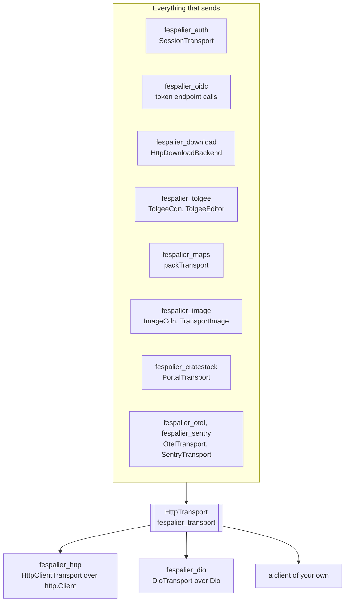
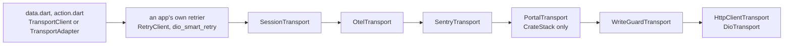

# HTTP transport

Since 0.21.0. `package:fespalier_transport` is the one seam fespalier's networking packages share: an `HttpTransport` interface that sends a request and answers a response. It is **pure Dart with no dependencies**, so a package that sends through it links neither `package:http` nor Dio, and an app picks one of them (or a client of its own) once, by choosing which package implements the interface. The session of [`fespalier_auth`](auth.md), the downloads, the Tolgee CDN, the map packs, the images and the CrateStack client all send through it, and so do the telemetry decorators.



Install it by installing a package that depends on it: `fespalier_http`, `fespalier_dio` and `fespalier_auth` bring it at the same tag. Add it yourself (same `url`, same `ref` as fespalier) to write a transport or a decorator of your own; [its README](https://github.com/fespalier/fespalier/blob/main/packages/fespalier_transport/README.md) has the block.

## The interface

```dart
abstract interface class HttpTransport {
  Future<TransportResponse> send(TransportRequest request);
}
```

`send` answers once the headers are in; the body streams. **Every status is an answer, not an error**: a 404 and a 500 come back as a `TransportResponse`. It throws a `TransportFailure` when no response came back (see [Failures](#failures)), and any other error a decorator throws for its own reasons (a session's `AuthRejected`).

| Type                | What it is                                                                                                                                                                                                                          |
| ------------------- | ----------------------------------------------------------------------------------------------------------------------------------------------------------------------------------------------------------------------------------- |
| `TransportRequest`  | `method`, `uri`, `headers`, the body as the exact bytes on the wire (`body`) or a stream (`bodyStream`, with `contentLength`), an `abortTrigger` and `attributes`. `replayable` is false for a stream; `copyWith` replaces the rest |
| `TransportResponse` | `statusCode`, `headers` (lower-case names), `reasonPhrase` and the body: `body` streams once, `bytes()` reads it all, `TransportResponse.buffered(response)` reads it and hands the response on whole                               |
| `abortTrigger`      | A `Future<void>` that completes to abort the send (`package:http`'s `abortTrigger`, Dio's `CancelToken`). A transport honours it with no timer                                                                                      |
| `attributes`        | For decorators, **never sent**: `fespalier.auth.replay: true` marks a send that followed a verdict, `fespalier.memo` carries the [memo](#the-memo), and an app can add its own (a key-role hint)                                    |

Three more pieces of the package are not transports but belong to them:

- **`HttpWrites`** is the one rule for what counts as a write: any method but `GET`, `HEAD`, `OPTIONS` and `TRACE`, unless the request carries an `Idempotency-Key` header. `WriteGuardTransport` and `fespalier_dio`'s `WriteGuard` share it, so the two never disagree.
- **`HttpCredentials`** is what a transfer that is not a transport (a download, a plugin, a websocket handshake) needs from a session: `covers(uri)`, `authorize(request, previous:)` for the headers and `retry(attempt, response)` for "send it once more?". `fespalier_auth`'s `Authorizer` implements it ([Credentials for clients that are not an http.Client](http.md#credentials-for-clients-that-are-not-an-httpclient)).
- **`TransportZone`** carries an abort trigger in a `Zone`, for code that cannot hand one to the request it makes: a generated client takes no abort trigger, so `ref.cancellable` in `fespalier_cratestack` runs the call in a zone that carries one, and `TransportAdapter` merges it into the request's `abortTrigger`.

## The two implementations

| Package          | Sends with                                                                          | The other way round                                                                    |
| ---------------- | ----------------------------------------------------------------------------------- | -------------------------------------------------------------------------------------- |
| `fespalier_http` | `HttpClientTransport(client)`, over an `http.Client` (`IOClient`, `cupertino_http`) | `TransportClient(transport)`: an `http.Client` over any chain, for `package:http` code |
| `fespalier_dio`  | `DioTransport(dio)`, over a `Dio` and its interceptors                              | `TransportAdapter(transport)`: a Dio `HttpClientAdapter` over any chain                |

Each pair is a bridge in both directions, so an app has one chain and both worlds on top of it:

```dart
final chain = SessionTransport(WriteGuardTransport(HttpClientTransport(http.Client())), authorizer);
final client = TransportClient(chain);                        // package:http code, RetryClient
final dio = Dio()..httpClientAdapter = TransportAdapter(chain); // a Dio with its interceptors and dio_smart_retry
final response = await chain.send(TransportRequest(method: 'GET', uri: Uri.parse('https://api.example.com/me')));
```

What each one does with a request and an error (a `DioException` or an `http.ClientException` becomes a `TransportFailure`, and back) is in [HTTP clients](http.md#one-seam-for-any-client); `fespalier_dio`'s README has the table of `DioExceptionType` to failure. Dio's `DioHttpClient` (your Dio as an `http.Client`) is gone since 0.21.0: send through `DioTransport`, or through `TransportClient(DioTransport(dio))` when code needs an `http.Client`.

## Writing your own

A **transport** over a client of your own (a platform channel, a gRPC-web gateway, a `cronet` client) maps three things: the request to the client's, the response back to a `TransportResponse`, and the client's errors to a `TransportFailure`.

```dart
final class MyClientTransport implements HttpTransport {
  const MyClientTransport(this.client);
  final MyClient client;

  @override
  Future<TransportResponse> send(TransportRequest request) async {
    try {
      final raw = await client.send(
        request.method,
        request.uri,
        headers: request.headers,
        body: request.body ?? request.bodyStream, // the exact bytes, or a stream sent once
        abort: request.abortTrigger,
      );
      return TransportResponse(
        statusCode: raw.status,
        headers: {for (final h in raw.headers.entries) h.key.toLowerCase(): h.value},
        body: raw.body,
      );
    } on MyAbort catch (e) {
      throw TransportAborted(e, request.uri);
    } on MyRefused catch (e) {
      throw TransportUnsent(e, request.uri); // it never left: sending it again is always safe
    } on MyTimeout catch (e) {
      throw TransportTimedOut(e, request.uri);
    } on Object catch (e) {
      throw TransportBroken(e, request.uri);
    }
  }
}
```

A **decorator** is a transport over a transport, and that is all it needs to be:

```dart
final class TimingTransport implements HttpTransport {
  const TimingTransport(this.inner, this.report);
  final HttpTransport inner;
  final void Function(String method, String path, int? status, Duration took) report;

  @override
  Future<TransportResponse> send(TransportRequest request) async {
    final watch = Stopwatch()..start();
    try {
      final response = await inner.send(request); // the request as it came: attributes and all
      report(request.method, request.uri.path, response.statusCode, watch.elapsed);
      return response;
    } on TransportFailure {
      report(request.method, request.uri.path, null, watch.elapsed);
      rethrow;
    }
  }
}
```

The rules a decorator keeps, because the others rely on them:

- **Pass `attributes` through unchanged.** They carry the auth replay mark and the [memo](#the-memo); a decorator that builds a new `TransportRequest` without them breaks the session above it. Use `request.copyWith(headers: ...)`, which keeps them, and add to the map rather than replace it.
- **Pass the `abortTrigger` and the body through.** A stream body is sent once; do not read it to look at it.
- **Do not consume a body you hand on.** To look at a response body, use `TransportResponse.buffered(response)` and return the buffered response.
- **Throw a `TransportFailure` for a transport problem, and let any other error through.** A session's `AuthRejected` or `AuthUnavailable` comes out of a decorator below it as it is.
- **No timer, no listener, and nothing sensitive in what you record**: never a header value, a body or a query.
- Test it with `FakeTransport` from `package:fespalier_transport/testing.dart`: it answers from a handler or a script (`FakeTransport.script([...])`, a `TransportResponse` or a `TransportFailure` per request), honours an abort trigger, and records every request with its body.

## Decorators and their order

| Decorator                                                                                | Package                | What it does                                                                                                                                                          |
| ---------------------------------------------------------------------------------------- | ---------------------- | --------------------------------------------------------------------------------------------------------------------------------------------------------------------- |
| `SessionTransport(inner, authorizer)`                                                    | `fespalier_auth`       | Attaches the session to requests to `apiOrigins`, renews once, sends again after a verdict ([Calling your API](auth.md#calling-your-api))                             |
| `WriteGuardTransport(inner)`                                                             | `fespalier_transport`  | Marks each response and error as a write's or a read's, so a retrier leaves writes alone ([Writes are never retried](http.md#writes-are-never-retried-over-http-too)) |
| `PortalTransport(inner)`                                                                 | `fespalier_cratestack` | A `text/html` answer becomes a `TransportPortal` (a captive portal or a gateway page)                                                                                 |
| `OtelTransport(inner, {isReady, propagateTo})`                                           | `fespalier_otel`       | A `CLIENT` span for each request sent, a child of the current data or action span ([Observability](observability.md))                                                 |
| `SentryTransport(inner, {hub, tracing, captureFailedRequests, tracePropagationTargets})` | `fespalier_sentry`     | A breadcrumb for each request, a span with `tracing`, an error event for a failed one only with `captureFailedRequests`                                               |

The order, outermost first, and why (`PortalTransport` is only for a CrateStack client):



```dart
// the same chain, built once (startup.dart, below, builds it for real)
final network = WriteGuardTransport(HttpClientTransport(http.Client()));
final observed = OtelTransport(SentryTransport(network), propagateTo: [api]);
// AuthConfig(transport: observed): authTransport adds SessionTransport(observed, authorizer) on top
```

- **A retrier is above the session**, never under it: under a session that signs requests it would send the same signature again. Above it, every retry calls the session again, and the session signs the exact bytes of that send ([The wrapping order](http.md#the-wrapping-order)).
- **The telemetry decorators are below the session**, so a replay after a 401 reaches them: each send is a span of its own (`http.request.resend_count` on the second), where above the session the replay would be hidden inside one.
- **`PortalTransport` is below the session**, so a captive portal's `401` page is a `TransportPortal` (offline), not a verdict that renews or ends the session.
- **`WriteGuardTransport` is next to the network**, so the response a retrier sees is the one the guard marked, and the session's own replay after a 401 passes it with its `fespalier.auth.replay` mark. The guard only marks, it refuses nothing (Dio's `WriteGuard` interceptor is what refuses a second send of a write); the two can be stacked in either order.
- **Do not also put `SentryHttpClient`, `sentry_dio`, `otel_http` or `otel_dio` on the same requests**: each request would be reported twice.

## The memo

A retrier above the transport sends the same logical request again, and a decorator sees each send as a new request. `TransportMemo` is how it knows it has seen this one before: a small mutable bag, carried in `TransportRequest.attributes['fespalier.memo']` (`TransportMemo.key`) and never sent. `request.memo` reads it, and `get`, `set`, `putIfAbsent` and `remove` use it, under a key the decorator owns (a private `const` string is enough; a decorator never reads another's).

`SessionTransport` keeps the user a request was authorized for, the `AuthRejected` that stopped it and the renewals it has spent in the memo, so a retry is refused when the session it wanted is gone, and a request renews at most once however many times it is sent.

A client that sends the same logical request more than once must give every send **the same memo**:

| Client                             | Where the memo lives                                                                                                                      |
| ---------------------------------- | ----------------------------------------------------------------------------------------------------------------------------------------- |
| `TransportAdapter` (Dio)           | `RequestOptions.extra`, which a Dio retrier reuses: every retry of one request shares it                                                  |
| `TransportClient` (`package:http`) | One per `http.BaseRequest` object. A `RetryClient` sends a **copy** of the request each time, so each copy is a new logical request there |
| A request with no memo             | A request seen once                                                                                                                       |

A decorator **must pass `TransportRequest.attributes` through**: dropping the memo makes every send a first one, and the session above forgets what it settled.

## Failures

`TransportFailure` is sealed: switch on it. It means **no response came back**, and the kind says what that tells you about the request, which is what a retrier needs.

| Kind                 | What happened                                                                                     | Was it processed? | Sending it again                            |
| -------------------- | ------------------------------------------------------------------------------------------------- | ----------------- | ------------------------------------------- |
| `TransportAborted`   | The request's `abortTrigger` fired before an answer                                               | Unknown           | It was stopped on purpose                   |
| `TransportUnsent`    | It provably never left: connection refused, host not found, not connected in time                 | No                | Always safe; the network is down            |
| `TransportUntrusted` | The server's TLS certificate was refused (since 0.21.0)                                           | No                | The network is not what failed: not offline |
| `TransportTimedOut`  | Sent, and no answer came in time                                                                  | Maybe             | Only a read                                 |
| `TransportBroken`    | Anything else that stopped the exchange: a dropped connection, a malformed answer                 | Maybe             | Only a read                                 |
| `TransportPortal`    | Something other than the API answered: a captive portal's or a gateway's page (`PortalTransport`) | Maybe             | Only a read; read as offline                |

- **A refused certificate is not offline.** A certificate that does not verify may be a captive portal or an attack, so a client reads it as unknown: it serves no cached read for it and keeps no queued intent waiting for the network. `DioTransport` throws it for Dio's `badCertificate`, `HttpClientTransport` for a `HandshakeException`, a `TlsException` or a `CertificateException` (not on the web, where the browser tells a refused certificate from nothing else). A download whose grantor's certificate is refused ends `Failed(network)`.
- **The text never names the server**: a failure's `summary` is one line, and the `cause` is the transport's own error, for a log.
- **`TransportStatusError`** is not a failure: a response did come back, with an error status. A client that wraps answers in exceptions (Dio does for a 4xx or a 5xx) carries one through `DioErrors.toTransport`, so a reader that knows no Dio type can classify it. The Tolgee CDN and editor throw one for a refusal (it was an `http.ClientException` until 0.20.0). Its `toString` shows the status only, because the body may hold personal data.
- **`CredentialsUnavailable`** is what a credential throws when it could not be reached (offline while a session renews, a 5xx from the renewal endpoint): nothing was refused, so a transfer reports a network failure, not a lost session. `AuthUnavailable` implements it.
- **CrateStack reads all of these in one place**: `TransportFailures.read` turns `TransportUnsent`, `TransportTimedOut` and `TransportPortal` into `CrateStackOffline`, `TransportAborted` into `CrateStackCancelled`, and a `TransportStatusError` by its status and body; a `TransportBroken` and a `TransportUntrusted` are unknown (null), not offline ([CrateStack](cratestack.md)).

## Streaming bodies

`send` answers at the headers and the body streams, so a response that never ends (server-sent events, since 0.25.0 with [`fespalier_stream`](streaming.md)) goes through the chain like any other. The decorators keep it that way: `SessionTransport` reads only the body of a 401 or a 403 (up to 64 KiB) and hands every other response on unread, and `OtelTransport` and `SentryTransport` end their span or breadcrumb at the headers, so their duration is the time to the first byte. Two things to know about a body that streams:

- **An error in the middle of a body is the client's own**, not a `TransportFailure`: `package:http` ends it with a `ClientException` (a `RequestAbortedException` after an abort), Dio with a `DioException`. `fespalier_stream` reads such an error as a dropped connection, a `TransportBroken`, unless it aborted the request itself.
- **Cancelling a body does not free every connection**: Dio keeps reading a body whose listener left, on the VM and on the web. Complete the request's `abortTrigger` to close it, as `fespalier_stream` does whenever it gives a stream up. On the web, Dio's default adapter receives a body whole, at its end; `HttpClientTransport(BrowserClient())` reads it as it arrives.

## One transport, built in startup

Build the chain once, in `startup()`, and hand the same object to everything that sends: the session, the images, the downloads, the translations, the map packs.

```dart
// lib/app/startup.dart
import 'dart:async';

import 'package:fespalier/startup.dart';
import 'package:fespalier_auth/fespalier_auth.dart';
import 'package:fespalier_http/fespalier_http.dart';
import 'package:fespalier_maps/fespalier_maps.dart';
import 'package:fespalier_otel/fespalier_otel.dart';
import 'package:fespalier_sentry/fespalier_sentry.dart';
import 'package:fespalier_transport/fespalier_transport.dart';
import 'package:http/http.dart' as http;

final api = Uri.parse('https://api.example.com');

FutureOr<List<Override>> startup() async {
  // The network end of the chain: the write guard next to it, telemetry above it (Otel outside Sentry).
  final transport = OtelTransport(
    SentryTransport(WriteGuardTransport(HttpClientTransport(http.Client()))),
    propagateTo: [api],
  );

  final auth = await restoreAuth(
    AuthConfig(
      backend: authBackend(transport), // OidcBackend(transport: transport, ...) or a DeviceAuthBackend
      transport: transport,            // authTransport = SessionTransport(transport, authorizer)
      apiOrigins: [api],
    ),
  );

  return [
    ...auth,
    packTransport.overrideWithValue(transport), // fespalier_maps; a file pack is a public file
  ];
}
```

- **Everything that is not your API takes the transport without the session**: the OIDC token endpoint, the Tolgee CDN, map packs and public images are not `apiOrigins`, and `SessionTransport` sends them through untouched anyway. Pass the same `transport` and only the requests to `apiOrigins` carry the session.
- **The consumers**: `HttpDownloadBackend(transport: ...)` ([Downloads](downloads.md)), `ImageCdn(transport: ...)` ([Images](responsive-images.md); not `const` any more), `TolgeeCdn(base, transport: ...)` and the `tolgeeEditorTransport` provider ([Translations](i18n-tolgee.md)), `packTransport` ([Maps](maps.md)), and a CrateStack client through `TransportAdapter` on its Dio ([CrateStack](cratestack.md)).
- **Tests** override the same seams with a `FakeTransport`: `fakeAuth(transport: FakeTransport(...))`, `packTransport.overrideWithValue(fake)`, `ImageCdn(transport: fake)`.
