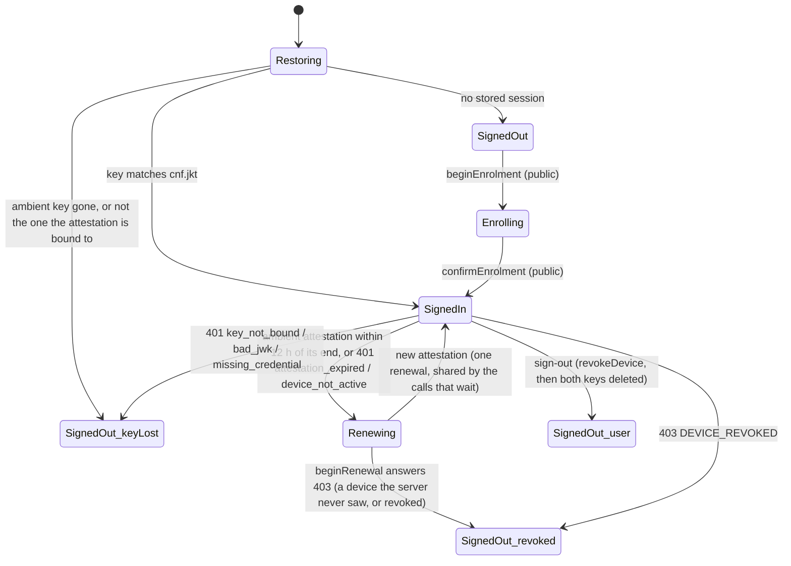
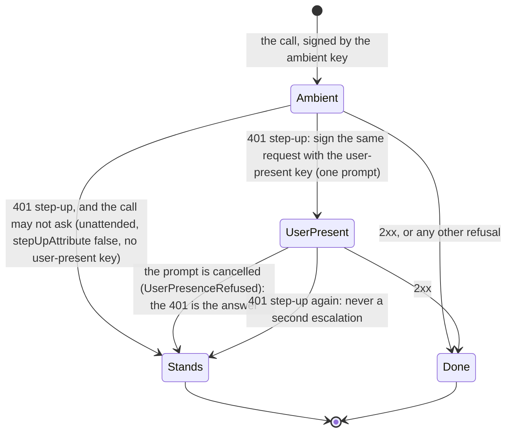
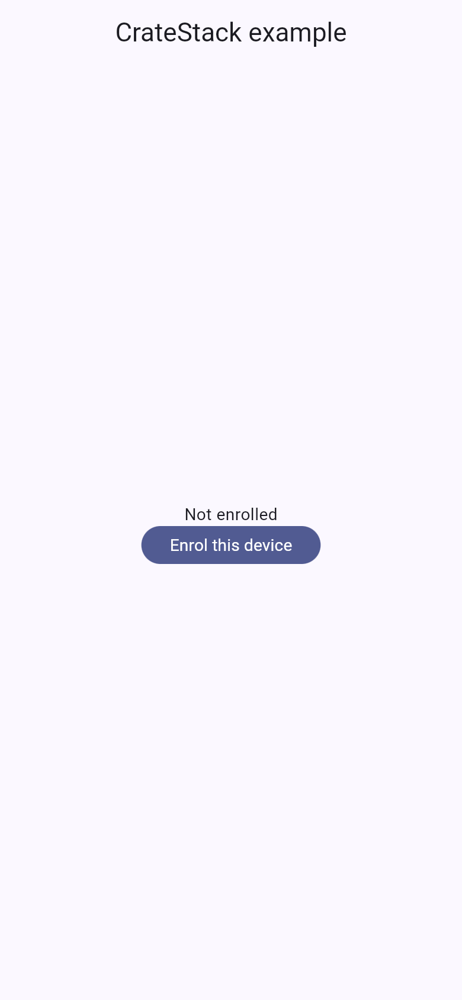

# cratestack

A [CrateStack](https://cratestack.dev) backend, a Flutter client **generated** from its schema by
`cratestack generate-dart --preset fespalier`, and **device-signed sessions**
([`fespalier_sign_keypair`](../../packages/fespalier_sign_keypair), the scheme Webank runs, fespalier#267): no password,
no token, no `Authorization` header. A small orders app that shows how the three fit together, with tests on both sides
and a cross-language end-to-end test (Dart signs, Rust verifies).

- [`server/`](server) is a standalone Rust crate, `cratestack-api` 0.17.2 (`@authn` since 0.17.1; 0.17.2 keeps no `Idempotency-Key` for a refusal), no
  database. `schema.cstack` is the contract: four **public** procedures (`beginEnrolment`,
  `confirmEnrolment`, `beginRenewal`, `confirmRenewal`) and the signed ones (`listOrders`, `getOrder`, `placeOrder`,
  `payOrder`, `account`, `revokeDevice`), and `payOrder`'s **step-up rule**, `@authn(amr: ["user"])`. It issues attestations
  from its own issuer key and verifies **every other request** with the profile of `fespalier_sign_keypair`.
- [`client/`](client) is what `scripts/cratestack-client.sh generate` writes: a Riverpod package that sends through
  fespalier's `HttpTransport` and links **no Dio**. It is committed, with the files `build_runner` writes from it, and CI
  generates it again and compares.
- The app (`lib/`, package `cratestack_example`) is an ordinary fespalier app: `lib/app/` has `startup.dart`, an enrolment
  page, a guarded group and the orders pages with their `data.dart` and `action.dart`.

Read it with the skills [`fespalier-cratestack`](../../skills/fespalier-cratestack/SKILL.md) (the wiring) and
[`fespalier-guards`](../../skills/fespalier-guards/SKILL.md) (device sessions). [CrateStack and fespalier](../../docs/cratestack.md),
[HTTP transport](../../docs/transport.md) and [Device-signed sessions](../../docs/auth.md#device-signed-sessions-fespalier_sign_keypair)
are the pages. [`examples/device`](../device/README.md) is the same session against a server written in Dart;
[`examples/cose`](../cose/README.md) signs the calls themselves instead of the session.

## What it shows

```mermaid
sequenceDiagram
  participant P as Pages
  participant B as DeviceAuthBackend
  participant G as Generated client (orders_client)
  participant S as Session (authTransport)
  participant R as server/ (Rust)
  P->>B: beginEnrolment(phone)
  B->>G: beginEnrolment(keys)  [plain chain, no session]
  G->>R: POST /rpc/procedure.beginEnrolment
  R-->>P: a challenge per key (the code is "sent")
  P->>B: signIn(CompleteEnrolment(challenge, code))
  B->>G: confirmEnrolment(signatures, code)  [plain chain]
  G->>R: POST /rpc/procedure.confirmEnrolment
  R-->>B: deviceId, an attestation per key (iss, sub, did, exp, cnf.jkt, att)
  B-->>P: SignedIn
  P->>G: listOrders (in ref.cancellable)
  G->>S: the request, as the adapter encoded it
  S->>R: X-Attestation + X-Signature over method, path, query and the exact body (no Authorization)
  R-->>P: 200
  Note over S,R: a 401 attestation_expired renews the attestation (beginRenewal, confirmRenewal) and sends the call once more
  P->>G: payOrder (an ordinary call, with an Idempotency-Key)
  S->>R: signed by the ambient key
  R-->>S: 401 step-up: WWW-Authenticate Bearer error="insufficient_user_authentication" (@authn(amr: ["user"]))
  Note over S: once, and only for a call the user is looking at (never inside Authorizer.unattended)
  S->>R: the same request (same body, same key), signed by the user-present key, which prompts
  R-->>P: 200 (amr ["user", "pop"])
  Note over S,P: a cancelled prompt: the 401 is the answer, a CratestackRpcException whose stepUp is set; the session stays
```



One request's step-up, inside `SignedIn` (the session does not change):



| Where                                                             | What                                                                                                                                                                                                                                                                                                                                                             |
| ----------------------------------------------------------------- | ---------------------------------------------------------------------------------------------------------------------------------------------------------------------------------------------------------------------------------------------------------------------------------------------------------------------------------------------------------------- |
| [`lib/app/startup.dart`](lib/app/startup.dart)                    | The **one transport**: `PortalTransport(WriteGuardTransport(HttpClientTransport(http.Client())))`, the only place `package:http` is named. `restoreAuth` puts the session on top of it, and `ordersOverrides` hands the session to the generated client                                                                                                          |
| [`lib/src/wiring.dart`](lib/src/wiring.dart)                      | `authSetup`: `AuthConfig(backend: DeviceAuthBackend(...), transport: <the plain chain>, apiOrigins: [server])`. `ordersOverrides`: `ordersClientTransportProvider` is `ref.watch(authTransport)`, `ordersClientBaseUriProvider` the origin, and the error reader and the account for `fespalier_cratestack`; `stepUpReason` is the caption of the step-up prompt |
| [`lib/src/device_server.dart`](lib/src/device_server.dart)        | The `DeviceAuthServer`: the four public legs go through the **generated client over the plain chain** (built from the same generated classes the provider builds, with `AuthConfig.transport` in the session's place); the revocation is signed by hand with `signer.signFor`                                                                                    |
| `lib/app/(signed-in)/orders/data.dart`                            | The list: the generated call inside `ref.cancellable` (leaving the page aborts the load), served by `ref.serve` (offline, the copy this phone saved)                                                                                                                                                                                                             |
| `lib/app/(signed-in)/orders/action.dart`                          | `placeOrder` with an `Idempotency-Key`; a validation answer is `FieldErrors` under its field; the list is invalidated                                                                                                                                                                                                                                            |
| `lib/app/(signed-in)/orders/$id/`                                 | The detail, and `pay`: an ordinary call that the server steps up (`@authn`) and the session completes with the **user-present key**; a cancelled prompt is the refusal (`stepUp` set)                                                                                                                                                                            |
| [`server/src/lib.rs`](server/src/lib.rs) `verify_device`, `admit` | The layer in front of the generated router: reads the body, runs the verifier, answers `401 {"error": code}` / `403 DEVICE_REVOKED` itself, and hands the verified device on as a request extension                                                                                                                                                              |
| [`server/src/verify.rs`](server/src/verify.rs) `verify`           | The profile, check by check, in the order of Dart's `verifyDeviceSignature`                                                                                                                                                                                                                                                                                      |
| [`server/src/lib.rs`](server/src/lib.rs) `DeviceAuth`             | CrateStack's auth seam (`AuthProvider`): turns that extension into the caller the procedures, `@allow(auth() != null)` and `@authn` see, through the principal contract (`principal_of`: `key_role`, `amr` from the key, `auth_time` for the user-present key). It reads no header and no body                                                                   |

## Screenshots

| `/`                                                                                                                                                                             | `/enrol`                                                                                                                                               | `/orders`, not enrolled                                                                                                                                                                          |
| ------------------------------------------------------------------------------------------------------------------------------------------------------------------------------- | ------------------------------------------------------------------------------------------------------------------------------------------------------ | ------------------------------------------------------------------------------------------------------------------------------------------------------------------------------------------------ |
|  |  |  |

A release web build in Chromium, 390 × 844 CSS pixels at 2× (`just example-screenshots cratestack`). The signed-in screens
need the server, which that check does not run.

## Run it

Two terminals. The server first (Rust, the toolchain in `server/rust-toolchain.toml`):

```sh
cd examples/cratestack/server
cargo run --locked -- --listen 127.0.0.1:8788
# {"addr":"127.0.0.1:8788","audience":"fespalier-cratestack","issuer_jwk":{...}}
```

Then the app:

```sh
cd examples/cratestack
flutter create --empty . --platforms=android,ios,web   # adds the platform folders, .gitignore and .metadata
flutter pub get
flutter run --dart-define=ORDERS_SERVER_URL=http://127.0.0.1:8788
```

Enrol with any phone number (`+237 6 55 00 00 00`) and the code `123456`. `ORDERS_AUDIENCE` must be the server's
`--audience` (the default is the same string in both). An Android emulator reaches the host at `10.0.2.2`, or through
`adb reverse tcp:8788 tcp:8788`; plain HTTP needs the platform's cleartext allowance (see [`examples/cose`](../cose/README.md#on-an-android-emulator-or-a-phone)).
The keys are in the Secure Enclave or the AndroidKeyStore where the platform has them; the web has the ambient key only
(paying says it cannot confirm), and Windows and Linux ask for `KeypairFallback.software`, a key in memory.

The server forgets everything at a restart (devices, orders, the single-use `jti`s), and draws a new issuer key unless it is
given `--issuer-scalar-hex`: an old session then reads `bad_attestation`, which is ambiguous to the client (it never
signs out on it), so enrol again.

## Decisions

- **RPC, not REST.** Every procedure is `POST /rpc/procedure.<name>`, errors are typed (`CratestackRpcException` with a
  status, a code and a message), and a call takes an `Idempotency-Key` in its options. Public and signed procedures are the
  same shape; the server lists the four public ones by name.
- **No Dio, and the test says so.** `test/no_http_test.dart` greps the app, the generated client and both pubspecs, and the
  resolved package graph: Dio is nowhere, and `package:http` is named in `lib/app/startup.dart` alone.
- **`--fespalier-ref` is a commit of fespalier, not a tag.** The preset pins `fespalier_transport` by git. fespalier 0.21.0
  is not released, so the default (`v0.21.0`) resolves to nothing yet; inside this repository `pubspec.yaml` overrides it
  with the checkout anyway, so the pin is never fetched. A commit is not a `ref: v...`, which `cli/tests/versions.rs` reads
  as fespalier's own version and release-please would never bump. In your own app leave `--fespalier-ref` out.
- **CrateStack is pinned to 0.17.2, on both sides**: the server's two CrateStack dependencies are `=0.17.2`, the first
  release with `@authn` and the generated clients' `StepUpRequired` (cratestack/cratestack#1244), and `CRATESTACK_REV` in
  `scripts/cratestack-client.sh` is the commit of its tag `v0.17.2`, which the CLI is built from (a commit, never a tag
  name). `just cratestack-cli` installs the CLI. `--no-native-cbor`: the pure-Dart `cbor`, so the client needs no native
  library.
- **Step-up is the server's rule, and the session follows it.** `payOrder` declares `@authn(amr: ["user"])` (RFC 8176
  `user`, a user-presence test). The server's principal says how a request was signed: `amr` `["user", "pop"]` and an
  `auth_time` (the signature's `iat`) for the user-present key, `["pop"]` and no `auth_time` for the ambient one. Not `hwk`:
  the server cannot tell a hardware-backed key from the software fallback, and it claims nothing it did not check. An
  ambient-key payment is refused before the procedure runs with RFC 9470's 401, which carries `WWW-Authenticate: Bearer
error="insufficient_user_authentication"` on the RPC unary response too (the body is CBOR, so the client reads the
  header); the session's `DeviceSigner` signs the same request again with the user-present key and sends it once more
  (since 0.25.0). Nothing in the app asks for the key: the confirm header and `ConfirmTransport` of 0.21.0 are gone.
- **A step-up refusal does not keep the `Idempotency-Key`.** The session's retry is the very same request under the same
  key. Since CrateStack 0.17.2 (cratestack/cratestack#1261) the idempotency layer releases the key for a refusal the
  generated dispatch makes before the procedure runs (`@authn`'s among them), so the retry runs once; on 0.17.1 the 401
  was recorded and replayed, and this example's store released it by hand.
- **The generated files are committed.** `client/` (the generator's output, formatted, and `*.g.dart`, `*.mapper.dart`,
  `*.builder.dart` from `build_runner`) is in the repository, like `lib/app.g.dart`, so a clone builds with `flutter pub
get`. `scripts/cratestack-client.sh check` generates again into a temporary directory and compares everything the
  generator writes; the `build_runner` files are not compared (their text depends on the builders' resolution, and a stale
  one does not compile). Never edit a file in `client/`: change `server/schema.cstack` and run `just cratestack-client`.

## What the generated client could not do, and what the example does about it

Each of these is a gap to close upstream; none needs a change to CrateStack here. (Over RPC a rejected field is
`422 invalid_argument`, which `fespalier_cratestack` reads like REST's `VALIDATION_ERROR`: no workaround is needed.)

- **A call cannot carry attributes for the session.** `CratestackRpcCallOptions` has headers, an idempotency key and an
  abort trigger; `CratestackHttpRequest.extra` (which the fespalier transport forwards as `TransportRequest.attributes`) is
  never filled by the RPC adapter ([cratestack/cratestack#1207](https://github.com/cratestack/cratestack/issues/1207)). The
  user-present key no longer needs one (the server's step-up asks for it), and work the user is not looking at, which must
  never prompt, runs inside `Authorizer.unattended(...)`, the zone form of `Authorizer.stepUpAttribute: false`.
- **A refusal body is `{code, message}`, the device-session classifier reads `{error}`**, and an `AuthProvider` error cannot
  shape its status or body ([cratestack/cratestack#1208](https://github.com/cratestack/cratestack/issues/1208)). The
  verification layer answers its refusals itself, with both: `{"error": "attestation_expired", "code": "unauthenticated",
"message": ...}`.
- **The verification is a layer, not an `AuthProvider`, for two reasons.** The check itself would fit in an `AuthProvider`
  (`RequestContext` has the method, path, query and exact body bytes, and `/rpc/batch` authenticates once per request); the
  first reason is the refusal shape above. The second is idempotency: `IdempotencyLayer` runs before the handlers, so before
  `authenticate`, and keys on a `VerifiedPrincipal` request extension that only a layer in front of it can set. The
  `AuthProvider` only reads what the layer recorded. Marking the four procedures public was no trouble: `@allow(true)` with
  an anonymous caller, and the layer lets them through by name.
- **A renewal shared by several calls may inherit the abort trigger of the first (suspected, not yet confirmed).** `ref.cancellable` puts the page's trigger
  in the zone, `SessionTransport` starts the single-flight renewal in that zone, and a page that goes away might abort the
  renewal for every call that waits for it. `OrdersDeviceServer` runs each leg in a zone with a trigger that never fires.
  (Upstream: the session should start a renewal outside the caller's zone.)

## Tests

`test/` runs against `test/fake_server.dart`, an in-memory server on `FakeTransport` that checks every signed call with
`verifyDeviceSignature`, on a fake clock and `FakeKeypairSigner` keys. No test here touches a secure element.

- `enrol_test.dart`: the two unsigned legs, every later call signed with no `Authorization`, field errors for a wrong number
  or code, and the guard to the enrolment and back.
- `orders_test.dart`: the list, the detail, a missing order, a new order (the `Idempotency-Key`, the list loaded again) and
  the server's validation answer under its field.
- `abort_test.dart`: leaving a page aborts its request (`FakeTransport.abortCount`), the detail's and the list under it.
- `offline_test.dart`: a `TransportUnsent` reads as offline and the list is the copy this phone saved; nothing saved is said;
  a refusal is never covered by the copy.
- `renew_test.dart`: an expired attestation is renewed once for two calls; a `401 attestation_expired` renews and sends
  the call again; a forgotten or revoked device ends the session as `revoked`.
- `presence_test.dart`: paying is refused for the ambient key and signed again with the user-present key (one prompt, the
  same request and `Idempotency-Key`); a cancelled prompt leaves the refusal and nothing else; work inside
  `Authorizer.unattended` never prompts; a device with no user-present key cannot confirm.
- `sign_out_test.dart`: sign-out revokes the device (signed with the user-present key), deletes both keys, and wipes what the
  phone saved.
- `wiring_test.dart`, `no_http_test.dart`: the chain and the generated seams.
- `e2e_test.dart` starts the **real server binary** (`ORDERS_SERVER_BIN`; skipped without it, a failure with
  `FSP_REQUIRE_ORDERS_SERVER=1`) and drives the app's own wiring over real sockets: enrolment, signed reads and writes, a
  write replayed under one key, the step-up (an ambient-key `payOrder` refused, then completed with one user-present
  signature and one retry; a cancelled prompt surfacing the 401; unattended work never prompting), a replayed or tampered
  or unsigned request, sign-out and
  `DEVICE_REVOKED`, a renewal before a call and after a real `401 attestation_expired`, and a restarted server that forgot the
  device. The server has its own tests in `server/tests/` (`verify.rs` for the verifier, `api.rs` for the router with a Rust
  device).

```sh
just cratestack          # the server's gates, the client compared with a fresh one, then the app's tests with the server required
cd examples/cratestack && flutter pub get && flutter test   # the end-to-end test skips without ORDERS_SERVER_BIN
```

## Unchecked on a device

No CI job runs these; the tests use `FakeKeypairSigner`. They belong in a `human-test` issue, like the device example's:

- **The user-present prompt**: the biometric or device-credential prompt, its caption (`stepUpReason`, here "Confirm it
  is you"), a cancelled prompt, a device with no screen lock, and how each surfaces: as the step-up refusal for a call the
  session escalated, as `UserPresenceRefused` for one signed with that key from the start.
- **Biometric invalidation** (enrolling or removing a fingerprint destroys the user-present key and leaves the ambient one).
- **The web key** across a reload, a restart and "clear site data", in Safari and Firefox.
- **Hardware-backed keys** on real StrongBox and Secure Enclave devices, and the fallback to a software key.
- **A real network**: the app against `server/` from a phone, over plain HTTP and over TLS. No test here sends a request
  from a phone.
