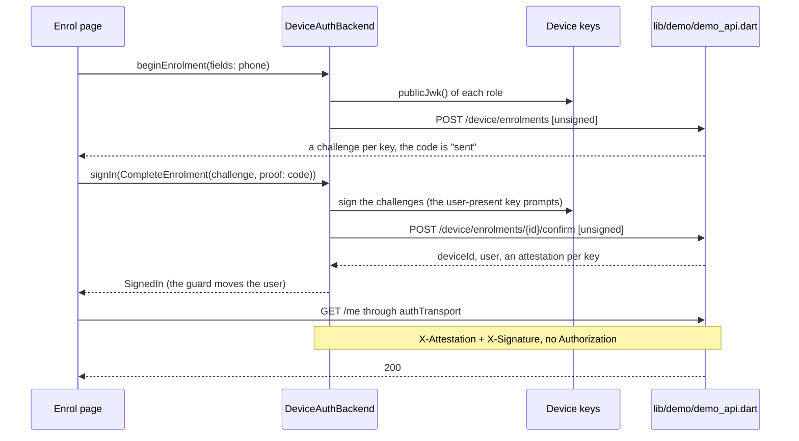
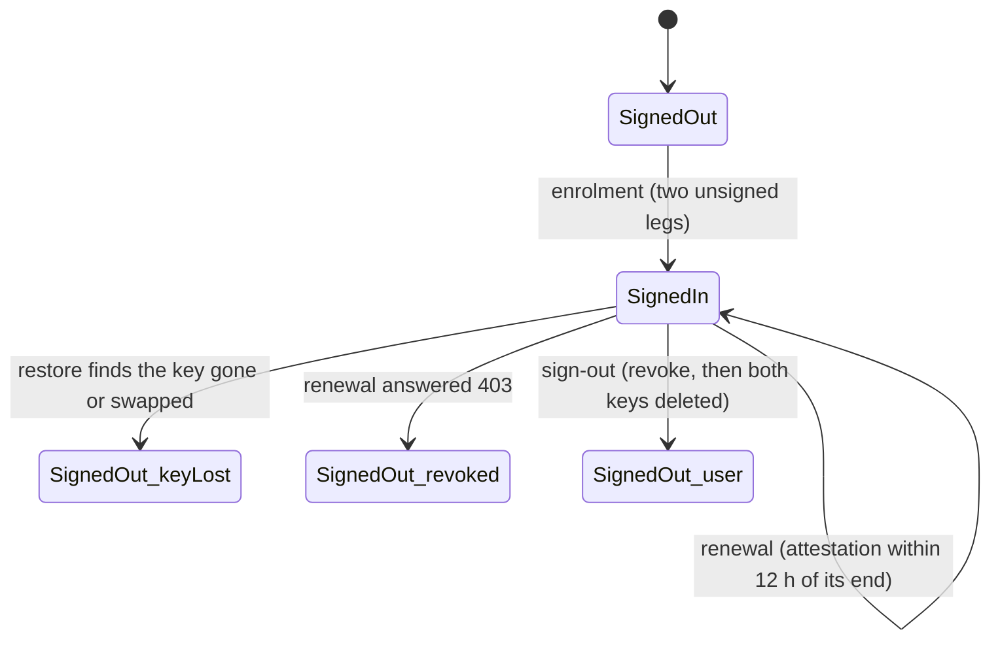
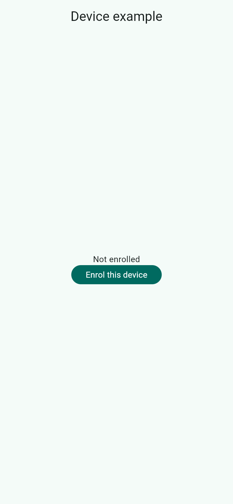

# device

A fespalier example for [`fespalier_sign_keypair`](../../packages/fespalier_sign_keypair) (since 0.21.0): signing in
by **enrolling the device**, with no token. Nothing is stored that works without the device's key, and no
`Authorization` header is ever sent: every request carries `X-Attestation` and an `X-Signature` over its method, path,
query and exact body bytes. It is the example for
[fespalier#267](https://github.com/fespalier/fespalier/issues/267). The API is an in-process server
(`lib/demo/demo_api.dart`, a `MockClient`), so the app runs and is tested with no network.

- `lib/app/startup.dart` builds the app's **one transport** (`apiTransport()`: in your app it is
  `HttpClientTransport(http.Client())`, from [`fespalier_http`](../../packages/fespalier_http)) and returns
  `restoreAuth(authSetup(transport))`. The restore reads the stored attestation with no network and asks the backend
  whether the device key is still the one it is bound to (`SignedOut(keyLost)` when it is not).
- `lib/device_setup.dart` is the `AuthConfig`: a `DeviceAuthBackend` over `DeviceKeys.device()` (that is
  `KeypairSigners.device` for each role: an ambient key that never prompts, and where the platform has a secure element a
  user-present key that prompts), the signature profile of the API, and `apiOrigins`, the only origin a signature is sent
  to.
- `lib/device_server.dart` is the recipe for **your server's endpoints**: a `DeviceAuthServer` with one method per leg
  (the two of an enrolment, the two of a renewal, and the revocation). It sends the four unsigned legs through
  `AuthConfig.transport`, which has no session on it, and signs the revocation itself with `signer.signFor`.
- `lib/app/enrol/` is the enrolment page: a phone number (`beginEnrolment`), then the one-time code
  (`signIn(CompleteEnrolment(challenge, proof: code))`). Its guard, `redirectIfSignedIn`, sends the user back to where
  they were going: the page has no navigation code. A wrong phone number or code is the `FieldErrors` the server answered,
  shown under its field.
- `lib/app/(signed-in)/guard.dart` is `requireSignedIn`: "signed in" means this device is enrolled. `account/` loads
  `GET /me` through `authTransport`; the attestation near its end is renewed once, silently, before the request.
- `lib/app/(signed-in)/transfer/` is a **sensitive action**: its request asks for the user-present key through its
  attributes (`DeviceSigner.roleAttribute`), so the signature is made behind a biometric or the device credential. A
  cancelled prompt is a `UserPresenceRefused` that fails that one request. The web has no user-present key, and the page
  says so.
- Signing out **revokes the device** on the server (signed with the user-present key when there is one), then deletes both
  keys and the stored session.
- `lib/demo/demo_api.dart` is what **your server** does, in pure Dart. It issues an attestation per key, signed by its own
  issuer key and bound to the key by `cnf.jkt`, and checks every API call with `verifyDeviceSignature` and an in-memory set
  of `jti`s, so a signature is good once. Sending money and revoking a device need the user-present key. The one-time code is
  always `123456`.





## Screenshots

| `/`                                                                                                                                  | `/enrol`                                                                                                                                           | `/account`, not enrolled                                                                                                                                                                       |
| ------------------------------------------------------------------------------------------------------------------------------------ | -------------------------------------------------------------------------------------------------------------------------------------------------- | ---------------------------------------------------------------------------------------------------------------------------------------------------------------------------------------------- |
|  |  |  |

A release web build in Chromium, 390 × 844 CSS pixels at 2× (`just example-screenshots device`).

## Run it

```sh
cd examples/device
flutter create --empty . --platforms=android,ios,web   # adds the platform folders, .gitignore and .metadata
flutter pub get
flutter run
```

Enrol with any phone number (`+237 6 55 00 00 00`) and the code `123456`. On Android, iOS and macOS the keys are in the
Secure Enclave or the AndroidKeyStore; the user-present key needs a screen lock. The web has the ambient key only (a
non-extractable `CryptoKey`), so the transfer page says it cannot confirm. Windows and Linux have no keystore: the example
asks for `KeypairFallback.software`, a key in memory that does not survive a restart. A production app that promises
device-bound sessions keeps the default, `KeypairFallback.refuse`.

**Unchecked on a device.** No test here touches a secure element: the user-present prompt, a cancelled prompt, a device with
no screen lock, biometric invalidation, and the web key across a reload are all untried. The tests use `FakeKeypairSigner`.

## Tests

`test/` runs against the demo server on the test's fake clock and fake keys:

- `enrolment_test.dart`: the phone number then the code opens the route it was going to, field errors for a wrong number or
  code, and a web device with the ambient key alone.
- `requests_test.dart`: every request verifies and none carries an `Authorization` (the store holds a device id and
  attestations, not a token), and a signature fits one request, once.
- `renew_test.dart`: an attestation near its end is renewed exactly once for two requests, and an expired one before the
  request; a device the server forgot ends the session as `revoked`.
- `restore_test.dart`: the next start is signed in with no request, and a swapped or wiped key is `SignedOut(keyLost)`.
- `presence_test.dart`: sending money prompts and the server sees the user-present key; a cancelled prompt fails that one
  request.
- `sign_out_test.dart`: sign-out revokes the device, then deletes both keys.
