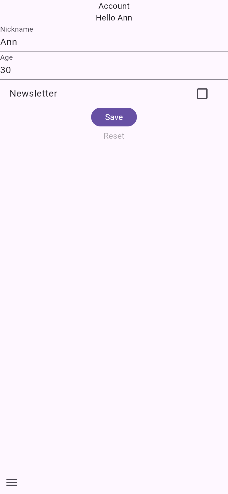
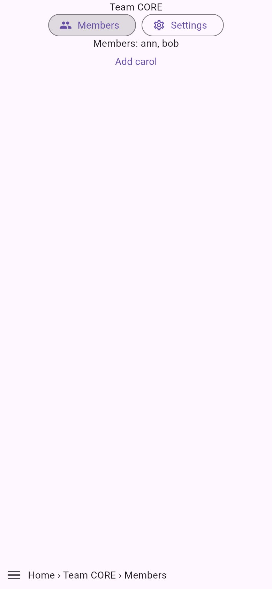
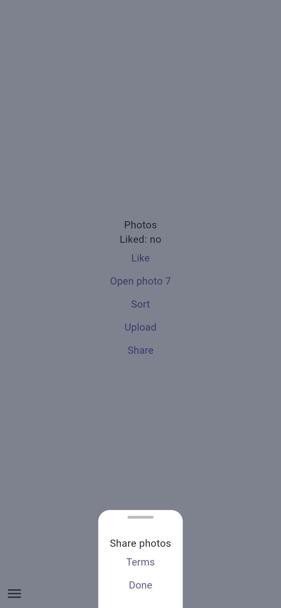

# features

Every binding the generator knows, in one app, with widget tests: routing and layouts, guards and redirects, a
form on an action, optimistic updates, feature flags, a cache on disk and reconnects. It is the place to look up a
binding next to the test that shows it. Read [`minimal`](../minimal) first. [Run the examples](../../docs/examples.md#features)
lists every piece, file by file.

## Screenshots

| `/nickname`                                                                                                                                                                  | `/teams/core/members`                                                                                                                                                                                      | `/photos/share`                                                                                                                                  |
| ---------------------------------------------------------------------------------------------------------------------------------------------------------------------------- | ---------------------------------------------------------------------------------------------------------------------------------------------------------------------------------------------------------- | ------------------------------------------------------------------------------------------------------------------------------------------------ |
|  |  |  |

A release web build in Chromium, 390 × 844 CSS pixels at 2× (`just example-screenshots features`).

## Run it

```sh
cd examples/features
flutter create --empty . --platforms=android,ios,web   # adds the platform folders, .gitignore and .metadata
flutter pub get
flutter run
```

## Things to try

- `/nickname`: a form on an action, with an error per field, a save button that is disabled while the save runs,
  and a title that shows the new nickname at once.
- `/teams/core/members`: **Add carol** writes to the team's section, and the page and the team reload.
- `/photos/share`: a bottom sheet with a URL of its own, over `/photos`; `/photos/share/terms` opens a page on top of it.
- `/vault` signed out: the guard sends you to `/login?from=/vault`, and **Sign in** sends you back. `/admin` goes to the
  login page too; once signed in, its own guard runs next and, since you are not an admin, sends you to `/inbox` (guards
  run outermost first).
- `/labs`: a route behind a feature flag. Until you run with `--dart-define=FEATURES_LABS=true`, its guard sends you to `/`.
- `/old-shops/acme` and `/old-search?q=x`: old addresses that redirect to `/shops/acme` and `/search?q=x`.
- `/aide` and `/hilfe`: the `help/` pages under their French and German spellings.
- `/signup/company` on its own: the flow guard sends you back to step 1 of 3.

## Test it

```sh
flutter analyze
flutter test
```

`test/flags_test.dart` turns `/labs` on and off with a `FakeFlags`, and `test/offline_test.dart` restarts the app over
the same saved team and flaps a `FakeConnectivity`.
