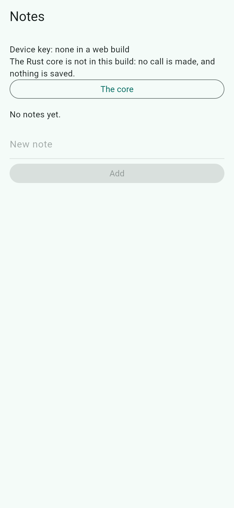
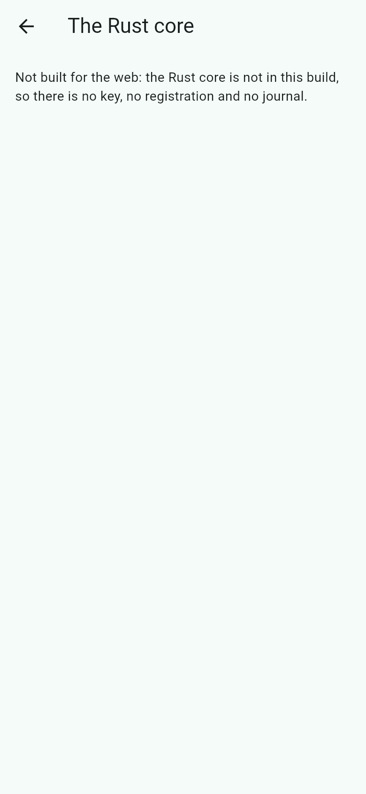

# frb-cose: a Rust core that is the CrateStack client, behind flutter_rust_bridge

A [fespalier](../../README.md) app whose network layer is a **Rust core** behind [flutter_rust_bridge](https://github.com/fzyzcjy/flutter_rust_bridge) 2.13.0. The core is CrateStack's own generated Rust client. It seals every call as a `COSE_Sign1` message with `cratestack-cose`, sends it, and opens the sealed answer. The device key stays in Dart: the core calls back into Dart to sign.

It is the notes app of [`examples/cose`](../cose/README.md) with a different split, and it shows four things together:

- **CrateStack's client, in Rust.** [`rust/src/core/client.rs`](rust/src/core/client.rs) is `include_client_schema!` over the example's own [`server/schema.cstack`](server/schema.cstack), on the `cratestack-client` 0.15.3 facade with its `cose` feature. Its sealed transport refuses redirects, verifies the server's answer and binds each request's digest, as CrateStack wrote them. Dart re-implements none of that.
- **Offline-first logic in Dart.** [`fespalier_cratestack`](../../packages/fespalier_cratestack) runs unchanged over the core: [`lib/src/core_transport.dart`](lib/src/core_transport.dart) is its `CrateStackTransport`, `ref.serve` keeps the last list, and an intent keeps a write under its `Idempotency-Key` until the server answers.
- **A change stream with one subscription.** The core reports its registrations, its forgotten keys and its calls on a `Stream`, and [`fespalier_frb`](../../packages/fespalier_frb) turns it into the feed the `/core` page watches.
- **The device key in Dart.** `fespalier_sign_keypair` holds the key: the Secure Enclave or the AndroidKeyStore on a device, a software key elsewhere.

Read it with the skills [`fespalier-cratestack`](../../skills/fespalier-cratestack/SKILL.md) (the wiring) and [`fespalier-data`](../../skills/fespalier-data/SKILL.md) (its change feeds). The guide is [`docs/examples.md`](../../docs/examples.md#frb-cose).

## Screenshots

| Screen                                                                                                                                                                                                                                                                            | What it shows                                                                                                                                    |
| --------------------------------------------------------------------------------------------------------------------------------------------------------------------------------------------------------------------------------------------------------------------------------- | ------------------------------------------------------------------------------------------------------------------------------------------------ |
|  | In a web build there is no Rust core, so the page makes no call and keeps nothing: the field and the button are disabled, and the line says why. |
|                                                                                     | The core page of a web build: no key, no registration and no journal, and no request.                                                            |

A release web build in Chromium, 390 × 844 CSS pixels at 2× (`just example-screenshots frb-cose`). The web build has no Rust core (the build hook builds none for the web), so no call is made.

## Why a Rust core, and why this split

Two other splits were possible.

- **A whole client in Rust, with its own store and sync**, would re-implement the intent contract that `fespalier_cratestack` pins (the key `<id>#<attempt>`, the answer table). CrateStack has no sync engine for a schema without a database.
- **Sealing and opening in Rust, with the HTTP in Dart**, would re-implement in Dart the Rust client's refusal of unsigned answers, its no-redirect rule and its request-digest binding. That is what [`examples/cose`](../cose/README.md) does by hand, in `lib/src/cose/`, checked against CrateStack's test vectors.

So the core is CrateStack's client, and Dart keeps what it does well: the pages, the offline copy, the intent queue and the device key.

| In `examples/cose`                              | Here                                                                                                                                                                                          |
| ----------------------------------------------- | --------------------------------------------------------------------------------------------------------------------------------------------------------------------------------------------- |
| `lib/src/cose/` (the sealer and the opener)     | `cratestack-cose`, inside the core                                                                                                                                                            |
| `lib/src/contracts.g.dart` (generated)          | the generated Rust client: `OP_CONTRACTS`, typed `Args` and `Output`                                                                                                                          |
| `package:http` in `lib/src/cose_transport.dart` | reqwest in `rust/`, with redirects off                                                                                                                                                        |
| the registrar in Dart (`lib/src/wiring.dart`)   | `rust/src/core/registrar.rs`                                                                                                                                                                  |
| the server                                      | a copy in `server/`, kept apart on purpose: its own crate, audience and `Cargo.lock`. The two can drift apart; the lockfile and toolchain tests keep their versions together, not their code. |

## The architecture

```text
Flutter app (Dart)                                      Rust core (rust/, one native library)
--------------------------------------------            ----------------------------------------------
fespalier routes: /   (data.dart, action.dart)          NotesCore (opaque): open, call, changes,
                  /core (data.dart watches the feed)      journal, status
CoreTransport  --- call(op, args, key) ------------->   seal: cratestack-cose, COSE_Sign1, ESP256
  (a CrateStackTransport)  <--- answer (status, body) -- send: reqwest, no redirects; open and verify
ChangeFeed     <--- Registered, Forgotten, Called ----- events, and a journal (32 rows, no payload)
DpopSigner     <--- sign(bytes) callback -------------- signer: asks Dart; 10 s, then nothing is sent
hook/build.dart: builds the core for the target at build time
                                                        |
                                                        v  POST /rpc/<op>, COSE_Sign1 both ways
                             examples/frb-cose/server (frb-cose-demo-server, cratestack-api 0.15.3, in memory)
```

### One sealed call across the bridge

```text
 1  Dart   the write is saved first: IntentQueue.submit(RpcCall('addNote', ...)), under the key <id>#<attempt>
 2  Dart   CoreTransport.send calls NotesCore.call(op, argsJson, key)
 3  Rust   if the server does not know the device key yet, one plain registerDevice call (an event: Registered)
 4  Rust   the COSE_Sign1 is built: protected {alg, kid, iat, cti}, payload {"args": ...}, the external AAD
 5  Rust   the callback: Dart signs the bytes with the device key, and answers r||s or null
 6  Rust   POST /rpc/procedure.addNote with Idempotency-Key, Cratestack-Contract and application/cose
 7  Server verifies the signature, the audience, the contract, the clock and the replay; runs the handler; seals the answer
 8  Rust   opens the sealed answer with the pinned server key; writes the journal row; emits Called
 9  Dart   a 2xx is the result; anything else follows the answer table below
```

Step 9 is where the offline rules apply: a failure that is not the server's word keeps the intent pending under the same key, and a refusal is thrown to the person.

## Run it

Three things run: the server, the app, and (for the tests) the core, which the build compiles for you.

### 1. The toolchains

- **Rust, through [rustup](https://rustup.rs).** `rust/rust-toolchain.toml` pins Rust 1.98.1 with rustfmt and clippy, and lists twelve targets: three Android, three iOS (two simulators and a device), two macOS, two Linux and two Windows. The first `cargo` command in `rust/` installs all of them, **about 2 GB, once per machine** (measured: the first `cargo` run took about half a minute on the development machine and raised disk use by about 2 GB; the time depends on your network). A Flutter build uses the same toolchain, so run `cargo --version` in `rust/` before the first one. To fetch only the platform you build for, run `rustup target add <triple>` first, for example `rustup target add aarch64-linux-android`. The build hook refuses a target the file does not list, so the list is the whole set.
- **Android:** an Android SDK with NDK 27 or later. The hook reads `ANDROID_HOME` and the NDK from the environment. This is UNCHECKED on a device (below).
- **iOS and macOS:** Xcode. **Linux:** a C toolchain (`cc`). **Windows:** Visual Studio's C++ tools.
- **Flutter** 3.44 or later, the floor the pubspec states. CI runs 3.47.7.

### 2. Start the server

```sh
cd examples/frb-cose/server
cargo run --locked -- --listen 127.0.0.1:8787 --server-scalar-hex 0707070707070707070707070707070707070707070707070707070707070707
```

The first run compiles CrateStack and takes a few minutes. The server then prints one JSON line:

```text
{"addr":"127.0.0.1:8787","audience":"fespalier-frb-cose","server_public_jwk":{"crv":"P-256","kty":"EC","x":"...","y":"..."}}
```

The app **pins** the `server_public_jwk`: it never learns the key from the network. The whole line works too.

- `--server-scalar-hex` takes 64 hex digits and fixes the server's key. The digits above are the test suite's: a demo key, public once you print it, not for anything else. Without the flag the server draws a new key on every start, so after a restart the app's pin no longer opens its answers and the page falls back to the device's copy. Copy the new `server_public_jwk` and build again, or keep the flag.
- `--exit-when-stdin-closes` makes the server exit when its stdin closes. A program that starts the server and holds its stdin open (the end-to-end test does) passes it, so a killed run leaves no server behind. Without the flag, a server started with stdin at `/dev/null` would exit at once, so a person running it by hand does not need it.
- **The server keeps its notes and its registrations in memory. A restart forgets them.** After a restart the first call or two can fail (a pooled connection is dead, and a `401` makes the core forget the device key). The next call registers the key again and goes through, with no restart of the app.

### 3. Run the app

```sh
cd examples/frb-cose
flutter create --empty . --platforms=android,ios,macos,linux,windows   # the platform folders, .gitignore and .metadata
flutter pub get
flutter run \
  --dart-define=FRB_COSE_SERVER_JWK='{"crv":"P-256","kty":"EC","x":"...","y":"..."}' \
  --dart-define=FRB_COSE_SERVER_URL=http://127.0.0.1:8787
```

The defines are this example's own:

| Define                | Default                 | What it is                                                                                                                                            |
| --------------------- | ----------------------- | ----------------------------------------------------------------------------------------------------------------------------------------------------- |
| `FRB_COSE_SERVER_JWK` | none: required          | The server's `server_public_jwk`, or the whole hello line. Without it the start fails, and the splash screen shows the error, which names the define. |
| `FRB_COSE_SERVER_URL` | `http://127.0.0.1:8787` | The server's origin.                                                                                                                                  |
| `FRB_COSE_AUDIENCE`   | `fespalier-frb-cose`    | The audience the server binds into each message. It must equal the server's `--audience`.                                                             |

**On an Android phone or emulator,** `127.0.0.1` is the device, not your machine. `adb reverse tcp:8787 tcp:8787` tunnels the port, and the default URL then works. Whether the core's own socket may speak plain `http://` on Android (its cleartext rules) is UNCHECKED on a device; if a build refuses it, the page says the server did not answer.

**On macOS**, a sandboxed app cannot open a socket without `com.apple.security.network.client`, and the core's socket is the app's. Add it to `macos/Runner/DebugProfile.entitlements` and `Release.entitlements`, as [`examples/cose`](../cose/README.md#on-macos) does.

**Where no hardware keystore is available,** the app still gets a software key, and the `/core` page says so ("Not hardware-backed: ..."). Which software key depends on the platform:

- **Linux and Windows** have no keystore. `flutter_sign_keypair` gives them its own pure-Dart signer, so the key is a software key in memory: `isHardwareBacked()` is false, and the page says the key is a software key.
- **An iOS simulator's** keychain opens, but it is not a secure element: the same answer.
- **A macOS build without a signing certificate** (a sandboxed app cannot write a keychain item without one) and **a phone whose keystore fails** make the keystore throw. `startup()` catches that and falls back to a `SoftwareDpopSigner`, a software key in memory, and the page says the keystore did not open. The fallback is not silent: it is on the page, and a debug build prints the error's class.

A software key in memory does not survive a restart, so a restart is a new device to the server and the `kid` on the page changes, as in `examples/cose`. The web never reaches this code: it has no core, so it has no key (see below). A build that must have hardware passes `requireHardware: true` to `openDeviceSigner` ([`lib/src/device_key.dart`](lib/src/device_key.dart)); a device without a secure element then fails to start, and the splash screen shows the keystore's error, instead of getting a software key.

**On the web** the app runs with no core: the notes page says so, Add is disabled, and no request is made. See [Not built](#not-built).

### 4. Try it

1. Add a note. The first call registers the device key, then goes out sealed. The page says "Answered by the server: sealed by the Rust core, and verified there."
2. Open **The core**. It shows the device key's `kid`, whether the key is hardware-backed, whether the server registered it, and the journal of the calls the core accepted. Each row says what happened and holds nothing sent or received: no arguments, no body and no server's text.
3. Stop the server and add another note. The page says "No answer yet. Kept under key …", and the list's line says "The server did not answer: the copy of …".
4. Start the server again with the same `--server-scalar-hex` and tap **Send waiting**. The note is sent again, sealed anew by the core, under the same key. The first note is gone from the list, because the server forgot it in the restart.

## What is in it

| Path                                            | What it is                                                                                                                                                                   |
| ----------------------------------------------- | ---------------------------------------------------------------------------------------------------------------------------------------------------------------------------- |
| `lib/app/page.dart`, `data.dart`, `action.dart` | The notes page: `ref.serve` for the signed read, an intent for the signed write. Generated: `lib/app.g.dart`.                                                                |
| `lib/app/core/page.dart`, `data.dart`           | `/core`: the key, the registration and the journal. Its `data.dart` watches `coreChanges.any`.                                                                               |
| `lib/src/device_key.dart`                       | `openDeviceSigner`: the keystore first, then a software key where it throws (unless `requireHardware: true`), and `DeviceKeyKind`, how the key is held, which `/core` shows. |
| `lib/app/startup.dart`                          | Pins the server key, loads the core (`initRustCore`), opens the device key, and returns the overrides. On the web it returns the unavailable core first.                     |
| `lib/src/core.dart`, `frb_core.dart`            | `NotesCore`, the seam the app reads; `FrbNotesCore`, the only wrapper of the generated object; `UnavailableCore`, for the web.                                               |
| `lib/src/core_transport.dart`                   | `CoreTransport`: a `CrateStackTransport` over the core, with the answer table.                                                                                               |
| `lib/src/changes.dart`                          | `coreChanges`: the one `ChangeFeed` over `core.changes()`.                                                                                                                   |
| `lib/src/config.dart`, `wiring.dart`            | The server pin from the defines; the providers and the overrides.                                                                                                            |
| `lib/src/rust/`                                 | **Generated** by `flutter_rust_bridge_codegen`. Never edited.                                                                                                                |
| `rust/src/api/core.rs`                          | The surface Dart gets: structs, fieldless enums and the opaque `NotesCore`.                                                                                                  |
| `rust/src/core/`                                | The engine, in pure Rust: the generated client, the signer, the registrar, the journal, the events and the error mapping.                                                    |
| `rust/src/frb_generated.rs`                     | **Generated**. Never edited.                                                                                                                                                 |
| `rust/tests/`                                   | `against_server.rs` (the example's server, in process) and `contracts.rs`.                                                                                                   |
| `hook/build.dart`                               | The native-assets build hook.                                                                                                                                                |
| `server/`                                       | The server copy: `schema.cstack`, `src/`, `tests/envelope.rs`, its own `Cargo.lock` and toolchain.                                                                           |
| `test/`                                         | The fakes tests; `core_ffi_test.dart` (the real core against a stub server); `e2e_test.dart` (the real server).                                                              |

## The bridge

Only structs and fieldless enums cross the bridge. `NotesCore` is an opaque object, and its methods are:

- `NotesCore.open(config:, sign:)` (async): builds the engine and both clients. Nothing is sent, and the callback is not called, until the first call.
- `call(op, argsJson, idempotencyKey)` (async): one sealed call; the core first registers the device key, if the server does not know it yet. It returns a `CoreAnswer` (the sealed status, the `Retry-After` hint and the body as JSON), or throws a `CoreError`.
- `changes()` (async, a `StreamSink`): the engine's events.
- `journal()` and `status()` (`#[frb(sync)]`): read without a call.

A `CoreError` is a Dart exception (`CoreError implements FrbException`). Its `kind` says why (`unsigned`, with the status; `unverified`; `seal`; `transport`; `badInput`; `registration`), and its message is one of the engine's own fixed sentences (`rust/src/core/error.rs`), never a server's text.

**The device key's callback** has the shape `sign: impl Fn(Vec<u8>) -> DartFnFuture<Option<Vec<u8>>>`, which Dart sees as `FutureOr<Uint8List?> Function(Uint8List)`. Three rules hold for it:

1. It catches everything and returns `null`. A throw in Dart would panic the generated Rust code.
2. It runs only from `async` functions, never from a `#[frb(sync)]` one, which would deadlock.
3. Only the public point and the bytes to sign cross the bridge. The private key never does.

**Timeouts.** A signature has 10 s (`SIGN_TIMEOUT`). An answer that does not come in time is "no signature", so nothing is sent. The HTTP client has a 10 s connect timeout and a 30 s total, and does not follow redirects. A sealed request is never sent again by the client: the intent queue decides when the next attempt goes.

## The answer table

`CoreTransport.send` reads the core's answer as CrateStack reads a server's (the full table is the dartdoc of `lib/src/core_transport.dart`):

| The core says                                       | `send` throws                                                   |
| --------------------------------------------------- | --------------------------------------------------------------- |
| an unsigned `401`                                   | `CrateStackUnauthenticated`: the intent stays pending, same key |
| an unsigned `400`, `413`, `415` or `426`            | `CrateStackRefused`, code `HTTP_<n>`                            |
| any other unsigned answer                           | `CrateStackOffline`, same key                                   |
| a sealed answer that is not `2xx`                   | by its status and envelope (`CrateStackFailure.fromResponse`)   |
| a sealed `2xx`                                      | nothing: the body is the result                                 |
| `Unverified`, `Seal`, `Registration` or `Transport` | `CrateStackOffline`, same key                                   |
| `BadInput`, or an op the core does not have         | `ArgumentError`: nothing was sent                               |

A failure that is not the server's word is offline, never unavailable: the write may have landed, and a new key would run it twice.

## The change stream

- `core.changes()` is one `Stream<CoreEvent>`. `ChangeFeed` holds its one subscription in a keep-alive provider, and `/core` watches `coreChanges.any`, so each event rebuilds that page and nothing else listens.
- The events are `Registered` (the server registered the device key), `Forgotten` (the server stopped knowing it, so the next call registers again) and `Called` (a call the core accepted ended; its journal row is written first; `op` names the op).
- A new listener first gets the last 64 events the core kept, so a listener that starts just after a call still sees it, and then each new event.
- The journal keeps the newest 32 rows, with no payload.
- `flutter_rust_bridge` 2.13 has no signal for a cancelled stream. A cancelled listener's forwarder ends at its next event, or when the core is dropped (`rust/src/api/core.rs` says so).

## Tests

| Layer                 | Command                        | What it runs                                                                                                                                                                                                                                                  |
| --------------------- | ------------------------------ | ------------------------------------------------------------------------------------------------------------------------------------------------------------------------------------------------------------------------------------------------------------- |
| Rust core             | `just frb-cose-core`           | `cargo fmt --check`, clippy with `-D warnings`, the unit tests (9), the tests against the example's server in process (11, `rust/tests/against_server.rs`), the contract tests (3), a locked build and `cargo deny`.                                          |
| Rust server           | `just frb-cose-server`         | `cargo fmt --check`, clippy, the copied envelope tests (22, `server/tests/envelope.rs`), a locked build and `cargo deny`.                                                                                                                                     |
| Dart                  | `flutter test`, in the example | The fakes tests (the notes page, the core page, the answer table, the config, startup and the web, the bindings' boundary), and `core_ffi_test.dart`: the real core, built by the hook, against a stub server (6 tests). `e2e_test.dart` skips, and says why. |
| Dart, with the server | `just frb-cose`                | Everything above, and `e2e_test.dart` (3 tests): it starts the server binary and drives the app over the core. `FSP_REQUIRE_FRB_COSE_SERVER=1` makes a missing binary fail, so the test cannot pass by skipping.                                              |
| Bindings              | `just frb-cose-bindings`       | Regenerates `lib/src/rust/` and `rust/src/frb_generated.rs` with the pinned codegen, and fails on any difference or any new file.                                                                                                                             |

`just ci` runs the example's Dart tests (its `flutter` step, with the end-to-end test skipped). CI's `dart` job runs the same tests with the Rust toolchain installed for the hook. The server, the core and the end-to-end test run in CI's `frb-cose` job, the same steps as `just frb-cose`. Both jobs run on Linux only.

**Host tests load the core by its file.** The hook puts the library in `build/native_assets/<os>/` (`libfrb_cose_core.so`, `libfrb_cose_core.dylib` or `frb_cose_core.dll`). A bare `RustLib.init()` does not find it there, so `test/support/host_core.dart` opens the file by its path. It throws, naming the path, when the file is missing; it never skips.

## Native assets

- `hook/build.dart` runs `FlutterRustBridgeNativeAssetsBuilder` (from `flutter_rust_bridge_hooks` 2.13.0) for every build of the app: `flutter test`, `flutter run` and `flutter build`. It builds `rust/` in **release** for the target Flutter asks for, and bundles the library as a native asset. A web build has no code assets, so the hook builds nothing there.
- Measured on the development machine (Linux, 4 vCPUs, shared with other work):
  - the first `flutter test`, which includes the release build of the core: 115 to 135 s; a warm run: 4 to 20 s;
  - the first build of the server, which compiles CrateStack: about 3 minutes;
  - installing the codegen and `cargo-expand` for `just frb-cose-bindings`: about 2.5 and 2 minutes;
  - the twelve targets: about 2 GB of disk, once.
- A phone build is a cold build per target: three Android ABIs, or a universal macOS build. Its time is UNCHECKED on a device.

## Regenerating the bindings

FRB is pinned exactly at 2.13.0 in five places: the two lines of `pubspec.yaml`, `rust/Cargo.toml`, the headers of the generated files, the `frb_codegen` variable of the justfile, and the `frb-cose` job's `FRB_CODEGEN_VERSION`. `cli/tests/versions.rs` keeps them equal.

```sh
cargo install flutter_rust_bridge_codegen --version 2.13.0 --locked
cargo install cargo-expand --version 1.0.127 --locked
just frb-cose-bindings     # pub get, the generator, then a check that nothing changed
```

The generated files are never edited. A change to `rust/src/api/` is a regeneration. The bindings depend on `pub get` having run, because the generator formats its output by the package's language version, so the recipe runs it first. Upgrading FRB is a deliberate edit: `dart run melos run deps:upgrade` keeps its pins at 2.13.0 and prints the remaining steps.

## Not built

- **Persistence on the device.** The app's `localStore` is the package's default, `InMemoryLocalStore`, so the read copy of the notes and the writes waiting for the server (the intents) live in memory: they last while the app runs, and an app restart drops both. The list then starts empty and a note that was never sent is lost. A durable `HiveLocalStore` (`fespalier_cratestack/hive.dart`, given to `localStore.overrideWithValue(...)` in `startup()`) is how an app keeps them; this example does not wire it, and [`examples/cose`](../cose/README.md) does not either.
- **Persistence in the core.** The journal and the event log are in memory. The device key lives in Dart's keystore, or in memory for a software key. The server keeps notes and registrations in memory.
- **A web core.** A web build has no native library, so it has no key, no registration, no journal and no request. Its notes page is read-only and says so.
- **The Rust side's HTTP is not visible to the tools a Dart app has.** There is no DevTools network view, no system proxy and no Android TLS setup. HTTPS uses reqwest's platform verifier (`rustls-platform-verifier`), which needs JNI initialisation on Android; this example does not do it.
- **Signed intents.** Each attempt is a new signature over the same payload, as in `examples/cose`; a signature is not stored with a queued call.

## UNCHECKED on a device

No test here runs on a phone or a desktop, and CI builds the core on Linux only. What needs a device, and what to check:

1. The native-assets build on each platform: the three Android ABIs (with NDK 27 or later), iOS device and simulator, macOS (universal, two targets), Windows. The Android 16 KB page alignment is the hook's.
2. `RustLib.init()` finding the packaged library by name on each platform. The host tests load it by path instead.
3. The device key's callback into the Secure Enclave or the StrongBox signer, and a locked keystore, which should answer `null` and send nothing. Also what the `/core` page says about the key on each platform: hardware-backed on a phone, a software key on an iOS simulator, Linux and Windows, and the keystore-did-not-open line on a macOS build without a signing certificate.
4. Plain `http://` from the core's own socket on Android and iOS (their cleartext and App Transport Security rules), and an `https` server through `rustls-platform-verifier` on Android.
5. Backgrounding during a call: the 10 s signature timeout, then `Seal`, then `Offline` under the same key.
6. The app's size per ABI, and the first-build time of each target.

The steps to try these are in the device-test issue, [fespalier/fespalier#271](https://github.com/fespalier/fespalier/issues/271), labelled `good first issue` and `human-test`.
