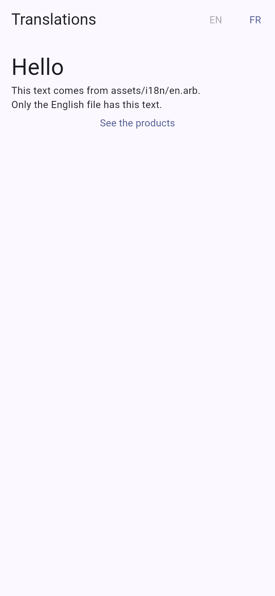
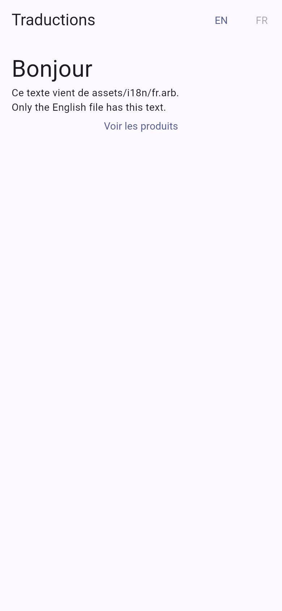
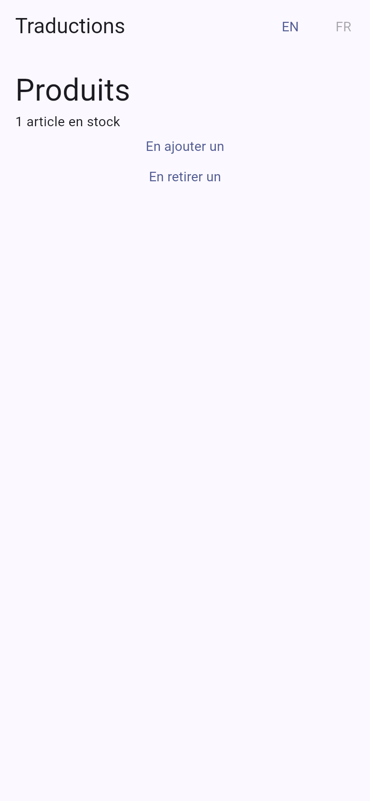

# i18n

Translated routes with [`fespalier_tolgee`](../../packages/fespalier_tolgee): the language comes
from the URL, the texts are bundled in the app, and nothing here touches the network. It pairs with
the [`fespalier-i18n`](../../skills/fespalier-i18n/SKILL.md) skill; the guide is
[i18n with Tolgee](../../docs/i18n-tolgee.md).

## Screenshots

| `/en`                                                                                                                                                                                                                   | `/fr`                                                                                                                                                  | `/fr/produits`                                                                                                                                       |
| ----------------------------------------------------------------------------------------------------------------------------------------------------------------------------------------------------------------------- | ------------------------------------------------------------------------------------------------------------------------------------------------------ | ---------------------------------------------------------------------------------------------------------------------------------------------------- |
|  |  |  |

A release web build in Chromium, 390 × 844 CSS pixels at 2× (`just example-screenshots i18n`).

## What it shows

Two screens, in two languages.

- **`/en` and `/fr`**: a home page. A `$lang` folder holds every page, and `Lang` is an enum, so
  `/xx` is not found. A button for each language in the `AppBar` (plain buttons, no dropdown) moves
  to the same page in the other language with `relocate`: `/en/products` becomes `/fr/produits`.
- **`/en/products` and `/fr/produits`**: a list with an ICU plural (`=0`, `one`, `other`) in one
  string, and the French spelling of the folder from a `route.dart` `paths`.

```text
assets/i18n/en.arb, fr.arb       the bundled catalogs (fr.arb lacks home.footer on purpose)
lib/
  lang.dart                      enum Lang { en, fr }
  app/
    startup.dart                 BundledTranslations.load(...) -> translationsConfig
    splash.dart                  shown while it reads, and the retry when a file is missing
    app.dart                     MaterialApp.router(routerConfig: TranslationScope.routerConfig(...))
    redirect.dart                /  ->  the device's language, else /en
    not_found.dart               /xx
    $lang/
      layout.dart                the AppBar with the language switch
      page.dart                  HomePage({required Lang lang})
      products/page.dart         ProductsPage: context.tr('products.stock', {'count': n})
      products/route.dart        const paths = {'fr': 'produits'}
test/i18n_test.dart              widget tests
```

Things to read in it:

- The first frame is translated: `startup()` reads the catalogs while `splash.dart` shows, so the
  app never paints a raw key.
- `app.dart` gives `MaterialApp.router` the scope's `routerConfig`, never the router, and the
  Material delegates (`GlobalMaterialLocalizations.delegates`).
- `fr.arb` has no `home.footer`: the French page shows the English text, not the key
  (`Translator.originOf` says `fallbackLocale`).
- No API key anywhere. `startup.dart` builds the app's one transport (`HttpClientTransport(http.Client())`,
  from `fespalier_http`) and gives it to `TolgeeCdn`, the `remote:` of `Translations`, but only when the build
  has `--dart-define=TOLGEE_CDN_URL=<the public Content Delivery URL of your Tolgee project>`. Without it
  nothing is fetched. The CDN takes no key.

## Run it

```sh
cd examples/i18n
flutter create --empty . --platforms=android,ios,web   # adds the platform folders, .gitignore and .metadata
flutter pub get
flutter run
```

On the web (`flutter run -d chrome`), put `/fr/produits` in the address bar.

## Test it

```sh
flutter analyze
dart format --set-exit-if-changed lib test
flutter test
```

The tests need no network. They open the app's own `App` with `pumpRouter(app: ...)` (the default
app has no `TranslationScope`, and `context.tr` would throw) over the real `assets/i18n/*.arb`
files, and use `FakeTranslations` from `package:fespalier_tolgee/testing.dart` as the over-the-air
source and `fakeTranslations(...)` for a strict catalog. They cover the first frame, a deep link in
French, a localized path, the language switch changing the URL and the text, ICU plurals, the
fallback to the English text, a fetched text and an offline source, `/xx` not found, and a key
missing from a catalog.
