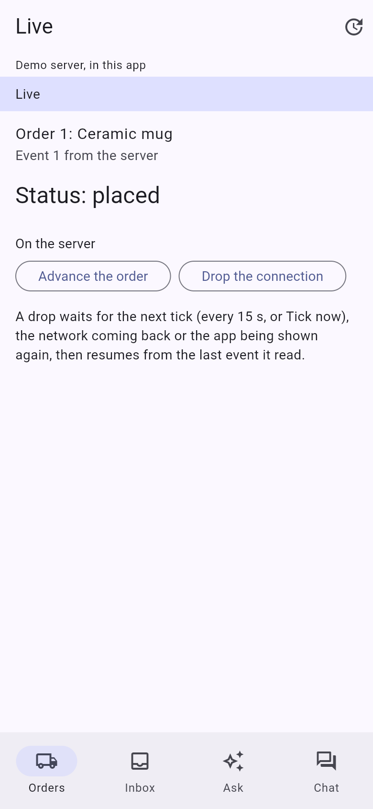
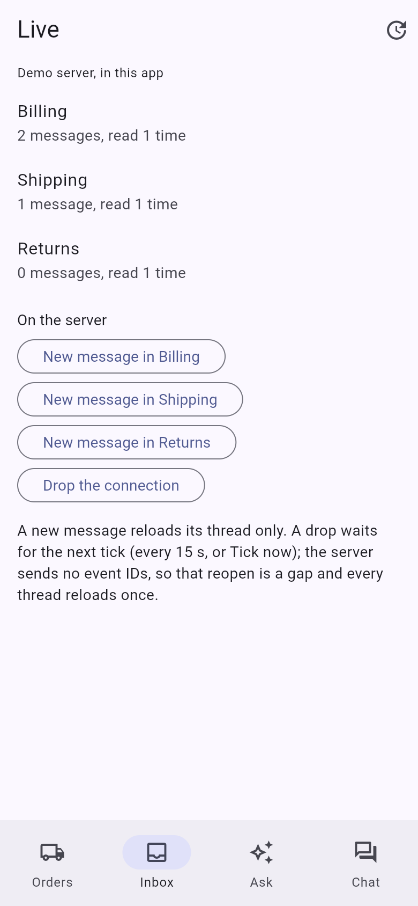
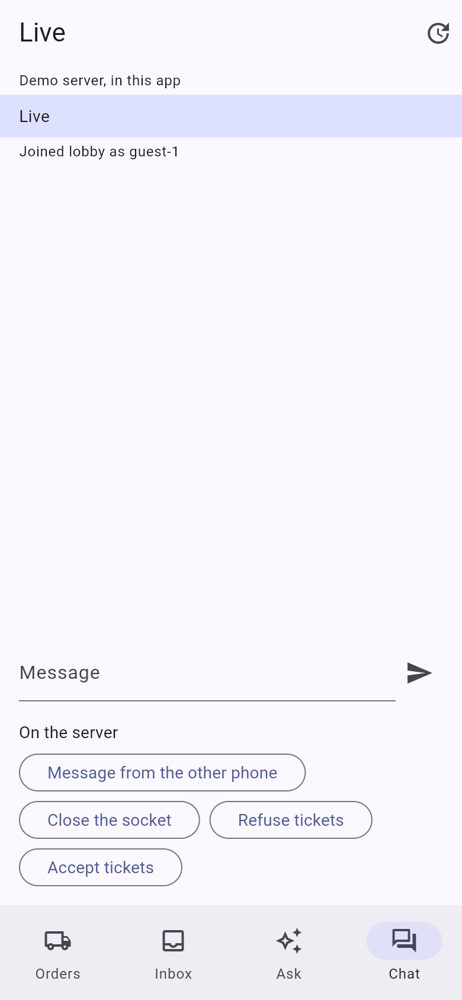

# live

Streaming with [`fespalier_stream`](../../packages/fespalier_stream) (since 0.25.0): four screens that each show one way a
server talks to the app while it is open, on an in-process demo server (so `flutter run` needs no backend) or on
[`tool/server.dart`](tool/server.dart), a small `dart:io` server you run on your computer for a test on a phone or in a
browser. The guide is [Streaming](../../docs/streaming.md).

- **Orders** (`/orders/:id`): an order followed by **server-sent events**. `lib/app/orders/$id/data.dart` is a selector
  over a `LiveFeedFamily` (one event stream per order watched, `lib/orders.dart`), and a banner shows the feed's
  `status`: connecting, live, paused while hidden, disconnected (waiting for the tick), stopped. **Advance the order**
  makes the server send the next status; **Drop the connection** breaks the stream: the feed waits for the next tick and
  resumes from the last event it read (`Last-Event-ID`). An order the server does not know is refused (404), which is
  `error.dart`'s and never retried.
- **Inbox** (`/inbox`): one **live change feed** (`ChangeFeed.live` over an event stream, `lib/inbox.dart`) whose topics
  reload the rows. A new message in one thread reloads that row only ("read N times" counts how often the server was
  asked). The server sends no event IDs, so a reopen after a drop is a **gap**: every row reloads once.
- **Ask** (`/ask`): a **streaming action**. `lib/app/ask/action.dart` returns a `Stream<String>` of the answer so far, read
  from a `POST /ask` whose body the server writes a word at a time (`lib/ask.dart`). **Stop** cancels the request and
  keeps what came; leaving the page cancels it too.
- **Chat** (`/chat`): a **WebSocket** held by a `LiveFeed` (`lib/chat.dart`). Before every connect it fetches a
  single-use ticket through the app's transport (`ticketGrantor`, `POST /ws-ticket`), and on every open it joins the
  room again (`onOpen`). The page sends through a `SocketHandle`. When the server refuses tickets, the chat stops trying
  and says you are signed out, until **Sign in again**.

Nothing reconnects on a timer of the package's: the app's own timer fires the tick every 15 seconds
(`lib/ticker.dart`), **Tick now** in the app bar fires it at once, and a feed that dropped also opens again when the
network comes back (`fespalier_connectivity`) or the app is shown again.

## Screenshots

| `/orders/1`                                                                                                                                                                                                                                | `/inbox`                                                                                                                                                                                                                                                         | `/chat`                                                                                                                                                                                                                                                                   |
| ------------------------------------------------------------------------------------------------------------------------------------------------------------------------------------------------------------------------------------------ | ---------------------------------------------------------------------------------------------------------------------------------------------------------------------------------------------------------------------------------------------------------------- | ------------------------------------------------------------------------------------------------------------------------------------------------------------------------------------------------------------------------------------------------------------------------- |
|  |  |  |

A release web build in Chromium, 390 × 844 CSS pixels at 2× (`just example-screenshots live`), on the demo server.

## Run it

```sh
cd examples/live
flutter create --empty . --platforms=android,ios,macos,linux,windows,web   # adds the platform folders; keep the ones you use
flutter pub get
flutter run
```

The example commits no platform folders, as the other examples do. With no `--dart-define`, the app talks to the demo
server inside it: the buttons under **On the server** are what the server does, and the app bar says **Demo server, in
this app**.

## Against a real server: tool/server.dart

The device tests below need a real network, so the app talks to `tool/server.dart` instead. It answers the same requests
as the demo server, and prints a line for every connection it opens or closes.

### Start the server

On your computer, in a terminal:

```sh
cd examples/live
dart run tool/server.dart                 # every interface, port 8080; --port 9000 for another
```

It prints the address to give the app from each place (this computer, the Android emulator, a phone on the same Wi-Fi):

```text
live server on port 8080. LIVE_ORIGIN for the app, from:
  this computer (desktop, Chrome): http://localhost:8080
  the Android emulator:            http://10.0.2.2:8080
  a phone on this network (en0): http://192.168.1.20:8080
```

Leave it running. Type a command and Enter in the same terminal to make the server do something while the app is away
from it (the app's **On the server** buttons do the same):

| Command     | What the server does                                                                            |
| ----------- | ----------------------------------------------------------------------------------------------- |
| `advance 1` | the next status of order 1, sent to every stream of it                                          |
| `post t1`   | a new message in thread `t1` (Billing; `t2` Shipping, `t3` Returns)                             |
| `other`     | a chat message from "other phone"                                                               |
| `kick`      | closes every chat socket (code 1001)                                                            |
| `drop`      | breaks every event stream, as a network that goes away does                                     |
| `refuse`    | **refuses tickets** from now on (`POST /ws-ticket` answers 401) and closes every chat with 4401 |
| `accept`    | accepts tickets again                                                                           |

`dart run tool/server.dart --refuse-tickets` starts it refusing. What each log line means:

| Line                                                                                          | Meaning                                                                      |
| --------------------------------------------------------------------------------------------- | ---------------------------------------------------------------------------- |
| `sse-open #3 order-1 last-event-id=2`                                                         | an event stream opened; `last-event-id` when the app resumed from that event |
| `sse-closed #3 order-1 (the client left)`                                                     | the app closed it (a page left, a tick that closed a hidden page's stream)   |
| `ticket tk-2`, `ticket-refused`                                                               | a ticket was handed out, or refused                                          |
| `ws-open #2 ticket=tk-2`                                                                      | the chat's socket opened with that ticket                                    |
| `ws-closed #2 code=1000 (client)`                                                             | the socket closed, with its code, and which side closed it                   |
| `ws-refused ticket=tk-2`                                                                      | a socket came with a ticket that was used already or too old (30 s)          |
| `ask-open #5`, `ask-ended #5 after 36 words`, `ask-closed #5 after 4 words (the client left)` | an answer started, finished, or was cancelled by the app                     |

### Security

The server listens on every interface (`0.0.0.0`) and answers every origin (`access-control-allow-origin: *`). Anyone
on the network, and any web page open in your browser while it runs, can reach it, including the endpoints that control
it (`/admin/refuse-tickets`, `/chat/kick`, the drops). It has no login and keeps nothing worth stealing, but run it only on
a network you trust, and stop it (Ctrl+C) when the test is over. `--host 127.0.0.1` listens on this computer only (a
phone cannot then reach it).

A client that resets its connection (a phone back from airplane mode, a paused feed that the tick closed) is normal here:
the server logs the close, lets go of the socket and keeps serving.

### Point the app at it

Every command below adds `--dart-define=LIVE_ORIGIN=<the address the server printed>`. The app bar then says
**Server http://..., through dio**. `--dart-define=LIVE_CLIENT=http` sends through `package:http` instead of Dio (in a
web build: `BrowserClient` instead of Dio's fetch adapter); test both if you can.

- **Desktop** (on the same computer): `flutter run -d macos --dart-define=LIVE_ORIGIN=http://localhost:8080`, or with
  `-d linux` or `-d windows`. On macOS, first add `<key>com.apple.security.network.client</key><true/>` to
  `macos/Runner/DebugProfile.entitlements` and `macos/Runner/Release.entitlements`, or nothing connects.
- **Chrome**: `flutter run -d chrome --dart-define=LIVE_ORIGIN=http://localhost:8080`. The server allows every origin
  (CORS), so the page may come from Flutter's own server. Add `--wasm` for the wasm build.
- **Android**: `flutter run -d <device id> --dart-define=LIVE_ORIGIN=<the address the server printed>` (the
  emulator: `http://10.0.2.2:8080`). The phone must be on the same Wi-Fi as the computer, and the computer's firewall
  must let port 8080 in. The server speaks plain `http:` and `ws:`, and Android 9 and later refuse cleartext traffic
  unless the app allows it: add `android:usesCleartextTraffic="true"` to the `<application>` tag of
  `android/app/src/main/AndroidManifest.xml`, so that no platform policy refuses it (whether the policy reaches
  `dart:io`'s sockets, which the app uses, is UNCHECKED: say in your report if it worked without the line). A debug build has the `INTERNET` permission; for `--profile` or
  `--release`, also add `<uses-permission android:name="android.permission.INTERNET" />` inside `<manifest>`.
- **iPhone**: `flutter run -d <device id> --dart-define=LIVE_ORIGIN=<the address the server printed>`, on the same
  Wi-Fi. The first time the app reaches your computer, iOS asks whether it may find devices on your local network: allow
  it (to change it later: Settings > Privacy & Security > Local Network). If it never asks and stays on **Connecting**,
  add to `ios/Runner/Info.plist` the key `NSLocalNetworkUsageDescription` (a sentence such as "Talks to the test
  server") and `NSAppTransportSecurity` with `NSAllowsLocalNetworking` set to `YES`, run again, and say so in your
  report.
- **Safari on a Mac, an iPhone or an iPad**: Flutter's own web server is not reachable from a phone, so let
  `tool/server.dart` serve the web build itself, from the same address:

  ```sh
  flutter build web --release --no-web-resources-cdn --dart-define=LIVE_ORIGIN=<the address the server printed>
  dart run tool/server.dart --web build/web
  ```

  Open that same address in Safari. For the wasm build add `--wasm` to `flutter build web` (Safari
  18.2 or later). For `package:http`, add `--dart-define=LIVE_CLIENT=http`. Build again for each, and stop and start the
  server after each build.

For the cases that leave the app in the background, use a profile build (`flutter run --profile ...`): a debug build
attached to the debugger is not suspended the way an app a person uses is.

## Test it on a device

These are the manual tests no CI job can run: each is **UNCHECKED** until someone reports it. You need no knowledge of
fespalier, and you write no code. Start the server and the app as above, and keep the server's terminal in view: its
lines are what to copy into the report.

### WebSocket chat on a phone ([#324](https://github.com/fespalier/fespalier/issues/324), part 2)

Open **Chat** on an Android phone or an iPhone. The banner says **Live**, the chat shows `Joined lobby as guest-1`, and
the server logs `ticket tk-1` then `ws-open #1 ticket=tk-1`.

1. **Messages both ways.** Send three messages. _Expected:_ each appears as `you: ...`, in order. Type `other` in the
   server's terminal. _Expected:_ `other phone: Hello from the other phone (1)` appears. With a second device (another
   phone, or Chrome on the computer) on the chat, a message from one shows on the other as `guest-<n>: ...`.
2. **The app in the background.** Switch to another app for 30 seconds, come back; then for 5 minutes, and come back.
   _Expected:_ the chat works again within a minute of coming back (at once when the app saw the socket close). When the
   socket died without a word, the app notices only that the server's pings stopped: after 45 seconds of silence a
   15-second tick closes it and the next tick opens it, so up to about 75 seconds after it died. Say how long it took. If the socket was closed meanwhile, the server logs a `ws-closed` line, then a **new** ticket and
   `ws-open #<n> ticket=tk-<n>`, and the chat shows `Joined lobby as guest-<n>` again (it subscribed again). Say whether
   the socket survived each wait (no new `ws-open`) or not.
3. **A network change.** Turn airplane mode on for 30 seconds, then off (or Wi-Fi off and on). _Expected:_ the banner
   says **Disconnected**, then **Live** again soon after the network is back, with a new ticket and a new `Joined lobby`
   line, as in case 2. (Wi-Fi to mobile data only works with a server reachable from the internet; if you have one, say
   so.)
4. **The server restarts.** Stop the server (Ctrl+C) and start it again. _Expected:_ the banner says **Disconnected**;
   within 15 seconds (the app's next tick) the chat is **Live** again, with `ticket tk-1` and `ws-open #1 ticket=tk-1` in
   the new server's log (it counts from 1 again).
5. **A refused ticket.** Type `refuse` in the server's terminal (or tap **Refuse tickets**). _Expected:_ the server logs
   `ws-closed #<n> code=4401 (server)`; within 15 seconds it logs one `ticket-refused` and the app shows **You are signed
   out of the chat** with **The server refused a ticket (401).** Wait a minute: _expected:_ **no** further
   `ticket-refused` line, the app does not retry for ever. Type `accept`, tap **Sign in again**: _expected:_ a new ticket,
   and the chat is back.

### Event streams on a phone ([#325](https://github.com/fespalier/fespalier/issues/325))

Open **Orders**, then **Order 1**. The banner says **Live** and the server logs `sse-open #<n> order-1`.

1. **Events as they happen.** Type `advance 1` in the server's terminal. _Expected:_ **Status** moves to `packed` at once.
2. **The app in the background.** Switch to another app for 30 seconds; while it is away, type `advance 1`. Come back.
   Then the same for 5 minutes. _Expected:_ within a minute of coming back (up to about 75 seconds when the stream died without a word, as in the chat's
   case 2; say how long) the status shows the new value,
   and if the stream was closed meanwhile, the server logs `sse-open #<n> order-1 last-event-id=<k>`: the app asked for
   what it missed. Say whether the stream survived each wait (no new `sse-open`).
3. **A network change.** Airplane mode on for 30 seconds, `advance 1` meanwhile, then off. _Expected:_ **Disconnected**,
   then **Live, resumed from the last event** with the new status.
4. **The server restarts.** Ctrl+C and start the server again. _Expected:_ **Disconnected**, then within 15 seconds
   **Live, resumed from the last event** (the banner says resumed because the app asked from its last event ID), with the
   order's real state on the new server: it starts over at `placed`, so the status may go _back_. That is harmless
   here: every event carries the whole order, and the new server's IDs start again at 1. A real server must keep its
   event IDs across a restart, or send none, or a client that resumes from an ID of the earlier run misses events without
   knowing ([Streaming](../../docs/streaming.md), "Gaps").
5. **A gap.** Open **Inbox** and type `drop`. _Expected:_ within 15 seconds every row's "read N times" goes up by one
   (the reopen is a gap, so every thread is read again), and `post t1` afterwards moves the Billing row only.

### A streaming action on a phone ([#322](https://github.com/fespalier/fespalier/issues/322))

Issue #322 runs `examples/features`' draft; **Ask** is the same over a real network. Open **Ask** and tap **Ask**.

1. _Expected:_ the answer grows a word at a time; the server logs `ask-open` and, at the end,
   `ask-ended #<n> after <k> words`.
2. Tap **Ask**, then **Stop** before it ends. _Expected:_ the text so far stays, **Stopped after N words**, and the server
   logs `ask-closed #<n> after <k> words (the client left)` at once.
3. Tap **Ask**, then switch to **Orders** before it ends. _Expected:_ the same `ask-closed` line.
4. With the keyboard up in the question field, and with TalkBack or VoiceOver on: is the growing answer readable, and
   can you reach **Stop**?

### Safari ([#316](https://github.com/fespalier/fespalier/issues/316))

Issue #316's harness checks the transports alone; this is the app on top of them (`ServerEvents` with its errors, the change
feed, the streaming action and the socket). Serve the web build as in "Safari on a Mac, an iPhone or an iPad" above, once
for each of the four builds (JavaScript and wasm, `dio` and `http`), and in each:

1. **Order 1**, then `advance 1` in the terminal. _Expected:_ the status moves at once, not when the stream ends.
2. **Ask**. _Expected:_ the words appear one by one, not all at the end.
3. Tap **Ask**, and close the tab before it ends. _Expected:_ `ask-closed ... (the client left)` in the server's log at
   once, and an `sse-closed` line for each event stream the page had open (the inbox's, once visited).
4. **Chat**: the chat cases 1, 4 and 5 above.

### What to report

Comment on the issue with:

- the device and OS version (or the Mac and Safari version), the network, `flutter --version`, and the commit
  (`git rev-parse HEAD`);
- the build: debug or profile, JavaScript or wasm, `LIVE_CLIENT` (`dio` or `http`);
- for each case: what you did, what the banner and the page said, and the server's lines from that moment. Say whether
  it was what the case expects.

## How it is built

```text
lib/
  main.dart              AppMain.run()
  wiring.dart            LIVE_ORIGIN and LIVE_CLIENT: the demo server, or DioTransport (webStreamingAdapter()) or
                         HttpClientTransport, and WebSocketConnector
  ticker.dart            AppStreamTicker: the app's 15 s timer that fires streamTicker
  orders.dart            orderLive, a LiveFeedFamily of ServerEvents
  inbox.dart             inboxChanges (ChangeFeed.live), threadChanged (a topic), thread (a row's provider)
  ask.dart               streamAnswer: a POST whose body is read as it comes, aborted on cancel
  chat.dart              chat (a LiveFeed of a SocketConnection made in its builder), chatSocket (SocketHandle),
                         chatSession (Sign in again)
  widgets.dart           the status banner and the server's buttons
  demo/live_server.dart  the in-process server: an HttpTransport and a SocketConnector
  demo/script.dart       what both servers serve (pure Dart)
  app/
    app.dart, startup.dart, layout.dart, redirect.dart
    orders/page.dart, orders/$id/{data,page,loading,error}.dart
    inbox/{data,page}.dart
    ask/{action,page}.dart
    chat/page.dart
tool/server.dart         the same routes over dart:io, for a real network
```

- **One transport.** Every request, event stream and ticket goes through `liveTransport`; a real app wraps it in its
  session and its other decorators, which then see the streams too. On the web the client at the bottom must stream a
  body: Dio with `webStreamingAdapter()` (the fetch adapter in a web build, Dio's default elsewhere), or
  `package:http`'s `Client` (`BrowserClient` on the web). The Dio leaves `receiveTimeout` unset, or Dio would drop a
  quiet stream.
- **The tick is the app's.** `AppStreamTicker` fires `streamTicker` every 15 seconds and stops only when it is disposed,
  not when every page is hidden: closing the streams of hidden pages is what it is for. `startup.dart` also overrides
  `reconnectSignal` with `fespalier_connectivity`'s `ConnectivitySignal`, and every feed reconnects on it and on
  `appShowSignal`. Against `tool/server.dart` the feeds also have `LiveRules.idle` (45 s): the server sends a comment on
  each event stream every 15 s and a ping message on the chat every 20 s, so a connection a NAT or a sleeping radio lost
  is closed on a tick and opened again. The demo server sends neither, and gets no `idle`.
- **The chat's connection is made in the feed's builder.** A `SocketConnection` is single-use: the feed closes it when
  its build ends, so the page sends through `chatSocket`, a `SocketHandle` the builder attaches each connection to. The
  builder watches `chatSession`, so **Sign in again** replaces a refused connection with a new one. Only the ticket
  endpoint's 4xx ends the connection (`SocketTicketRefused`, a `DataRefusal`); a socket closed with 4401 waits and asks
  for a ticket on the next tick, which is how "refuse" reaches the app.
- **The demo server emits only when asked**, or a bounded answer, so every screen settles for the screenshots, and the
  tests run on the test's clock.

### Tests

```sh
flutter test
```

The widget tests boot the app over the demo server, with `ManualStreamTicker` for the tick: an order that follows the
server, a drop that resumes with `Last-Event-ID` on the tick, a page watched again that resumes from the ID the feed kept
(`FakeEventServer`), a refused order; a change that reloads one row and a gap that reloads all; an answer that grows, a
**Stop** and a page left that cancel the request at the server, an empty question never sent; the chat's ticket, the
room joined again after a close, a refused ticket that signs out and stops trying, and the socket's URL and first message
over `FakeSocketConnector`. `test/server_test.dart` starts `tool/server.dart` on a free port and runs the app's feeds
against it over Dio, `package:http` and `WebSocketConnector`, on the VM.
