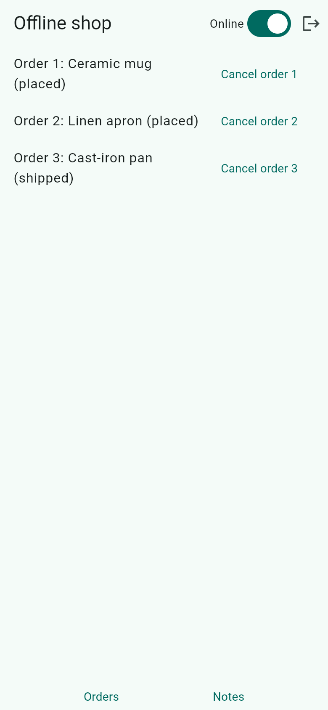
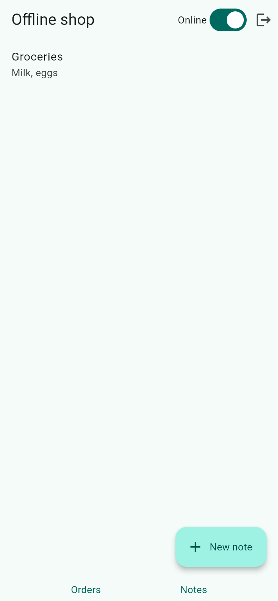
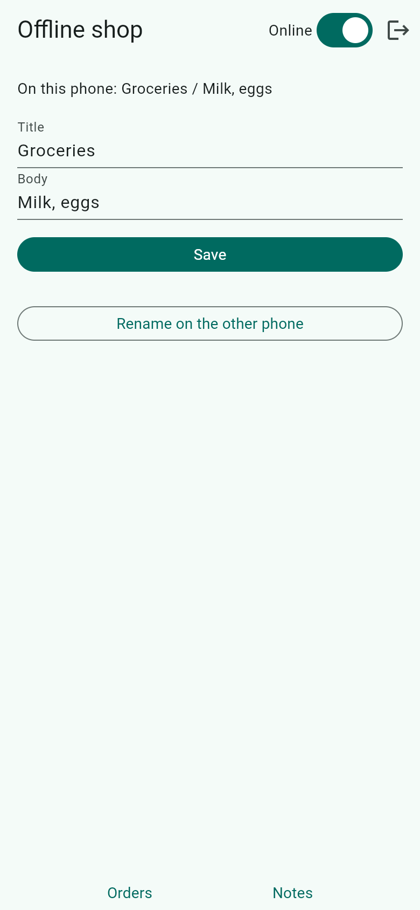

# offline

A fespalier example for [`fespalier_cratestack`](../../packages/fespalier_cratestack) (since 0.10.0): an app that
keeps working without a network. There are two screens and a switch in the app bar that plays the device's network.
The server is an in-process demo (`lib/demo/demo_server.dart`), so `flutter run` needs no backend; the tests use the
package's own fakes.

- **Orders** (`/orders`): a list read with `ref.serve` and the default `networkFirst` policy (`lib/app/orders/data.dart`).
  Switch the network off and the list is the copy this phone last loaded, with its time ("Offline copy, as of 10:42"),
  or "not loaded on this phone yet" when there is none. Cancelling an order is a decision only the server makes, so it
  is an **intent** (`lib/app/orders/action.dart`): saved, sent once under the key `<id>#<attempt>`, and answered
  `Queued` ("Cancelling, will send when back online") while there is no network. Switch the network on and the queue
  drains. Order 3 is already shipped: the server refuses it, the refusal is shown and never retried, and a refusal that
  arrives after the wait is kept as "Not sent" until you discard it.
- **Notes** (`/notes`): rows this device **owns** (`OwnedRows`), edited offline and merged with the server's copy
  field by field (`lib/app/notes/`, `lib/note_sync.dart`). Edit a note's body offline, press "Rename on the other
  phone" (the demo server edits the title with a later stamp), and switch the network on: the page shows both edits. A
  title over 60 characters is refused by the server, and the phone rolls the edit back and says so.
- **A push from the server** (since 0.25.0): the demo server has a subscription shaped like CrateStack's `@@subscribe`
  (`GET /rpc/subscribe/model.Note.subscribe`, an event per change, no event id, no heartbeat), which
  `lib/server_changes.dart` reads with `crateStackEvents` into a `ChangeFeed.live` and gives `autoSync` as its
  `syncPushSignal`. With the network on, "Rename on the other phone" reaches the open note at once: the event makes the
  app sync, and the page shows the row the sync pulled, never the event's data. The switch plays the phone's requests: a
  subscription already open stays open when it goes off (a real network loss would break it), and one that failed opens
  again on `reconnectSignal`.
- **Sign out** wipes the account's queue, rows and saved reads before the session ends (`lib/session.dart`).

`lib/app/layout.dart` watches `autoSync` once, so a sync runs at start, on resume, on reconnect (the switch fires
`reconnectSignal`; a device would use `fespalier_connectivity`), on the app's tick (`lib/foreground_ticker.dart`, a
timer the app owns: the package starts none) and on a push from the server's subscription (`lib/server_changes.dart`). `lib/wiring.dart` is the whole connection to the package: the transport
behind the switch (which fails with a `TransportUnsent` while it is off, as a real transport does), the error readers
(`lib/errors.dart`: the app's own, then `TransportFailures.read`), the account as `crateStackScope`, and the `RowSync`.

The queue is in memory here, so a queued change is lost when the app exits. A device build overrides `localStore` with
`HiveLocalStore` (`package:fespalier_cratestack/hive.dart`) so it survives; see the
[wiring page](../../skills/fespalier-cratestack/references/wiring.md) of the `fespalier-cratestack` skill.

## Screenshots

| `/orders`                                                                                                                                                                                            | `/notes`                                                                                                         | `/notes/n1`                                                                                                                                                                         |
| ---------------------------------------------------------------------------------------------------------------------------------------------------------------------------------------------------- | ---------------------------------------------------------------------------------------------------------------- | ----------------------------------------------------------------------------------------------------------------------------------------------------------------------------------- |
|  |  |  |

A release web build in Chromium, 390 × 844 CSS pixels at 2× (`just example-screenshots offline`).

## Skills

Read it with [`fespalier-offline`](../../skills/fespalier-offline/SKILL.md) (what a write is, `serve`, intents, owned
rows, the triggers, testing) and [`fespalier-cratestack`](../../skills/fespalier-cratestack/SKILL.md) (the transport and
error-reader seams, `startup()`, the sign-out). [`examples/cose`](../cose/README.md) shows a real CrateStack server with
signed requests; this one is the same wiring with no server to start.

## Run it

```sh
cd examples/offline
flutter create --empty . --platforms=android,ios,web   # adds the platform folders, .gitignore and .metadata
flutter pub get
flutter run -d chrome   # or any device
```

Flip the "Online" switch, press **Cancel order 1**, flip it back. Nothing here needs a network, a server or Docker.

## Tests

`test/` uses `FakeCrateStackTransport` (it plays the server's idempotency layer), `FakeRowServer`,
`ManualSyncTicker` and no timer at all (`test/support.dart` wires them over the app's own `appWiring()`):

- `orders_test.dart`: a read served from the copy while offline, `neverFetched`, a 403 that is never answered from the
  copy; a cancel queued offline and sent once when the network is back (same key, whatever triggers follow); a lost
  answer replayed under the same key and run once; a refusal on the spot and one after the wait, neither retried;
  the sign-out wipe.
- `notes_test.dart`: an edit saved offline and pushed on reconnect; two phones editing different fields (both kept) and
  the same field (the greater stamp wins, on both); a refused row rolled back out loud; the app's tick pushing an edit
  nothing else would; the app's timer.
- `demo_test.dart`: the same flows over the real demo server, with nothing scripted.
- `push_test.dart`: a rename on the server reaching the open note by push, over the demo server; and over
  `fespalier_stream`'s `FakeEventServer`, an event that makes the app pull the row (not show the event's data) and a
  lag that reopens the subscription and syncs again.
