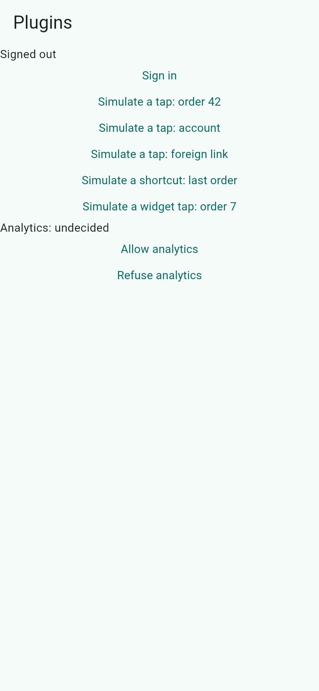
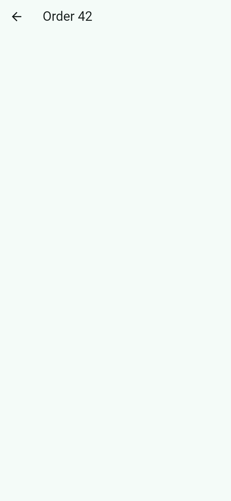
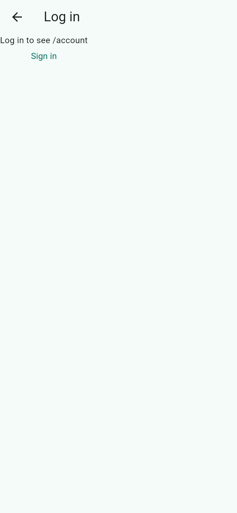

# plugins

The companion packages, plugged in the way an app plugs them in: `fespalier: adapters:` in the pubspec, and a
`main()` that configures each one before `AppMain.run()`. A notification tap opens a typed route
([`fespalier_push`](../../packages/fespalier_push)), so do a home-screen shortcut and a widget tap
([`fespalier_launch`](../../packages/fespalier_launch)), and a screen view is reported only with the person's consent
([`fespalier_analytics`](../../packages/fespalier_analytics)). The platform sources are fakes, so the app runs with no
push service, store or launcher. [Run the examples](../../docs/examples.md#plugins) has the rest.

## Screenshots

| `/`                                                                                                                                                                                                                                                                             | `/orders/42`                                                                                                                                | `/account`, signed out                                                                                                                                                         |
| ------------------------------------------------------------------------------------------------------------------------------------------------------------------------------------------------------------------------------------------------------------------------------- | ------------------------------------------------------------------------------------------------------------------------------------------- | ------------------------------------------------------------------------------------------------------------------------------------------------------------------------------ |
|  |  |  |

A release web build in Chromium, 390 × 844 CSS pixels at 2× (`just example-screenshots plugins`).

## Run it

```sh
cd examples/plugins
flutter create . --platforms=android,ios,web   # adds platform folders only
flutter pub get
flutter run
```

The buttons on the home page stand in for the system: a tap on a notification, a shortcut and a widget tap. Nothing
here runs on a device. The real sources are recipes in the skills
([`push-sources.md`](../../skills/fespalier-routing/references/push-sources.md),
[`launch-sources.md`](../../skills/fespalier-routing/references/launch-sources.md)).

## Things to try

- **Simulate a tap: order 42** opens `/orders/42`, which no guard covers.
- **Simulate a tap: account**, signed out, opens `/login?from=/account`; **Sign in** there returns you to `/account`.
- **Simulate a tap: foreign link** navigates nowhere: a link to another host is refused.
- **Simulate a shortcut: last order** opens order 42, and **Simulate a widget tap: order 7** opens `/orders/7`.
- **Allow analytics** and **Refuse analytics** set the consent. The analytics backend here only records what it would
  send; nothing leaves the app, and nothing is recorded while the consent is undecided or refused.

## Test it

```sh
flutter analyze
flutter test
```

Most of the tests run the app through `AppMain.root()` with these fakes, and read the telemetry and the analytics
recorder for what each tap, shortcut and consent did. `test/navigation_test.dart` drives the router directly.
