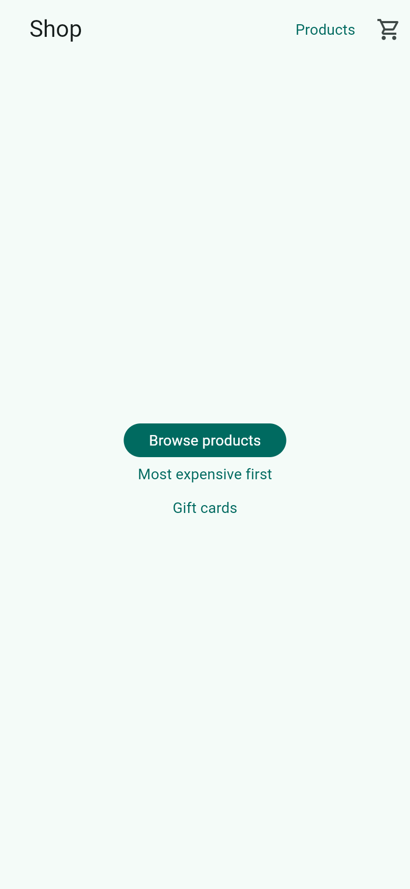
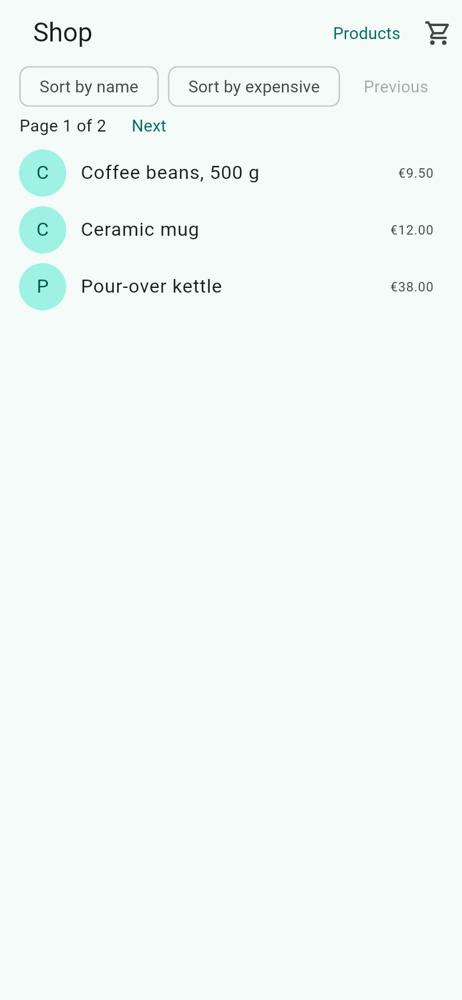
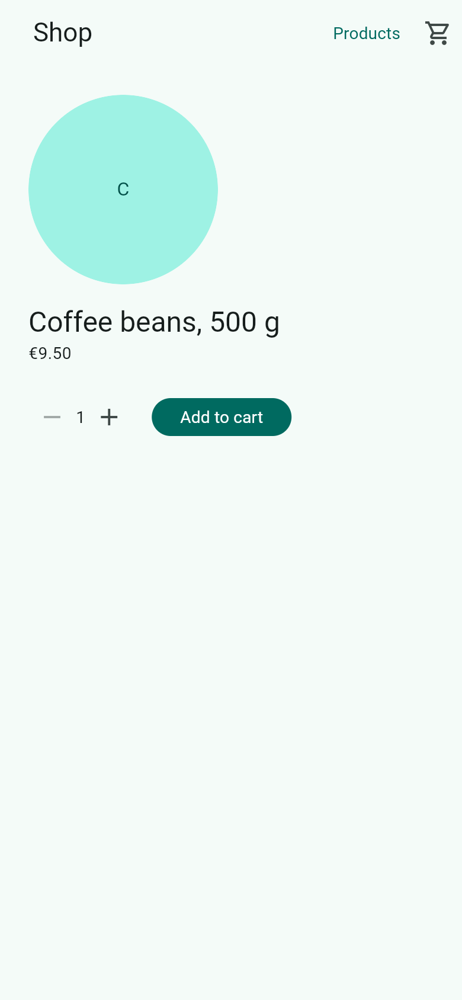

# shop

A small shop on fespalier: a product list whose sort and page are query parameters, a product page that is a
deferred chunk on the web and loads its own data (`data.dart`, with `error.dart` and **Retry**), a cart, and a
checkout behind a guard. Its pages wear `Semantics(identifier:)` (`semantics_ids: true`), so its Maestro flows
(`.maestro/routes/`) and route smoke tests (`test/routes/`) are written by `fsp maestro` and `fsp test`. More in
[Run the examples](../../docs/examples.md#shop).

## Screenshots

| `/`                                                                                | `/products`                                                                          | `/products/1`                                                                        |
| ---------------------------------------------------------------------------------- | ------------------------------------------------------------------------------------ | ------------------------------------------------------------------------------------ |
|  |  |  |

A release web build in Chromium, 390 × 844 CSS pixels at 2× (`just example-screenshots shop`).

## Run it

```sh
cd examples/shop
flutter create . --platforms=android,ios,web   # adds platform folders only
flutter pub get
flutter run
```

The product photos come from an [EmgR](https://github.com/vaam-apps/image-resizer) on this computer, unsigned.
`lib/images.dart` says how to run it. Without a server each photo fails and shows the product's initial.

## Things to try

- `/products?sort=expensive&page=2`: the sort and the page are in the URL, so the link can be sent, and back and
  forward move between the views.
- `/products/13` fails once, so you see `error.dart` and **Retry**.
- `/products/abc`: the int parse fails, so you get `not_found.dart`.
- `/checkout` with an empty cart: the guard redirects to `/cart`.
- `/greet/you`.
- Hover a row on the web: its product page's photo is loaded before you click.

## Test it

```sh
flutter analyze
flutter test
flutter test test/routes   # fsp test's smoke test of every route, with the accessibility checks
```
