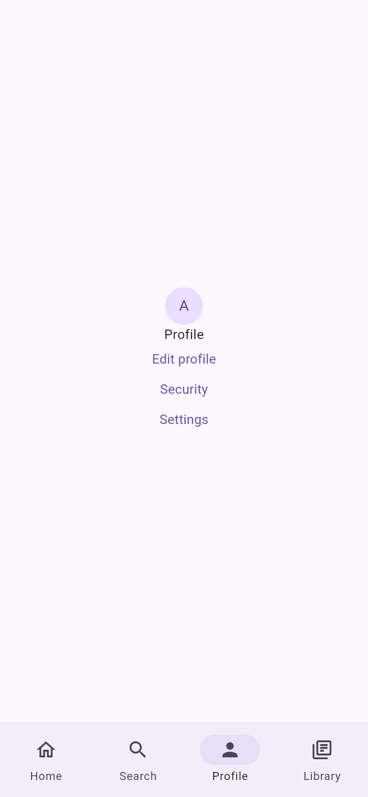
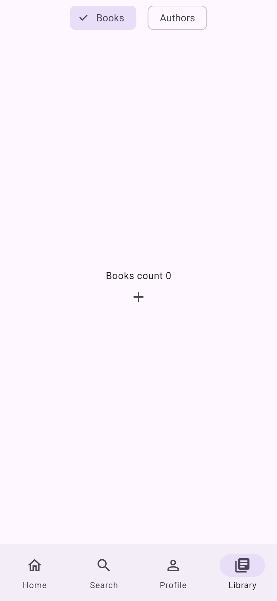
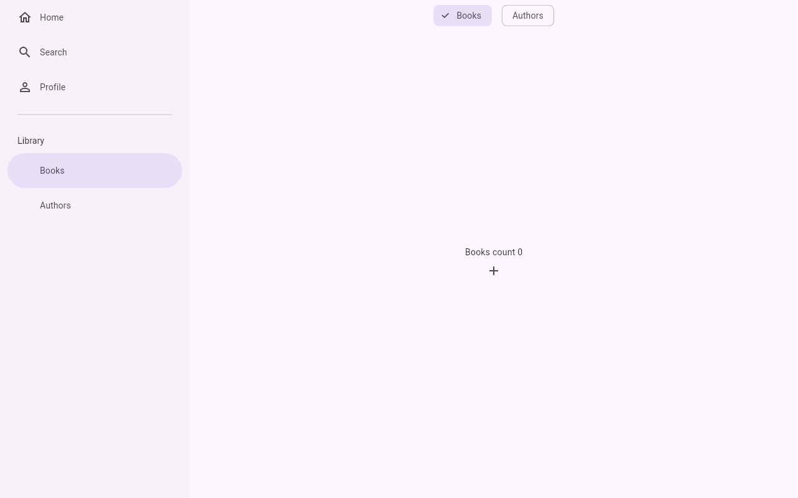

# tabs

A bottom navigation bar built as a tab layout: four tabs, one of them with nested pages, and a Library tab that is a
tab layout of its own. [`fespalier_adaptive`](../../packages/fespalier_adaptive) draws the bar as a bar, a rail or a
drawer by window width, and each tab keeps its state when you leave it. Two pages leave the tabs: a full-screen
settings page, and an edit page that covers the bar but stays under `/profile` in the URL. [Run the examples](../../docs/examples.md#tabs)
has the rest.

## Screenshots

| `/profile`                                                                                                                                                                                                                 | `/library/books`                                                                                                                                                                              |
| -------------------------------------------------------------------------------------------------------------------------------------------------------------------------------------------------------------------------- | --------------------------------------------------------------------------------------------------------------------------------------------------------------------------------------------- |
|  |  |



A release web build in Chromium: the phone shots are 390 × 844 CSS pixels at 2×, the wide one 1280 × 800 at 1×
(`just example-screenshots tabs`).

## Run it

```sh
cd examples/tabs
flutter create --empty . --platforms=android,ios,web   # adds the platform folders, .gitignore and .metadata
flutter pub get
flutter run
```

## Things to try

- Library opens on Authors: tap **Books**, press **+**, then switch to Home and back. The count is still there,
  because the tab kept its state.
- Tap the tab you are on: it goes back to its first page.
- `/recherche` opens the Search tab under its French spelling (the same route as `/search`).
- `/settings` covers the whole screen, with no bar. `/profile/edit` covers the bar too, and the URL still starts
  with `/profile`.
- Resize the window (or open the page on a wide screen): from 840 pixels the bar becomes a rail, and from 1200 pixels
  a drawer. The tab you are on keeps its state through the change.

## Test it

```sh
flutter analyze
flutter test
```

`test/adaptive_test.dart` resizes the window across the breakpoints, and `test/tabs_test.dart` checks that a tab keeps
its state.
