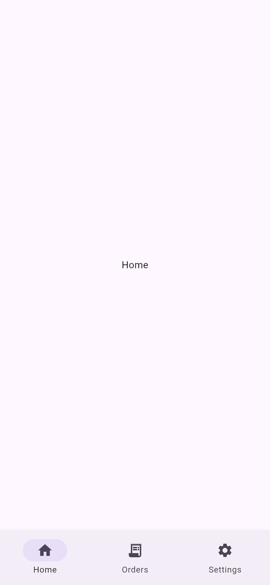
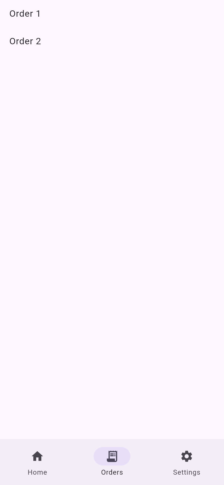
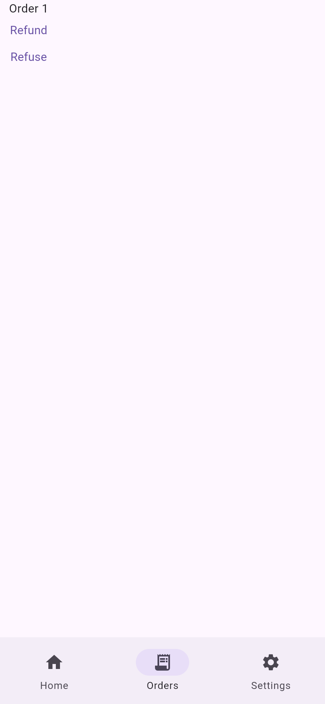
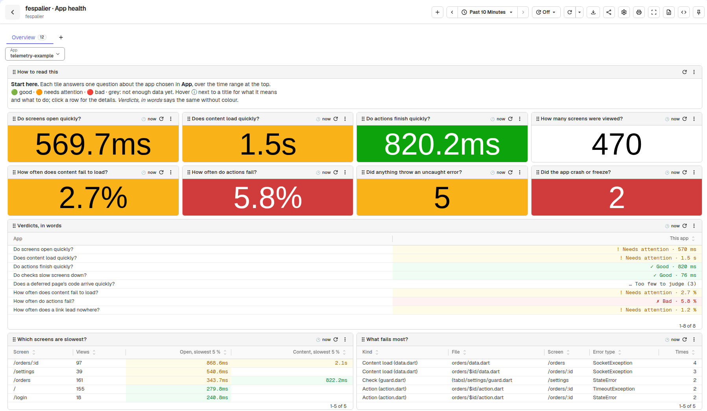

# telemetry

A fespalier example for the route lifecycle (`observe.dart`), for OpenTelemetry through
[`otel_zone`](https://github.com/vaam-apps/flutter-otel-zone) and `package:fespalier_otel`
(both since 0.8.1) and, since 0.9.0, for errors in Sentry through `package:fespalier_sentry`. Three tabs
(home, orders, settings), an order page with a `data.dart`, an `action.dart` (a refund that can be
refused) and its own `observe.dart`, a guarded and deferred settings page, and a login page.

- `lib/app/observe.dart` and `lib/app/(tabs)/orders/$id/observe.dart` write the screens they see
  into `lib/analytics.dart`; `test/lifecycle_test.dart` reads them.
- `pubspec.yaml` has `fespalier: telemetry: true`, so the generated `lib/app.g.dart` tells
  fespalier where each guard, data provider, action and deferred page is.
- `lib/main.dart` starts Sentry (`SentryFlutter.init`, with `FespalierSentry.configure`) and, inside its
  `appRunner`, `otel_zone` and both sinks in the one slot
  (`FespalierTelemetry.combine([FespalierSentry(), FespalierOtel(...)])`). It stays a hand-written
  `main()`; a generated entrypoint (`zone()` in `lib/app/startup.dart`) can take its place. Sentry is the
  outermost zone, so `OtelZone.runGuarded` is not used (it would hide uncaught async errors from Sentry).
  `SENTRY_DSN` is empty by default: nothing is sent; run it with
  `--dart-define=SENTRY_DSN=...` for events in your project. A failure while the app starts arrives
  through `FlutterError.reportError`.
- `FespalierOtel(onScreen: observability.setCrashScreen)` (since 0.19.0) names the page the app shows
  for every navigation, so a native crash record carries `otel_zone.crashed.screen`, and the Errors
  dashboard has a table of crashes by screen. It needs `otel_zone` v0.7.0 or later (the pin in
  `pubspec.yaml`), and the platform's limits are in otel_zone's README, "Which screen it died on".
- `test/telemetry_test.dart` runs the app on the SDK's in-memory exporter and reads the spans:
  a navigation with its guard, data load and page events as children and events, an action, and a
  deferred load.
- `test/sentry_test.dart` runs it on a real Sentry hub whose transport keeps what it would send
  (`RecordingSentry`), next to the same in-memory exporter: the `Refuse` button's action is an event tagged
  with its route, its file and its name, and with the trace id of the OpenTelemetry span of the same call;
  a crash after opening an order says which screen it happened on; a page change is a breadcrumb; with
  `tracing: true` opening an order is a `ui.load` transaction with its data load.

## Screenshots

| `/`                                                                                                                                                                                                        | `/orders`                                                                                            | `/orders/1`                                                                                                                                                            |
| ---------------------------------------------------------------------------------------------------------------------------------------------------------------------------------------------------------- | ---------------------------------------------------------------------------------------------------- | ---------------------------------------------------------------------------------------------------------------------------------------------------------------------- |
|  |  |  |

A release web build in Chromium, 390 × 844 CSS pixels at 2× (`just example-screenshots telemetry`).

## See it

```sh
cd examples/telemetry
flutter create --empty . --platforms=android,ios,web   # adds the platform folders, .gitignore and .metadata
flutter pub get
git checkout analysis_options.yaml   # pub get added the platform folders to analyzer: exclude:; this takes that back
fsp telemetry          # starts the stack and prints the addresses
flutter run -d chrome  # open the app's routes a few times
```

Open `http://localhost:5080` (`dev@fespalier.local` / `Fespalier-local-1`), then Dashboards, folder
`fespalier`, **fespalier · App health**: one tile per question, green, amber or red (grey until 20
samples are in). `fsp telemetry --report` prints the same answers in the terminal.



_Sample data from `scripts/telemetry/seed.py --showcase`._

It resolves go_router 18 like the other examples: since `otel_zone` moved to the dartastic rc.4 line,
its `otel_go_router` accepts go_router 17 and 18 (the pin in `pubspec.yaml` is the commit of its v0.8.1).
