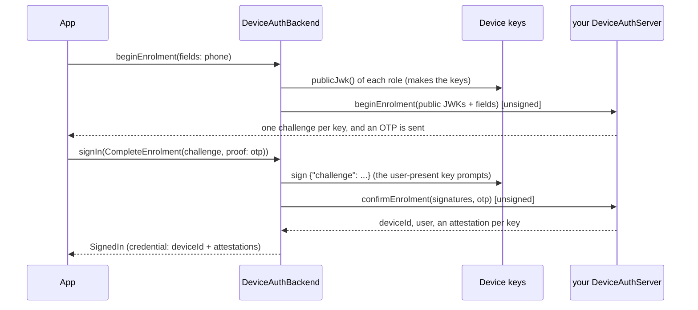
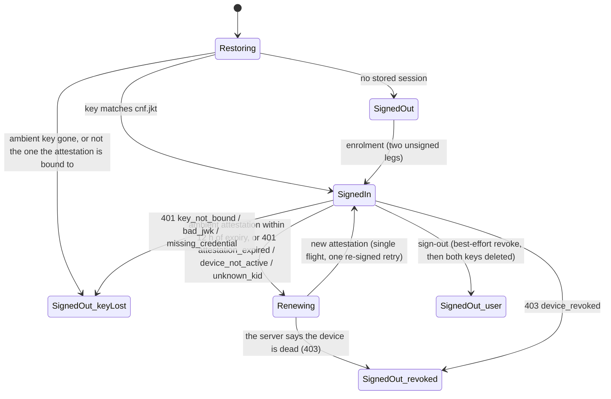

# fespalier_sign_keypair

**Token-free device-signed sessions** for [`fespalier_auth`](../fespalier_auth) (since 0.21.0), the scheme Webank runs in
production ([fespalier#267](https://github.com/fespalier/fespalier/issues/267)). There is no OIDC provider, no access
token, no refresh token, no DPoP and no `Authorization` header. "Signed in" means this device's key is enrolled and holds
a valid attestation; every request then carries its own signature over its method, path, query and exact body bytes.

You get the same `authSession` states, guards (`requireSignedIn`, `redirectIfSignedIn`), restore, `keyLost` and sign-out as
an OIDC app, from the same `fespalier_auth` core. It depends on `fespalier_auth` and [`fespalier_keypair`](../fespalier_keypair)
(the keys), and on no HTTP client (`test/no_http_test.dart` greps `lib/` and the pubspec); it talks to your server through
the `DeviceAuthServer` you write.

Until 0.21.0 this package held DPoP. DPoP is now [`fespalier_keypair_dpop`](../fespalier_keypair_dpop), a hard cutover with
no re-export.

## Install

Next to fespalier, `fespalier_auth` and `fespalier_keypair`, with the same `url` and `ref` for all of them:

<!-- x-release-please-start-version -->

```yaml
dependencies:
  fespalier_sign_keypair:
    git:
      url: https://github.com/fespalier/fespalier
      path: packages/fespalier_sign_keypair
      ref: v0.27.0
```

<!-- x-release-please-end -->

Needs Dart 3.12 and Flutter 3.44 or newer (flutter-sign-keypair needs them). It is not published to pub.dev.

## The scheme

A device holds two keys (P-256, ES256, raw `r||s`): an **ambient** key that never prompts and signs every ordinary
request, and, where the platform has a secure element, a **user-present** key (a biometric or the device credential) for
the calls worth a prompt. The web has the ambient key only (a non-extractable `CryptoKey` in IndexedDB).



An **attestation** is a JWS signed by your issuer with the claims `iss`, `sub`, `did`, `iat`, `exp`, `cnf.jkt` (the RFC 7638
thumbprint of the key) and a status. It lasts about a day, and on its own it is useless: it counts only next to a fresh
signature from the bound key.

**Every signed request** carries `X-Attestation` (the stored attestation, unchanged) and `X-Signature` (a compact JWS,
header `{"alg":"ES256","jwk":{crv,kty,x,y}}`) with these claims, and no `Authorization`:

| Claim        | Meaning                                                                         |
| ------------ | ------------------------------------------------------------------------------- |
| `iat`, `exp` | `exp` is `iat` plus the profile's lifetime, at most 300 s                       |
| `jti`        | 128 random bits, fresh on every send: retries and replays included              |
| `mth`        | the HTTP method, upper-case                                                     |
| `pth`        | `uri.path` (`/` for an empty path)                                              |
| `qsh`        | lower-case hex SHA-256 of the raw query; left out when there is none            |
| `bdh`        | lower-case hex SHA-256 of the exact body bytes on the wire; left out when empty |
| `aud`        | the API's audience (`DeviceSignatureProfile.audience`)                          |

`bdh` covers JSON, CBOR and multipart alike, because `fespalier_auth`'s `SessionTransport` hands the signer the final bytes
(`TransportRequest.body`): package:http multipart is finalized once, and Dio's `FormData` arrives finalized from
`TransportAdapter`. **A streamed body cannot be signed** (its bytes are not known before they are sent), so a request with
one is refused with an `ArgumentError`. Note that `package:http`'s `RetryClient` sends a copy of every request as a stream,
so it can retry bodiless requests only; for writes retry in Dio (`dio_smart_retry`) or in your own transport.

### Renewal, in place of refresh



Renewal is a silent proof of possession: `beginRenewal(deviceId, role)` returns a challenge, the key signs it,
`confirmRenewal` returns a fresh attestation. It is lazy (the first request that finds the ambient attestation within
`renewAhead`, 12 h by default, of its expiry, or the first that is refused) and single-flight (concurrent 401s share one
renewal), and a request is re-sent at most once, signed again. The user-present attestation renews only when a server
refuses it, with a prompt.

The default classifier ([`webankRefusals`](lib/src/signer.dart), also `deviceSignatureRefusals`) reads the refusal table of
Authkestra's device-signature profile v1 (since the release after 0.25.0; see [The wire](#the-wire-authkestras-device-signature-profile-v1)):
the status and the `error` of the JSON body, or, when the body has none, of a `WWW-Authenticate: DeviceSignature
error="..."` challenge.

- **Renewable**: 401 `attestation_expired`, `device_not_active`, `unknown_kid` (an issuer key rotation, since the release
  after 0.25.0): renew the attestation of the key that signed, send once more.
- **Confirmed dead**: 401 `key_not_bound`, `bad_jwk`, `missing_credential`: `SignedOut(keyLost)`, both keys deleted;
  403 `device_revoked` (Webank's `DEVICE_REVOKED` too, in any case): `SignedOut(revoked)`, both keys deleted.
- **Step-up**: 401 `insufficient_user_authentication`: the request is signed again with the user-present key, once.
- **Anything else is ambiguous**: `malformed`, `bad_alg`, `untrusted_issuer`, `bad_attestation`, `bad_signature`,
  `signature_expired`, `lifetime_too_long`, the `*_mismatch` codes, `replay_detected`, a 413 `body_too_large`, the legacy
  `mismatch` and `replay`, and a code at another status than its own. It never wipes and never loops. Pass `classify:` to
  `DeviceAuthBackend` to read your own codes; `DeviceRefusals.actionOf(status, code)` is the profile's table.

## Wire it

```dart
// lib/auth_setup.dart
final backend = DeviceAuthBackend(
  server: ShopDeviceServer(transport), // your endpoints
  keys: DeviceKeys.device(), // ambient + user-present where the device has it
  profile: const DeviceSignatureProfile(audience: 'https://api.example.com'),
);

AuthConfig authSetup() => AuthConfig(
  backend: backend,
  transport: transport, // the transport the enrolment and renewal legs go through: no session on it
  apiOrigins: [Uri.parse('https://api.example.com')],
);
```

Send API calls through `ref.watch(authTransport)` (or a `TransportClient` / `TransportAdapter` over it); the session signs
each one. A phone screen starts the ceremony, a code screen finishes it:

```dart
final challenge = await backend.beginEnrolment(fields: {'phone': phone}); // FieldErrors for a wrong number
// ... the one-time code screen ...
await ref.read(authSession.notifier).signIn(CompleteEnrolment(challenge, proof: code)); // FieldErrors for a wrong code
```

A request the user is looking at can ask for the user-present key; background and queued work never should (a prompt on
a request nobody is waiting for is a bug, and a queue stores the payload and the `Idempotency-Key`, never a signature):

```dart
await dio.post('/transfers', data: body, options: Options(extra: {
  DeviceSigner.roleAttribute: KeyRole.userPresent,
  DeviceSigner.reasonAttribute: 'Confirm the transfer',
}));
```

A refused prompt is a `UserPresenceRefused` that fails that one request: the session, the ambient key and every ordinary
request go on working. For a rule of your own pass `policy:` (`KeyRole Function(TransportRequest)`). A device without a
user-present key (the web) fails such a request with a `StateError` that says so.

**Or let the server ask (since 0.25.0).** A step-up refusal, a 401 whose `WWW-Authenticate` says
`error="insufficient_user_authentication"` under any scheme (RFC 9470; CrateStack's `@authn` sends `Bearer`) or whose JSON
body's `error` does, makes `DeviceSigner` sign **that request** once more with the user-present key and send it again (one
prompt, captioned by the request's `reasonAttribute` or `DeviceAuthBackend(stepUpReason:)`). Once per request (kept in its
`TransportMemo`), never for a request already signed with that key or on a device without one, and never for a request
that may not ask (`Authorizer.stepUpAttribute: false`, or sent inside `Authorizer.unattended`), so background work still
never prompts. A cancelled prompt leaves the server's 401 as the answer (`UserPresenceRefused` is a `ProofDeclined`) and
the session as it was. There is no session-wide step-up: a user-present proof covers the one signature it made.

The enrolment and renewal calls are unsigned **by name, not by origin**: send them through the transport you gave
`AuthConfig.transport` (no session on it), or list their paths in `unsignedPaths:` when they go through `authTransport`.

### `DeviceAuthServer`, the seam you write

```dart
final class ShopDeviceServer implements DeviceAuthServer {
  ShopDeviceServer(this.transport);
  final HttpTransport transport; // AuthConfig.transport

  @override
  Future<EnrolmentChallenge> beginEnrolment(EnrolmentStart start) async {
    // POST /devices/enrol/begin {phone: start.fields['phone'], keys: {ambient: {...jwk}, userPresent: {...jwk}}}
    // -> {enrolmentId, challenges: {ambient: "...", userPresent: "..."}}; a 422 becomes FieldErrors.
    final json = await _post('/devices/enrol/begin', {...});
    return EnrolmentChallenge(
      challenges: {for (final e in json['challenges'].entries) KeyRole.values.byName(e.key): e.value as String},
      data: {'enrolmentId': json['enrolmentId']},
    );
  }

  @override
  Future<DeviceEnrolment> confirmEnrolment(EnrolmentChallenge challenge, Map<KeyRole, String> signatures, Object? proof) async {
    // POST /devices/enrol/confirm {enrolmentId, otp: proof, signatures: {ambient: "<jws>", ...}}
    // -> {deviceId, user: {id, ...}, attestations: {ambient: "<jws>", ...}}
    // The server derives the subject from the OTP-verified phone; the client never says who it is.
  }

  @override
  Future<RoleChallenge> beginRenewal(String deviceId, KeyRole role) async {/* POST /devices/renew/begin; 403 -> throw const AuthRejected('device_revoked') */}

  @override
  Future<Attestation> confirmRenewal(RoleChallenge challenge, String signature) async {/* POST /devices/renew/confirm -> Attestation.parse(jws) */}

  @override
  Future<void> revoke(DeviceCredential credential, DeviceSigner signer) async {
    final request = TransportRequest(method: 'DELETE', uri: Uri.parse('https://api.example.com/devices/${credential.deviceId}'));
    final headers = await signer.signFor(credential, request); // user-present when the device has it
    await transport.send(request.copyWith(headers: headers));
  }
}
```

A refusal that means "this device is dead" (a 403) is thrown as `AuthRejected`; the backend turns it into
`SignedOut(revoked)`. Anything that means "could not ask" (offline, a 5xx) is thrown as it is, and the session stays.
Whatever your answers carry that the next leg needs (an enrolment id, a challenge id) goes in the `data` map.

### Sign-out and restore

`signOut()` calls `revoke` first, best effort (signed with the user-present key when the device has one, so it prompts),
then deletes **both** keys and the stored session, whatever the revoke did: a failed revoke, or a refused prompt, still
ends in a signed-out device with no keys. A restore signs the user out as `keyLost` when the ambient key is gone or is not
the one the stored attestation is bound to (it never makes a key to check); a lost user-present key is not a lost session.

The store keeps `{"v": 2, "backend": "device", "credential": {"deviceId", "attestations": {role: jws}}, "user": ...}`:
the attestations only, no private material.

## The wire: Authkestra's device-signature profile v1

Since the release after 0.25.0 the package follows [Authkestra's device-signature profile v1](https://github.com/Authkestra/authkestra/blob/af5c0e1b477ce1ebfda6eabb6f8f5a0c6e697279/docs/rfc-014-devsig-profile-v1.md)
(RFC-014), so an unmodified client talks to an Authkestra server, to `examples/cratestack`'s and to `examples/device`'s:

- **The attestation**: header `alg` (an issuer signs ES256, EdDSA or RS256, never `none` or an HMAC) and the issuer key's
  `kid` (required); claims `iss`, `sub`, `did`, `iat`, `exp`, `cnf.jkt` and `att`, **a JSON object** with `status`
  (only `"active"` passes) and `role` (only the exact string `"user_present"` is the user-present key; anything else, or
  nothing, is the ambient one). The application's other members of `att` are surfaced unchanged
  (`VerifiedDeviceRequest.attributes`).
- **The signature**: the device signs ES256. `qsh` and `bdh` are present exactly when there is a query or a body; a bare
  `?` is no query, an empty body no body, an empty header a missing one. Both clocks may be 30 s off; a signature lives at
  most 300 s.
- **A refusal**: its status, `Content-Type: application/json`, the body exactly `{"error":"<code>"}` (a server may add
  members) and, for a 401, `WWW-Authenticate: DeviceSignature error="<code>"`. `DeviceRefusals` has the table, the
  legacy names and `body` / `challenge` / `headers` for a server to answer with.

Before it, the `att` claim was a key-role string in `examples/cratestack`'s server and a top-level `status` in the fakes,
an issuer key had no `kid`, and the verifier's codes were one `mismatch` and `replay`; the client still reads those two,
and `DEVICE_REVOKED`.

**Conformance vectors.** `test/fixtures/devsig-profile-v1/vectors.json` is the profile's own set, copied unchanged from
Authkestra at the commit `PIN` names, with its SHA-256; `test/profile_v1_test.dart` checks the copy against the pin, runs
every vector (43 required and the optional EdDSA device key) through `verifyDeviceSignature` at the vector's `now`, and runs
the refusal table through `webankRefusals`. To move to another commit, run `tool/refresh-devsig-vectors.sh <commit>
[authkestra checkout]` and commit both files. `examples/cratestack/server`'s Rust verifier runs the same copy.

## Verifying on a server

`package:fespalier_sign_keypair/verify.dart` is pure Dart, for a demo server and for tests:

```dart
final verified = verifyDeviceSignature(
  method: request.method, uri: request.uri, headers: request.headers, body: bodyBytes,
  profile: profile,
  issuerKeys: [{...issuerJwk, 'kid': 'issuer-2027', 'alg': 'ES256'}], // a JWKS's keys
  trustedIssuers: const ['https://issuer.example.com'],
  seenJtis: seenJtis,
);
```

The checks run in the profile's order: both headers (`missing_credential`); both are compact JWSs of JSON (`malformed`)
with an allowed `alg` (`bad_alg`; `issuerAlgorithms:` ES256, EdDSA and RS256, `deviceAlgorithms:` ES256 unless you add
EdDSA) and a `jwk` in the signature's header (`bad_jwk`); the attestation's claims and `att` object (`malformed`), its
`iss` (`untrusted_issuer`), its `kid` among `issuerKeys` (`unknown_kid`), its signature (`bad_attestation`), its validity
(`attestation_expired`) and `att.status` (`device_not_active`); `cnf.jkt` equals the thumbprint of the `jwk`
(`key_not_bound`); the signature (`bad_signature`); freshness (`signature_expired`, `lifetime_too_long`); `mth`, `pth`,
`aud`, `qsh` and `bdh` (`method_mismatch`, `path_mismatch`, `audience_mismatch`, `query_mismatch`, `body_mismatch`); a
`jti` that was not used before (`replay_detected`; added to `seenJtis` only when everything passed, and a set that throws
is refused the same, failing closed). A failure is a `DeviceSignatureInvalid` whose `code`, `statusCode`, `headers` and
`body` are the answer to send. Replay storage, the issuer, revocation (`device_revoked`), step-up
(`insufficient_user_authentication`), denylists and access tiers stay with your backend.

The EdDSA and RS256 checks are `fespalier_keypair`'s `verifyEd25519` and `verifyRs256`. Ed25519 is written here in pure
Dart over `BigInt` (no package in the graph has it), strict (a non-canonical point or scalar and a small-order key are
refused), checked against RFC 8032's vectors and the profile's; it is not constant-time, which a verifier of public data
does not need, and it is slow next to a native library: it is for tests and demo servers, not a production hot path.

## Tests

`package:fespalier_sign_keypair/testing.dart` has `FakeDeviceAuthServer`: it checks the one-time code, verifies each
challenge signature against the registered key, issues attestations of the profile's shape signed by a test issuer key
(`issuerKeys`, with its `kid`, for `verifyDeviceSignature`; `issue(role:, status:)` mints one by hand), renews and revokes, and can be told to refuse (`renewalError`, `revokeError`, `revokeDevice`),
hold a renewal in flight (`renewalGate`) or issue short-lived or foreign attestations (`issue`). With
`FakeKeypairSigner` (`package:fespalier_keypair/testing.dart`), which counts prompts and can refuse one or lose its key,
the whole scheme runs in a unit test with a fake clock (`clock.now()`, no timer).

## What it costs

One ES256 signature per request (made by the secure element on a device), one SHA-256 over the body, 128 random bits. No
timer, no `Future.delayed`, no listener and no `DateTime.now()` (`test/no_timers_test.dart` greps `lib/`).

## UNCHECKED on a device

No CI job runs these; the tests use `FakeKeypairSigner`. Treat them as unverified until someone has tried them on hardware
(they belong in a `human-test` issue, like [#133](https://github.com/fespalier/fespalier/issues/133)):

- **The user-present prompt**: the Secure Enclave (iOS, macOS) and StrongBox / TEE (Android) biometric or device-credential
  prompt, its caption (`reason`), a cancelled prompt (`userAuthenticationCancelled`), a device with no screen lock
  (`userAuthenticationRequired`) and how each surfaces as `UserPresenceRefused`.
- **Biometric invalidation**: enrolling or removing a fingerprint or face destroys the user-present key
  (`keyInvalidated`) and leaves the ambient key; the session must stay signed in, and the next user-present call must say
  so. Re-enrolling just the user-present key is not built.
- **The web key** across a reload, a restart and "clear site data", and `WebCryptoKeypairSigner` in Safari and Firefox
  (tried only in Chrome); IndexedDB refused in a private window; no user-present key on the web.
- **Hardware-backed keys** (`isHardwareBacked`) on real StrongBox / Secure Enclave devices, and the keystore refusing
  (the fallback to a software key is `DeviceKeys.device(fallback: KeypairFallback.software)`, ambient only).
- **A real backend** issuing attestations and enforcing the profile: only `verifyDeviceSignature` is tested here.
