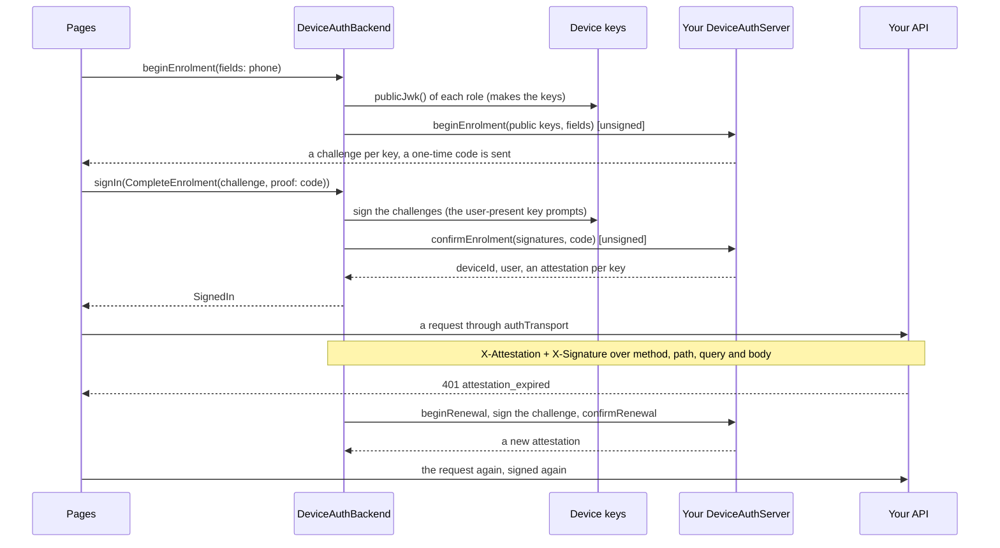

# Device-signed sessions: no token at all (`fespalier_sign_keypair`)

Since 0.21.0. `package:fespalier_sign_keypair` is a session with **no token**: no OIDC provider, no access or refresh
token, no DPoP, no `Authorization` header. "Signed in" means this device's key is enrolled and holds a valid attestation,
and every request then carries its own signature over its method, path, query and exact body bytes. It is the scheme Webank
runs ([fespalier#267](https://github.com/fespalier/fespalier/issues/267)). It plugs into the same `fespalier_auth` core as an OIDC app
([`auth-package.md`](auth-package.md)): the same `authSession` states, guards, `restoreAuth`, `keyLost` and sign-out. It depends
on `fespalier_auth` and `fespalier_keypair` (the keys) and on **no HTTP client**; it talks to your server through the
`DeviceAuthServer` you write.

**This package held DPoP until 0.20.0** (`DpopProof`, `DpopSigner` and `FakeDpopSigner` lived here). DPoP is now
[`fespalier_keypair_dpop`](auth-dpop.md), with no re-export: an app that imported DPoP from `fespalier_sign_keypair` changes its
dependency and its imports.

## What bites

- **UNCHECKED on a device.** No CI job runs the secure-element parts; every test uses `FakeKeypairSigner`. Untried: the
  user-present prompt (the Secure Enclave and StrongBox/TEE biometric or device-credential prompt, its caption, a cancelled
  prompt, a device with no screen lock), **biometric invalidation** (enrolling or removing a fingerprint or face destroys the
  user-present key and leaves the ambient one; re-enrolling just that key is not built), the **web key** across a reload, a
  restart and "clear site data" and in Safari and Firefox (run by hand in Chrome only), hardware-backed keys on real devices
  (and the fallback `DeviceKeys.device(fallback: KeypairFallback.software)`, ambient only), and a **real backend** that issues
  attestations and enforces the profile (only `verifyDeviceSignature` is tested here). Say so when you report that it works;
  these belong in a `human-test` issue.
- **A streamed body cannot be signed.** The signature covers the exact bytes (`bdh`), which a stream does not have before it
  is sent, so a request with one fails with an `ArgumentError` (`a streamed body cannot be signed: its bytes are not known
before they are sent, and the signature covers them. Send the body as bytes ...`). JSON, a form, CBOR and a finalized
  multipart are bytes. `package:http`'s `RetryClient` sends a copy of every request as a stream, so it can retry requests
  **without a body** only; for writes retry in Dio (`dio_smart_retry` over `TransportAdapter`) or in a transport of your own.
- **The enrolment and renewal calls are unsigned by name, not by origin.** Send them through the transport you gave
  `AuthConfig.transport` (no session on it), or list their paths in `DeviceAuthBackend(unsignedPaths: [...])` when they go
  through `authTransport`. A signed enrolment would need a session that does not exist yet.
- **The server decides what is renewable and what is dead, by status and by the `error` of a JSON body.** The default
  classifier `webankRefusals` reads Webank's codes; a server that says something else is `Accept` (ambiguous: the session is
  never wiped and a request never loops). Replace it with `classify:`.
- **Sign-out flips the state first.** `signOut()` sets `SignedOut(reason: SignOutReason.user)` before anything else, then the
  revoke call runs, signed with the user-present key when the device has one, so **the prompt appears after the UI has already
  moved on**. A refused prompt or a failed revoke still ends in a signed-out device with no keys.
- **A user-present call on a device without that key is a `StateError`**, not a silent downgrade: `fespalier_sign_keypair: this
request is to be signed with the userPresent key, but this device has no such key. A user-present call needs a device that
enrolled with a user-present key (not the web, and not a device without a screen lock)`. The web has the ambient key only.
- **Background and queued work never asks for the user-present key.** A prompt on a request nobody is waiting for is a bug.
  A queue stores the payload and the `Idempotency-Key`, never a signature: the signature is made when the request is sent.
- **A restore never makes a key to check.** `restoreAuth` signs the user out as `keyLost` when the ambient key is gone or is not
  the one the stored attestation is bound to. A lost user-present key is not a lost session.

## Install

Next to `fespalier`, `fespalier_auth` and `fespalier_keypair`, with the same `url` and `ref` for all (the package README has
the block); a transport implementation (`fespalier_http` or `fespalier_dio`) comes from your app. It needs Dart 3.12 and Flutter
3.44 (flutter-sign-keypair needs them) and is outside the repository's pub workspace and its Flutter 3.35 floor job. No
`package:http` or Dio in its `lib/` or pubspec (`test/no_http_test.dart`), and no timer, `Future.delayed` or `DateTime.now()`
(`test/no_timers_test.dart`).

## The scheme

A device holds two P-256 keys (ES256, raw `r||s`): an **ambient** key that never prompts and signs every ordinary request,
and, where the platform has a secure element, a **user-present** key (a biometric or the device credential) for the calls worth
a prompt (`KeyRole.ambient`, `KeyRole.userPresent`). The server answers enrolment with an **attestation** per key, a JWS from
your issuer with `iss`, `sub`, `did`, `iat`, `exp`, `cnf.jkt` (the RFC 7638 thumbprint of the key) and a status. It lasts about
a day, and on its own it is useless: it counts only next to a fresh signature from the bound key.

Every signed request carries two headers (names from `DeviceSignatureProfile`, `X-Attestation` and `X-Signature` by default) and
no `Authorization`: the stored attestation unchanged, and a compact JWS (header `{"alg":"ES256","jwk":{crv,kty,x,y}}`) with the
claims `iat`, `exp` (`iat` plus the profile's `lifetime`, at most five minutes), `jti` (128 random bits, fresh on every send,
retries and replays included), `mth` (the method, upper-case), `pth` (`uri.path`), `qsh` (lower-case hex SHA-256 of the raw
query, left out when there is none), `bdh` (the same of the exact body bytes, left out when empty) and `aud`
(`DeviceSignatureProfile.audience`).

```mermaid
stateDiagram-v2
  [*] --> SignedOut
  SignedOut --> SignedIn: enrolment (two unsigned legs)
  SignedIn --> SignedIn: renewal (ambient attestation within 12 h of expiry, or 401 attestation_expired, device_not_active)
  SignedIn --> SignedOut_keyLost: 401 key_not_bound, bad_jwk, missing_credential; or a restore finds the ambient key gone
  SignedIn --> SignedOut_revoked: 403 DEVICE_REVOKED; or the server refuses a renewal (AuthRejected)
  SignedIn --> SignedOut_user: signOut (revoke, then both keys deleted)
```





**Renewal replaces refresh.** A silent proof of possession: `beginRenewal(deviceId, role)` returns a challenge, the key signs
it, `confirmRenewal` returns a fresh attestation. It is lazy (the first request that finds the ambient attestation within
`DeviceAuthBackend.renewAhead`, 12 hours by default, of its expiry, or the first that is refused) and single-flight (concurrent
401s share one renewal), and a request is sent again at most once, signed again. The user-present attestation renews only
when a server refuses it, and that renewal prompts. An `AuthRejected` from `beginRenewal` or `confirmRenewal` (the device is
dead) ends the session as `SignOutReason.revoked`; anything else (offline, a 5xx) keeps it.

**The classifier.** `webankRefusals` (the default `classify:`) sorts a refusal by status and the lower-cased `error` of its JSON
body (`DeviceRefusal.error`):

| Answer                                               | Verdict                                                        |
| ---------------------------------------------------- | -------------------------------------------------------------- |
| 401 `attestation_expired`, `device_not_active`       | `Renew` the attestation of the key that signed, send once more |
| 401 `key_not_bound`, `bad_jwk`, `missing_credential` | `SessionEnded(SignOutReason.keyLost)`: both keys deleted       |
| 403 `DEVICE_REVOKED`                                 | `SessionEnded(SignOutReason.revoked)`: both keys deleted       |
| anything else                                        | `Accept`: the response stands, nothing is wiped, nothing loops |

## Wire it

The seam you write is `DeviceAuthServer`: five methods over your endpoints. The shapes below are an example (the paths and the
JSON are your server's); what the package fixes is what each method returns. Whatever the next leg needs (an enrolment id) goes
in the `data` map of `EnrolmentChallenge` and `RoleChallenge`. A refusal that means "this device is dead" is thrown as
`AuthRejected`; "could not ask" (offline, a 5xx) is thrown as it is, and the session stays.

```dart
// lib/device_auth.dart
import 'dart:convert';
import 'dart:typed_data';

import 'package:fespalier/fespalier.dart';
import 'package:fespalier_auth/fespalier_auth.dart';
import 'package:fespalier_http/fespalier_http.dart';
import 'package:fespalier_keypair/fespalier_keypair.dart';
import 'package:fespalier_sign_keypair/fespalier_sign_keypair.dart';
import 'package:fespalier_transport/fespalier_transport.dart';
import 'package:http/http.dart' as http;

final api = Uri.parse('https://api.example.com');

/// No session on it: the enrolment and renewal calls go through it, and `authTransport` wraps it.
final HttpTransport transport = HttpClientTransport(http.Client());

final class ShopDeviceServer implements DeviceAuthServer {
  ShopDeviceServer(this.transport);

  /// `AuthConfig.transport`.
  final HttpTransport transport;

  @override
  Future<EnrolmentChallenge> beginEnrolment(EnrolmentStart start) async {
    // The server derives the subject from the phone it verifies: the client never says who it is.
    final json = await _post('/devices/enrol/begin', 'phone', {
      'phone': start.fields['phone'],
      'keys': {for (final e in start.keys.entries) e.key.name: e.value},
    });
    return EnrolmentChallenge(
      challenges: {
        for (final e in (json['challenges']! as Map<String, Object?>).entries)
          KeyRole.values.byName(e.key): e.value! as String,
      },
      data: {'enrolmentId': json['enrolmentId']},
    );
  }

  @override
  Future<DeviceEnrolment> confirmEnrolment(
    EnrolmentChallenge challenge,
    Map<KeyRole, String> challengeSignatures,
    Object? proof,
  ) async {
    final json = await _post('/devices/enrol/confirm', 'code', {
      'enrolmentId': challenge.data['enrolmentId'],
      'otp': proof,
      'signatures': {for (final e in challengeSignatures.entries) e.key.name: e.value},
    });
    final user = json['user']! as Map<String, Object?>;
    return DeviceEnrolment(
      deviceId: json['deviceId']! as String,
      attestations: {
        for (final e in (json['attestations']! as Map<String, Object?>).entries)
          KeyRole.values.byName(e.key): Attestation.parse(e.value! as String),
      },
      user: AuthUser(id: user['id']! as String, name: user['name'] as String?),
    );
  }

  @override
  Future<RoleChallenge> beginRenewal(String deviceId, KeyRole role) async {
    final json = await _post('/devices/$deviceId/renew/begin', null, {'role': role.name});
    return RoleChallenge(
      role: role,
      challenge: json['challenge']! as String,
      data: {'deviceId': deviceId},
    );
  }

  @override
  Future<Attestation> confirmRenewal(RoleChallenge challenge, String signature) async {
    final json = await _post('/devices/${challenge.data['deviceId']}/renew/confirm', null, {
      'role': challenge.role.name,
      'challenge': challenge.challenge,
      'signature': signature,
    });
    return Attestation.parse(json['attestation']! as String);
  }

  /// Called by `signOut()`. The signer picks the user-present key when the device has one, so
  /// this prompts. The backend deletes both keys whatever happens here.
  @override
  Future<void> revoke(DeviceCredential credential, DeviceSigner signer) async {
    final request = TransportRequest(
      method: 'DELETE',
      uri: api.resolve('/devices/${credential.deviceId}'),
    );
    final headers = await signer.signFor(credential, request);
    await transport.send(request.copyWith(headers: headers));
  }

  Future<Map<String, Object?>> _post(String path, String? field, Map<String, Object?> body) async {
    final response = await transport.send(
      TransportRequest(
        method: 'POST',
        uri: api.resolve(path),
        headers: const {'content-type': 'application/json'},
        body: Uint8List.fromList(utf8.encode(jsonEncode(body))),
      ),
    );
    final bytes = await response.bytes();
    return switch (response.statusCode) {
      200 => jsonDecode(utf8.decode(bytes)) as Map<String, Object?>,
      // A form shows this under its field.
      422 when field != null => throw FieldErrors({field: 'Check the $field and try again'}),
      // The device is dead: the backend turns it into SignedOut(revoked).
      403 => throw const AuthRejected('device_revoked'),
      _ => throw TransportStatusError(
        statusCode: response.statusCode,
        headers: response.headers,
        body: bytes,
      ),
    };
  }
}

final DeviceAuthBackend deviceBackend = DeviceAuthBackend(
  server: ShopDeviceServer(transport),
  keys: DeviceKeys.device(), // ambient + user-present where the device has it
  profile: DeviceSignatureProfile(audience: api.toString()),
);

AuthConfig authSetup() => AuthConfig(
  backend: deviceBackend,
  transport: transport, // the enrolment and renewal legs: no session on it
  apiOrigins: [api],
);
```

`startup()` returns `restoreAuth(authSetup())` as for any backend. The phone screen starts the ceremony and the code screen
finishes it; `beginEnrolment` is on the backend (it makes the keys), the second leg is an ordinary `signIn`:

```dart
final challenge = await deviceBackend.beginEnrolment(fields: {'phone': phone}); // FieldErrors for a wrong number
// ... the one-time code screen, with `challenge` kept in a provider or passed along ...
await ref.read(authSession.notifier).signIn(CompleteEnrolment(challenge, proof: code)); // FieldErrors for a wrong code
```

`DeviceAuthBackend` throws an `ArgumentError` for any other `SignInRequest` (`a DeviceAuthBackend signs in with
CompleteEnrolment, after beginEnrolment`). The keys `beginEnrolment` made stay when it fails, and the next enrolment uses them.

**Which key signs a request.** By default the ambient one. A request the user is looking at asks for the user-present key
through its attributes; under Dio the attributes are `Options(extra: ...)` (`TransportAdapter` copies `RequestOptions.extra` into
`TransportRequest.attributes`), and on a transport directly they are the request's own:

```dart
await dio.post('/transfers', data: body, options: Options(extra: {
  DeviceSigner.roleAttribute: KeyRole.userPresent,
  DeviceSigner.reasonAttribute: 'Confirm the transfer',
}));

await ref.read(authTransport).send(TransportRequest(
  method: 'POST',
  uri: Uri.parse('https://api.example.com/transfers'),
  body: bodyBytes,
  attributes: {DeviceSigner.roleAttribute: KeyRole.userPresent, DeviceSigner.reasonAttribute: 'Confirm the transfer'},
));
```

`package:http` has no per-request attributes, so a `TransportClient` request cannot ask: send a `TransportRequest`, or give
`DeviceAuthBackend(policy: ...)` a `KeyRolePolicy` (`KeyRole Function(TransportRequest)`) of your own, for instance by path. A
refused prompt is a `UserPresenceRefused` (`UserPresenceRefused: the user-present key did not sign (...); the session is
unchanged`, with `code` and `cancelled`) that fails that one request: the session, the ambient key and every ordinary
request go on working.

The device-sessions example, `examples/device`, runs this whole flow (enrolment, signed requests, renewal, a user-present call) against a demo server. `examples/cratestack` is the Webank-style composition: a CrateStack backend, a client generated by `cratestack generate-dart --preset fespalier` and device-signed sessions, with a Rust server that verifies the same profile and an end-to-end test where Dart signs and Rust verifies.

## On the server and in tests

`package:fespalier_sign_keypair/verify.dart` is pure Dart, for a demo server and for tests. `verifyDeviceSignature(method:, uri:,
headers:, body:, profile:, issuerKeys:, seenJtis:)` checks, in order: the attestation's issuer signature and expiry; `cnf.jkt`
equals the thumbprint of the signature's `jwk`; the signature; freshness (30 s of skew, a lifetime of at most 300 s); `mth`,
`pth`, `aud`, `qsh` and `bdh` (a hash on one side only is refused); and a `jti` that was not used before (added to `seenJtis` only
when everything passed). A failure is a `DeviceSignatureInvalid` whose `code` (`missing_credential`, `bad_attestation`,
`attestation_expired`, `bad_jwk`, `key_not_bound`, `bad_signature`, `signature_expired`, `lifetime_too_long`, `mismatch`,
`replay`) is the one the client classifier reads. Replay storage, the issuer, denylists and access tiers stay with your backend.

`package:fespalier_sign_keypair/testing.dart` has `FakeDeviceAuthServer`: it checks the one-time code (`otp`, `123456`), verifies each
challenge signature against the registered key, issues attestations signed by a test issuer key (`issuerKeys`, for
`verifyDeviceSignature`), renews and revokes, and can be told to refuse (`renewalError`, `revokeError`, `revokeDevice(id)`), hold a
renewal in flight (`renewalGate`) or issue short-lived or foreign attestations (`issue`). It counts `enrolments`, `renewals` and
`revocations`. With `FakeKeypairSigner` (`package:fespalier_keypair/testing.dart`), which counts `signatures` and `prompts`, can
`refuseNextPrompt()` and can `loseKey()`, the whole scheme runs in a unit test with a fake clock (`clock.now()`, no timer):

```dart
// test/device_session_test.dart
import 'dart:convert';
import 'dart:typed_data';

import 'package:fespalier/fespalier.dart' show ProviderContainer;
import 'package:fespalier_auth/fespalier_auth.dart';
import 'package:fespalier_keypair/fespalier_keypair.dart';
import 'package:fespalier_keypair/testing.dart';
import 'package:fespalier_sign_keypair/fespalier_sign_keypair.dart';
import 'package:fespalier_sign_keypair/testing.dart';
import 'package:fespalier_sign_keypair/verify.dart';
import 'package:fespalier_transport/fespalier_transport.dart';
import 'package:fespalier_transport/testing.dart';
import 'package:flutter_test/flutter_test.dart';

const audience = 'https://api.example.com';
const profile = DeviceSignatureProfile(audience: audience);

void main() {
  test('a device enrols, then every request is signed, and a prompt only when asked', () async {
    final server = FakeDeviceAuthServer(); // the app's enrolment and renewal endpoints, in memory
    final issuerKeys = await server.issuerKeys;
    final seenJtis = <String>{};
    final verified = <VerifiedDeviceRequest>[];
    // The API: checks the attestation, the key binding, the signature and the body, like a real one.
    final api = FakeTransport((request, body) {
      verified.add(
        verifyDeviceSignature(
          method: request.method,
          uri: request.uri,
          headers: request.headers,
          body: body,
          profile: profile,
          issuerKeys: issuerKeys,
          seenJtis: seenJtis,
        ),
      );
      return fakeResponse(200);
    });
    final userPresent = FakeKeypairSigner(role: KeyRole.userPresent, seed: 'user-present');
    final backend = DeviceAuthBackend(
      server: server,
      keys: DeviceKeys(ambient: FakeKeypairSigner(), userPresent: userPresent),
      profile: profile,
    );
    final container = ProviderContainer(
      overrides: [
        authConfig.overrideWithValue(
          AuthConfig(
            backend: backend,
            transport: api,
            store: MemoryTokenStore(),
            apiOrigins: [Uri.parse(audience)],
          ),
        ),
      ],
    );
    addTearDown(container.dispose);

    final challenge = await backend.beginEnrolment(fields: {'phone': '+237600000000'});
    await container
        .read(authSession.notifier)
        .signIn(CompleteEnrolment(challenge, proof: server.otp));
    expect(container.read(authSession), isA<SignedIn>());
    expect(userPresent.prompts, 1, reason: 'enrolment signs a challenge with each key');

    final transport = container.read(authTransport);
    final uri = Uri.parse('$audience/orders');
    await transport.send(
      TransportRequest(method: 'POST', uri: uri, body: Uint8List.fromList(utf8.encode('{}'))),
    );
    expect(verified.single.claims['mth'], 'POST');
    expect(verified.single.claims['bdh'], isNotNull, reason: 'the body hash is in the signature');
    expect(userPresent.prompts, 1, reason: 'an ordinary request never prompts');

    await transport.send(
      TransportRequest(
        method: 'POST',
        uri: uri,
        attributes: {
          DeviceSigner.roleAttribute: KeyRole.userPresent,
          DeviceSigner.reasonAttribute: 'Confirm the transfer',
        },
      ),
    );
    expect(userPresent.prompts, 2);
    expect(userPresent.lastReason, 'Confirm the transfer');
    expect(verified, hasLength(2));
  });
}
```

Telemetry: the `auth` spans carry `fespalier.auth.backend=device` and `fespalier.auth.scheme=device`. Every message is in
[`fespalier-troubleshooting`](../../fespalier-troubleshooting/SKILL.md) (its `diagnostics-auth.md` page); the keys are in
`fespalier_keypair`'s README, and the testing side in [`fespalier-testing`](../../fespalier-testing/SKILL.md).
